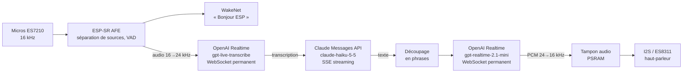

# Assistant vocal ESP32-S3-BOX-3 (Claude)

Assistant vocal en français qui tourne entièrement sur un **ESP32-S3-BOX-3**, sans serveur intermédiaire :
on le réveille en disant « **Bonjour ESP** », on pose sa question, et **Claude** répond à voix haute.
Tout est en streaming (transcription, réponse, synthèse vocale) : la réponse commence à être prononcée
environ **2,5 s** après la fin de la question.

Le projet est parti de la démo Espressif [`chatgpt_demo`](https://github.com/espressif/esp-box) (ESP-IDF),
largement réécrite.

## Fonctionnalités

- Mot de réveil local **« Bonjour ESP »** (ou « Hi ESP »), ou toucher de l'écran en veille.
- **Transcription en continu** pendant que l'on parle (texte affiché en direct à l'écran).
- Réponse de **Claude** en streaming, affichée au fil de l'eau avec le nom du modèle (`[claude-haiku-5-5] …`).
- **Synthèse vocale phrase par phrase** : la première phrase est prononcée pendant que Claude écrit la suite.
- **Relance sans mot de réveil** : après une réponse, l'assistant écoute encore 4 s pour une question de suivi
  (avec l'historique des derniers échanges).
- Dire « Bonjour ESP » pendant une réponse l'**interrompt**.
- Les erreurs (crédit Claude épuisé, clé refusée, réseau…) sont **affichées et prononcées**.
- Interface et voix en français (anglais disponible), configurables sans recompiler.

## Architecture



| Étape | Service | Détail |
| --- | --- | --- |
| Réveil | local (ESP-SR 2.5.5) | WakeNet9 « Bonjour ESP » + « Hi ESP », AFE 2 micros |
| Fin de parole | local | VAD d'ESP-SR, 0,9 s de silence |
| Transcription | OpenAI Realtime, `gpt-live-transcribe` | WebSocket ouvert en permanence, sortie de l'AFE envoyée en continu |
| Réponse | Anthropic Messages API, `claude-haiku-5-5` | `stream: true`, réflexion désactivée, effort `low`, historique de 4 échanges |
| Synthèse vocale | OpenAI Realtime, `gpt-realtime-2.1-mini`, voix `marin` | WebSocket permanent, une réponse par phrase, lecture mot pour mot |
| Lecture | local | Rééchantillonnage 24 → 16 kHz, I2S fixe à 16 kHz (partagé avec les micros) |

Les étapes se chevauchent : des tâches FreeRTOS reliées par des files (texte de Claude → phrases →
synthèse → tampon audio → I2S). Les connexions TLS sont réutilisées (keep-alive pour Claude, WebSockets
permanents pour la transcription et la voix) et ouvertes pendant que l'utilisateur parle.

### Latences typiques (mesurées)

| Étape | Durée |
| --- | --- |
| Fin de parole détectée | 0,9 s de silence |
| Fin de parole → transcription finale | 0,6 à 0,8 s |
| Premier mot de Claude | 0,7 à 1,6 s |
| Transcription → premier son | 1,4 à 2,8 s |

## Matériel et logiciels

- **ESP32-S3-BOX-3** (16 Mo de flash, 16 Mo de PSRAM octale).
- **ESP-IDF v5.3.6** (testé avec cette version ; les versions 6.x ne sont pas compatibles en l'état).
- Une **clé API OpenAI** (transcription et voix) et une **clé API Anthropic** avec du crédit
  (console.anthropic.com → API Keys ; le crédit API est distinct d'un abonnement Claude.ai).

## Organisation du dépôt

Deux firmwares cohabitent sur la flash :

| Dossier | Partition | Rôle |
| --- | --- | --- |
| `main/` (projet racine) | `factory` (6 Mo) | L'assistant vocal |
| `factory_nvs/` | `ota_0` (2 Mo) | Mode configuration : la BOX apparaît comme une clé USB contenant `CONFIG.INI` |
| `bsp/` | — | Composant carte (codec audio, boutons), utilisé par les deux projets |
| `spiffs/` | `storage` | Sons système (`echo_en_wake.wav`, bip de réveil) |

Modules principaux de l'assistant (`main/app/`) :

| Fichier | Rôle |
| --- | --- |
| `app_sr.c` | ESP-SR : AFE, mot de réveil, détection de parole et de fin de parole |
| `app_audio.c` | Gestion des sessions d'écoute, sons système |
| `stt_stream.c` | Transcription en continu (OpenAI Realtime, WebSocket permanent) |
| `claude_client.c` | Client Claude en streaming SSE, historique, gestion de `stop_reason` (prêt pour `tool_use`) |
| `sentence_splitter.c` | Découpage du texte en phrases (règles pour le français) |
| `tts_stream.c` | Synthèse vocale (OpenAI Realtime), rééchantillonnage et lecture I2S |
| `app_lang.c` | Textes de l'interface, consignes de Claude et de la voix, messages d'erreur (fr / en) |
| `app_ui_ctrl.c` | Interface LVGL (SquareLine) : panneaux, texte en direct, traductions |
| `main.c` | Enchaînement écoute → transcription → Claude → voix |

## Compilation et flash

Dans un terminal ESP-IDF v5.3.6 :

```bash
# 1. Le mode configuration d'abord (son binaire est intégré au flash du projet principal)
cd factory_nvs
idf.py set-target esp32s3
idf.py build

# 2. L'assistant
cd ..
idf.py set-target esp32s3
idf.py build
idf.py -p COMx flash monitor
```

- `idf.py flash` écrit tout : bootloader, assistant, mode configuration, sons (`spiffs/`) et modèles ESP-SR.
- `idf.py app-flash` ne réécrit que l'assistant (plus rapide) : **les sons ne sont pas mis à jour**.
- Les composants externes (`managed_components/`) sont téléchargés automatiquement au premier build ;
  leurs versions sont figées dans `dependencies.lock`.

## Configuration

### Sur l'appareil : `CONFIG.INI`

Au premier démarrage (ou via **Réglages → Réinitialisation → OK**), la BOX passe en mode configuration et
apparaît sur le PC comme une clé USB « ESP-BOX ». Modifier `CONFIG.INI`, enregistrer, puis appuyer sur
**Redémarrer** :

| Clé | Rôle | Exemple |
| --- | --- | --- |
| `ssid`, `password` | Wi-Fi (WPA2 minimum) | |
| `ChatGPT_key` | Clé OpenAI (transcription et voix) | `sk-proj-…` |
| `Base_url` | URL de l'API OpenAI | `https://api.openai.com/v1/` |
| `Claude_key` | Clé Anthropic | `sk-ant-…` |
| `Claude_model` | Modèle Claude | `claude-haiku-5-5` |
| `Language` | Langue de l'assistant | `fr` ou `en` |

Les espaces et retours à la ligne collés par erreur autour des valeurs sont ignorés. Les clés sont stockées
en clair dans la NVS de l'appareil et n'apparaissent jamais dans les logs (seule leur longueur est affichée).

### À la compilation : `sdkconfig.defaults` / `idf.py menuconfig`

Section « Example Configuration » :

| Option | Défaut | Rôle |
| --- | --- | --- |
| `CONFIG_ASSISTANT_LANGUAGE` | `fr` | Langue si `Language` absent de `CONFIG.INI` |
| `CONFIG_ASSISTANT_CLAUDE_MODEL` | `claude-haiku-5-5` | Modèle Claude par défaut |
| `CONFIG_ASSISTANT_CLAUDE_EFFORT` | `low` | Effort de Claude (plus bas = plus rapide) |
| `CONFIG_ASSISTANT_STT_MODEL` | `gpt-live-transcribe` | Modèle de transcription |
| `CONFIG_ASSISTANT_END_OF_SPEECH_MS` | `900` | Silence qui marque la fin de la question |
| `CONFIG_ASSISTANT_TTS_MODEL` | `gpt-realtime-2.1-mini` | Modèle de synthèse vocale |
| `CONFIG_ASSISTANT_TTS_VOICE` | `marin` | Voix |
| `CONFIG_ASSISTANT_FOLLOWUP_WINDOW_MS` | `4000` | Durée d'écoute après une réponse (0 = désactivé) |
| `CONFIG_VOLUME_LEVEL` | `90` | Volume du haut-parleur |

Le fichier `sdkconfig` existant a priorité sur `sdkconfig.defaults` : pour changer une valeur, passer par
`idf.py menuconfig` (ou supprimer `sdkconfig` avant de recompiler).

## Utilisation

1. Dire « **Bonjour ESP** » (bip), puis poser la question. Le texte s'affiche pendant que l'on parle.
2. Après 0,9 s de silence, la question part ; la réponse s'affiche et est prononcée.
3. Après la réponse, l'assistant écoute encore 4 s : on peut enchaîner sans redire « Bonjour ESP ».
4. Sans parole, il retourne en veille (aucun appel aux API n'est fait pour du silence).

## Sons système

Les sons de `spiffs/` doivent être des **WAV PCM 16 bits à 16 kHz** (mono ou stéréo) : le bus I2S est partagé
avec les micros et reste à 16 kHz, les autres fréquences sont refusées. Après modification, faire un flash
complet (`idf.py flash`).

## Logs et diagnostic

Le moniteur série (`idf.py -p COMx monitor`) affiche notamment :

- `[timing] final transcript … ms after the end of speech`, `[timing] first audio … ms after the transcription`
- `claude: first text after … ms, … tokens in … (cache read …), out …`
- `tts: "…": first audio … ms` par phrase, `tts: reply played, N underrun(s)`
- `stt: committed … ms of audio; at the end of speech … ms were still to send`
- `[heap] internal free …` toutes les 30 s (la RAM interne est la ressource critique)

## Notes de conception

- **Mémoire** : la RAM interne (~30 Ko libres en fonctionnement) est réservée aux piles et au DMA ; les gros
  tampons, les arbres JSON, les buffers TLS (mbedTLS) et les piles des tâches réseau sont en PSRAM.
- **Pas d'annulation d'écho** : la détection de parole ignore le début de chaque écoute (bip, fin de réponse)
  et filtre par volume ; les transcriptions vides ou typiques de Whisper sur du silence sont ignorées.
- **Coûts** : la transcription est facturée à la durée d'audio envoyé (uniquement pendant l'écoute) ; les
  connexions ouvertes en permanence ne sont pas facturées selon la documentation d'OpenAI.
- **Outils Claude** : `claude_client.c` gère `stop_reason: tool_use` (journalisé, point d'extension
  `handle_tool_use()`), mais aucun outil n'est encore déclaré.

## Pistes d'évolution

- Annulation d'écho et interruption de l'assistant par la voix (si la BOX-3 fournit un canal de référence).
- Outils pour Claude (heure, météo, domotique…).
- Chiffrement de la NVS pour protéger les clés API.
- Remplacer la liste « Région » (inutilisée) de l'écran Réglages par le choix de la langue.

## Crédits et licences

- Basé sur l'exemple `chatgpt_demo` d'[esp-box](https://github.com/espressif/esp-box) (Espressif, CC0 /
  Apache-2.0 selon les fichiers).
- Police Montserrat (SIL Open Font License), fournie avec LVGL, pour les caractères accentués.
- Composants Espressif (ESP-IDF, ESP-SR, esp-box-3, esp_websocket_client) sous leurs licences respectives.
