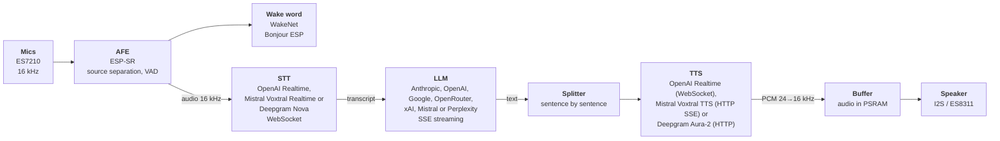

# ESP32-S3-BOX-3 Voice Assistant (Claude / GPT / Gemini / Grok / Mistral / Perplexity / OpenRouter)

A voice assistant that runs entirely on an **ESP32-S3-BOX-3**, with no server of your own: say "**Bonjour ESP**"
(or "**Hi ESP**"), ask your question, and **Claude** (or **GPT**, **Gemini**, **Grok**, **Mistral**, **Perplexity
Sonar**, or a model reached through **OpenRouter**) answers out loud, about **2.5 s** after you stop speaking. It
also plays internet radios, remembers what you ask it to, gives the weather, searches the web and can drive a
Homey home automation box.

It speaks **French, English, Dutch, German, Spanish and Italian** (English by default), and other languages can be
added.

This page has four parts:

1. **[Quick start](#quick-start)**: flash the firmware, enter your Wi-Fi and two API keys, talk. About 15 minutes.
2. **[User guide](#user-guide)**: everyday use, voice commands, radio, Settings screen, updates.
3. **[Advanced user guide](#advanced-user-guide)**: everything that can be tuned (models, voices, persona,
   languages, costs, home automation). Nothing there is needed to start: every setting has a working default.
4. **[Design and architecture](#design-and-architecture)**: how it works, and how to build it from source.

The project started from Espressif's [`chatgpt_demo`](https://github.com/espressif/esp-box) (ESP-IDF), which has
been largely rewritten.

## Contents

- [Quick start](#quick-start)
  - [1. What you need](#1-what-you-need)
  - [2. Get the API keys](#2-get-the-api-keys)
  - [3. Flash the firmware](#3-flash-the-firmware)
  - [4. First configuration: Wi-Fi and keys](#4-first-configuration-wi-fi-and-keys)
  - [5. Talk to it](#5-talk-to-it)
  - [If something goes wrong](#if-something-goes-wrong)
- [User guide](#user-guide)
  - [What it can do](#what-it-can-do)
  - [Everyday use](#everyday-use)
  - [Gestures](#gestures)
  - [On the device: Settings screen](#on-the-device-settings-screen)
  - [Voice commands](#voice-commands)
  - [Radio](#radio)
  - [Updating the firmware](#updating-the-firmware)
- [Advanced user guide](#advanced-user-guide)
  - [Files of the configuration drive](#files-of-the-configuration-drive)
  - [`CONFIG.INI`: settings and API keys](#configini-settings-and-api-keys)
  - [Models and costs](#models-and-costs)
  - [Voices: `[voices]` of `AGENTS.INI`](#voices-voices-of-agentsini)
  - [`PERSO_<XX>.TXT`: who the assistant is](#perso_xxtxt-who-the-assistant-is)
  - [`MEMORY.TXT`: long-term memory notes](#memorytxt-long-term-memory-notes)
  - [Languages: `LANG_<XX>.TXT`](#languages-lang_xxtxt)
  - [Adding a new language, step by step](#adding-a-new-language-step-by-step)
  - [Writing voice phrases (patterns)](#writing-voice-phrases-patterns)
  - [Home automation: Homey](#home-automation-homey)
- [Design and architecture](#design-and-architecture)
  - [Architecture](#architecture)
  - [Hardware and software](#hardware-and-software)
  - [Repository layout](#repository-layout)
  - [Build and flash](#build-and-flash)
  - [Making a release](#making-a-release)
  - [At build time: `sdkconfig.defaults` / `idf.py menuconfig`](#at-build-time-sdkconfigdefaults--idfpy-menuconfig)
  - [System sounds](#system-sounds)
  - [Logs and diagnostics](#logs-and-diagnostics)
  - [Features in detail](#features-in-detail)
  - [Design notes](#design-notes)
- [Roadmap](#roadmap)
- [Credits and licenses](#credits-and-licenses)

## Quick start

### 1. What you need

- An **[ESP32-S3-BOX-3](https://www.espressif.com/en/news/ESP32-S3-BOX-3)** (the BOX-3-SENSOR dock is optional:
  it adds presence detection and the battery gauge).
- A **USB-C cable** (data, not only charging) and a PC (Windows, macOS or Linux).
- A **2.4 GHz Wi-Fi** network (WPA2 or newer); 5 GHz-only networks are not seen by the ESP32-S3.
- Two **API keys** with credit (see the next step):
  - an **OpenAI** key: always needed, it hears you (transcription) and speaks (voice);
  - an **Anthropic** key for Claude, which answers by default.

  With the OpenAI key alone, the assistant works too, But the OpenAI model will be answering **without using the tools** 
  web search, weather or home automation. If you prefer alternatives to Anthropic's Models to use these tools (Gemini, Mistral, Grok, Perplexity,
  OpenRouter), look at what each one can do in [Models and costs](#models-and-costs).

### 2. Get the API keys

| Key | Where | Note |
| --- | --- | --- |
| OpenAI | [platform.openai.com/api-keys](https://platform.openai.com/api-keys) | Add a few dollars of credit (Billing). A ChatGPT subscription does not include API credit. |
| Anthropic (Claude) | [console.anthropic.com](https://console.anthropic.com) → API Keys | Add credit (Plans & Billing). A Claude.ai subscription does not include API credit. |

Everyday use costs little: with the defaults (Claude Haiku), about **$0.15 for 1,000 answers**, plus the
transcription and the voice (a few cents per hour of conversation). The device shows what it spends (see
[Costs](#costs-coststxt-and-the-cost-on-screen)). Other providers (Google Gemini, Mistral, xAI Grok, Perplexity,
OpenRouter for the answers; Mistral and Deepgram for the transcription and the voice) can be added later, each with
its own key.

The keys stay **only on your device** (its flash memory): they are never sent anywhere but to their provider, and
never shown in the logs.

### 3. Flash the firmware

1. Download the firmware from the **[Releases](https://github.com/vletroye/ESP32-S3-Voice-Assistant/releases)**
   page: the file **`ESP32-S3-Assistant-<version>.bin`** (about 12 MB). It holds everything: the assistant, its
   configuration mode, its sounds and the wake word models.
2. Connect the BOX to the PC with the USB-C cable.
3. Flash it, from your browser or from a command line.

**From the browser** (Chrome or Edge, nothing to install):

1. Open **[espressif.github.io/esptool-js](https://espressif.github.io/esptool-js/)**.
2. Leave the baud rate at 921600, click **Connect** and choose the port of the BOX ("USB JTAG/serial debug unit",
   or a COM port on Windows).
3. Under **Flash Address** type `0x0`, choose the `.bin` file, and click **Program**. It takes about 2 minutes.
4. When it is done, unplug the BOX and plug it again (or press its **Reset** button).

**From a command line** (Python 3 installed):

```bash
pip install esptool
esptool.py --chip esp32s3 -p COM3 write_flash 0x0 ESP32-S3-Assistant-<version>.bin
```

Replace `COM3` with the port of the BOX (`/dev/ttyACM0` on Linux, `/dev/cu.usbmodem…` on macOS).

**If the BOX is not seen** (no port, or "Failed to connect"): use another cable or USB port, then put the BOX in
download mode: hold its **Boot** button, press and release **Reset**, release **Boot**, and try again.

This first flash **erases everything** on the BOX (it is a full install). To update later without losing your
settings, see [Updating the firmware](#updating-the-firmware).

### 4. First configuration: Wi-Fi and keys

1. At the first start, the BOX has no Wi-Fi nor key yet: it opens its **configuration mode** by itself. With the
   USB cable still connected to the PC, it shows up as a **USB drive** named "ESP-BOX".
2. Open the file **`CONFIG.INI`** on that drive with a text editor (Notepad, TextEdit…) and fill in these lines
   (keep the rest as it is):

   ```ini
   ssid = MyWiFi
   password = MyWiFiPassword
   ChatGPT_key = sk-proj-...
   Claude_key = sk-ant-...
   ```

   Optional, but useful now: the language (English, `en`, by default; `fr`, `nl`, `de`, `es` or `it` for French,
   Dutch, German, Spanish or Italian), your country (2 letters: local news and web results) and your town (weather
   and local questions), for example:

   ```ini
   Language = fr
   Country = BE
   City = Brussels
   ```

   With an OpenAI key only, leave out `Claude_key` and also set `Chat_model = gpt-6-luna` (an OpenAI model answers
   instead of Claude; no web search, weather or home automation, see [step 1](#1-what-you-need)).
3. **Save** the file, then **wait about 10 seconds** before going on. Saving on the PC is not enough: the PC
   still has to copy the file into the BOX, and it may do it a little later (Windows often waits a few seconds).
   If the BOX restarts before the copy is finished, the file is lost or cut.
4. Press **Restart** at the bottom right of the BOX's screen.
5. The BOX restarts, connects to the Wi-Fi, and shows a welcome screen with the first steps. It is ready.

**If `CONFIG.INI` looks damaged** (lines cut or mixed up, odd characters): empty it (or delete it), save, wait,
and press **Restart**. At the next configuration mode, the BOX writes a clean `CONFIG.INI` again from the settings
it holds (Wi-Fi and keys included, if they were saved before); fill in what is missing.

You can come back to the configuration mode at any time: tap the gear icon, then the folder-and-gear icon at the
top right, then **OK** (or say "**édite la config**" / "**edit the config**" with the BOX connected to the PC).
Every file of the drive is explained in the [Advanced user guide](#advanced-user-guide).

### 5. Talk to it

- Say "**Bonjour ESP**" or "**Hi ESP**" (or touch the screen): a beep, then "J'écoute…" / "I'm listening…". Ask
  your question and stop: the answer is shown and spoken.
- After the answer it keeps listening for 4 seconds: go on without the wake word.
- To interrupt it, say "Bonjour ESP" again or **double-tap** the screen.
- Say "**Au revoir**" / "**Goodbye**" to send it back to sleep and start the next conversation afresh. Without
  it, the assistant remembers the conversation, even after sleeping or a restart: the next questions are answered
  in the light of what was already said ("and tomorrow?" after a weather question).
- Try: "What's the weather tomorrow?" (with a Claude model), "Play some jazz", "Remember that my sister is called Anne", "Speak
  Spanish", "Change the voice", "What are the latest news?".

The voice commands handled by the device itself are listed in the [User guide](#voice-commands).

### If something goes wrong

| What you see or hear | What to do |
| --- | --- |
| It stays in configuration mode, or shows "Wi-Fi not connected" | Check `ssid` and `password` (case matters), and that the network is 2.4 GHz. |
| "The OpenAI key is refused" / "The Claude key is refused" | The key was mistyped, or deleted on the provider's site: copy it again into `CONFIG.INI`. |
| "The … credit is used up" | Add credit on the provider's site. |
| It does not react to "Bonjour ESP" | Speak a little louder, about 1 m away; or touch the screen. |
| The answer is cut or stutters | The Internet connection is slow; it says so on screen. |
| `CONFIG.INI` changes are lost, or the file looks damaged | After saving, wait about 10 seconds before pressing **Restart** (the PC copies the file into the BOX a little after saving). A damaged file: empty it, save, wait, **Restart**: a clean one comes back at the next configuration mode. |

To start again from scratch, see the **factory reset** in [The Settings screen](#on-the-device-settings-screen).

## User guide

The assistant in daily use: what it does, how to speak to it, its screens. Everything here works with the
settings of the [Quick start](#quick-start).

### What it can do

- **Talk to an AI out loud**: say "Bonjour ESP" or "Hi ESP" (or touch the screen), ask, listen. The answer is
  spoken sentence by sentence as the model writes it, and shown on screen. After an answer it keeps listening a
  few seconds, so a conversation goes on without the wake word.
- **Choose who answers**: Claude (default), GPT, Gemini, Grok, Mistral, Perplexity (with web search) or many
  models through OpenRouter, free ones included. Change it from the Settings screen or by voice ("change de
  modèle" / "change the model", "utilise le modèle 3" / "use model 3"); the models offered are listed in a file you can edit.
- **Six languages** (French, English, Dutch, German, Spanish, Italian), switched by voice ("parle anglais", "speak
  French") or from the Settings screen; other languages can be added (see
  [Adding a new language, step by step](#adding-a-new-language-step-by-step)).
- **Choose the voice**: 10 OpenAI voices, Mistral's natural voices for each language, with an emotion and a
  pace if you like, or Deepgram's Aura-2 voices (the transcription can be Deepgram's Nova too) ("change de voix" / "change the voice", "prends la voix Cedar" / "use the voice Cedar").
- **It knows things around you**: the date and time, the weather (Open-Meteo), the latest news (web search), your
  country and town for local answers.
- **Long-term memory**: "Souviens-toi que…" / "Remember that…" stores a note it will use in every answer;
  "Oublie que…" / "Forget that…", "Oublie tout" / "Forget everything", "Dis-moi ce que tu as mémorisé" /
  "What do you remember?".
- **Conversation kept** across sleep and restarts; "Au revoir" / "Goodbye" ends it, "Nouvelle discussion" /
  "New conversation" starts a new one.
- **Internet radio**: "joue du jazz" / "play some jazz", "joue la radio Nostalgie" / "play the radio Nostalgie",
  "joue de la musique italienne" / "play italian music", "suivante" / "next", "stop", favourites, and a radio
  screen. The radio pauses while you talk to the assistant.
- **Home automation** with a Homey Pro: "Allume la lumière du salon" / "Turn on the living room light", "Qui est
  à la maison ?" / "Who is home?".
- **Clear errors**: a missing credit, a refused key or a network problem is said and shown, for each provider.
- **Costs on screen**: what the conversation and the day cost, and a detailed page (tap the cost).
- **Sleep screen** with the time and date, the volume and the Wi-Fi signal; with the BOX-3-SENSOR dock, the
  battery level and a screen that switches off when nobody is there.
- **Model test**: "teste les modèles" / "test the models" measures how fast each model (and each voice) answers, and says which one is
  the fastest.

Every feature in detail: [Features in detail](#features-in-detail).

### Everyday use

0. At start-up, once the Wi-Fi is connected, a welcome screen shows the steps; its button at the bottom right
   ("OK (60)") counts down from 60 and closes it at 0 (tap it, or say "Bonjour ESP", to close it at once).
1. Say "**Bonjour ESP**" / "**Hi ESP**" (beep), then ask your question ("J'écoute …" / "I'm listening …" is shown
   while you speak).
2. After 0.9 s of silence (`End_speech_ms` in `CONFIG.INI`) the question is sent: "Entendu …" / "Heard …" is shown
   until its transcript arrives (0.7 to 1.2 s), then "Je réfléchis …" / "Thinking …" until the answer starts; the
   answer is shown and spoken.
3. After the answer, the assistant keeps listening for 4 s: you can go on without saying "Bonjour ESP" / "Hi ESP"
   (not after a volume change, which sends it back to sleep).
4. To interrupt an answer, say "Bonjour ESP" / "Hi ESP" again or **double-tap** the screen: it stops and listens. A
   double tap while "J'écoute …" / "I'm listening …" or "Je réfléchis …" / "Thinking …" is shown drops the question:
   back to sleep, nothing said. When a voice
   command has asked something (which language, provider, model, voice, town…), a double tap, while the question
   is spoken or while its answer is listened for, drops the command: back to sleep, and the next words are no
   longer taken as its answer.
5. Without speech, it goes back to sleep (no API call is made for silence).
6. Saying just "**Au revoir**" / "**Goodbye**" (or another closing phrase, see below) sends it back to sleep at once, without
   an answer and without listening again, and clears the saved conversation: the next one starts afresh.
   Likewise, when the **assistant's answer ends with a closing phrase** ("… Bonne soirée !" / "… Have a nice
   evening!", "Au revoir !" / "Goodbye!"),
   it goes to sleep once it has said it, without listening again, and the conversation is cleared.
   Otherwise the conversation goes on after sleep or a restart.

### Gestures

- Touch the screen while asleep: wakes the assistant up, like "Bonjour ESP".
- Double-tap during an answer: interrupts it and listens.
- Double-tap while listening ("J'écoute …" / "I'm listening …") or thinking ("Entendu …" / "Heard …", "Je
  réfléchis …" / "Thinking …"): the question is dropped
  and the assistant goes back to sleep, saying nothing. While listening, the session ends as without speech; while
  thinking, the answer's stream is left at once (every client reads `llm_cancelled()` and closes its connection).

### On the device: Settings screen

Tap the gear icon on the home screen. The settings are split over two pages, browsed with the arrows at the
bottom left and right (from the last page, the right arrow goes back to the first, and the other way round); the
screen opens on the first page.

First page:

- **Langue / Language**: the languages of `Languages` in `CONFIG.INI`, the six given with the firmware by default
  (interface, transcription, answers and voice).
- **Modèle / Model**: the model answering the questions (see the table above), numbered as in the voice
  command: 1 Claude Haiku 5.5, 2 Claude Sonnet 5.5, 3 Claude Opus 5.5, 4 GPT-6 Luna, 5 GPT-6.1 Sol, 6 GPT-6 Astra,
  7 Gemini 3.5 Flash-Lite, 8 Gemini 3.8 Flash, 9 Gemini 4 Argon, then the OpenRouter models from 10 (10 DeepSeek
  V4.1 Flash, 11 Kimi K3.1 Pro, 12 MiniMax M3.1 Flash by default), 13 Grok 4.7 and 14 Grok 4.20 rapide (xAI),
  15 to 17 Mistral Small 4, Medium 3.5, Large 4, 18 to 23 the Perplexity models, then the free ones (24 to 30 with
  the defaults; numbers up to 13 can be said, the others are chosen by name, or by provider then number).

Second page:

- **STT**: the transcription model, among `[stt]` of `AGENTS.INI` (Mistral's and Deepgram's only with their key), applied
  at once and saved (`Stt_model`), as with "change de transcription" / "change the transcription".
- **TTS**: the speech model, among `[tts]` of `AGENTS.INI`. Applied **at once** and saved (`Tts_model`), as with
  "change de synthèse vocale" / "change the speech synthesis": the voice list follows its provider and the voice now in use introduces itself.
- The labels are the short `STT` and `TTS` in every language (`settings_stt`, `settings_tts` of `LANG_<XX>.TXT`),
  leaving the lists room for the models' names.
- **Voix / Voice**: the voice reading the answers, among the voices of `[voices]` (`AGENTS.INI`) of the speech
  provider in use that speak the language in use (OpenAI: Marin, Cedar, Alloy…; Mistral in French: Lea, Marie,
  Manon, Camille). Applied **at once**, without Save or restart: the speech session reconnects (~2 s) and the new
  voice introduces itself. The list follows the speech provider and the language.

For the language and the model, press **Save** (bottom middle, enabled once one of them changed): the choice is
saved to the device's NVS and applied at once, without restarting (the speech session reconnects, ~2 s).
The folder-and-gear icon (top right) opens the **Configuration** screen: its button at the bottom right
("OK (30)") counts down from 30 and switches to the configuration mode described below at 0 (tap it to switch
at once, or the back arrow to stay).

At the bottom left of this Configuration screen (the one opened from Settings), two icons reset the device.
Tapping one stops the countdown and asks for a confirmation:

- **Soft reset** (circular arrows): the settings of `CONFIG.INI` go back to their defaults (language, model,
  voice, volume, scrolling, delays, town…), **except** the Wi-Fi, the API keys (`ChatGPT_key`,
  `Claude_key`, `Gemini_key`, `OpenRouter_key`, `XAI_key`, `Mistral_key`, `Perplexity_key`, `Deepgram_key`) and Homey (`Homey_url`, `Homey_key`); the
  `PERSO_<XX>.TXT` files, `MEMORY.TXT` and the comments of `CONFIG.INI` are kept. The `VOICE_<XX>.TXT` and
  `LANG_<XX>.TXT` of the six languages given with the firmware (FR, EN, NL, DE, ES, IT), `COUNTRY.TXT` and
  `AGENTS.INI` are replaced by the versions of the firmware (your changes to them are lost); the files of a
  language you added (`LANG_PT.TXT`, `VOICE_PT.TXT`…) and its column of `COUNTRY.TXT` are kept. Then the device restarts. This is how phrases, texts
  or models added to the firmware reach a device whose files already exist (otherwise only the missing keys,
  sections and voice patterns are added).
- **Factory reset** (bin, red): **everything** goes back to the firmware's state: every setting is erased (Wi-Fi,
  API keys, Homey, `MEMORY.TXT`, comments of `CONFIG.INI`), as well as the files of every language (`VOICE_`,
  `LANG_`, `PERSO_<XX>.TXT`, those of the languages added too), `COUNTRY.TXT`, `RADIO.TXT`, `AGENTS.INI`, the saved
  conversation, the places of the weather and the list of free models. No backup is kept: copy `CONFIG.INI` (and
  the files you edited) to your PC first if you want to keep them. Then, with a PC connected, the device switches to the configuration mode (its drive shows up on
  the PC, which may offer to open it); without a PC it restarts, and since the Wi-Fi is erased it starts the
  configuration mode anyway.

The firmware holds **no Wi-Fi nor API key** (no build option for them): after a factory reset they are empty and
must be filled in `CONFIG.INI` again. Without a Wi-Fi network or an OpenAI key, the
device starts in configuration mode.

### Voice commands

Phrases recognised by the device itself. Punctuation (¿ ¡ « » included) and case are ignored ("Au revoir !" / "Goodbye!" works), and hyphens
and apostrophes count as spaces ("souviens-toi" = "souviens toi"). The tables below list the French and English
phrases; only those of the language in use are recognised, except "change la langue" / "change the language" and the direct language
phrases ("parle anglais", "speak French"), recognised in every language of `Languages`. They are written as
patterns in one file per language (see [Writing voice phrases](#writing-voice-phrases-patterns)).

#### Wake words (detected locally, without Internet)

| Phrase | Effect |
| --- | --- |
| "Bonjour ESP" | Wakes the assistant up (beep, then listening); during an answer, interrupts it and listens |
| "Hi ESP" | Same (English pronunciation) |

#### Closing phrases: back to sleep, conversation cleared

Recognised only when said **alone**. The French list is used when the assistant is in French, the English one
in English (section `[s_goodbyes]` of the phrase files, `voice_cmd_is_goodbye()` in `voice_cmd.c`).
The same list is checked against the **last sentence of each answer** of the model (whole, or its part after the
last comma: "Avec plaisir, bonne soirée !" / "My pleasure, have a nice evening!"): when it is a closing phrase,
the assistant goes to sleep after saying it (no follow-up listening) and the conversation is cleared.

| French | English |
| --- | --- |
| au revoir · au revoir ESP | goodbye · goodbye ESP |
| bonne nuit · bonne nuit ESP | good night · good night ESP |
| à demain · à bientôt · à plus · ciao | bye · bye bye · bye ESP · see you (soon / later / tomorrow) |
| bonne soirée · bonne journée · bonne après-midi | have a nice / good day · evening · night · afternoon |

#### New conversation: conversation cleared, without going to sleep

Recognised at the **start** of what is said, in the language in use (`main/app/voice_cmd.c`). Said alone (or with
"s'il te plaît" / "please"), the assistant answers "D'accord, je t'écoute." / "All right, I'm listening." and keeps
listening; followed by a question ("J'ai une autre question : quelle est la capitale du Pérou ?" / "I have another
question: what is the capital of Peru?"), the conversation is cleared and the model answers the
question.

| French | English |
| --- | --- |
| démarrons · commençons une nouvelle discussion / conversation · démarre · commence une nouvelle discussion / conversation · on démarre · on commence une nouvelle discussion · nouvelle discussion · nouvelle conversation | let's start a new conversation · start a new conversation · new conversation · new chat |
| on recommence à zéro · recommençons à zéro | let's start again from scratch · start over from scratch |
| j'ai une autre question · une autre question · autre question | I have another question · another question |
| passons à autre chose · on passe à autre chose · parlons d'autre chose · changeons de sujet · on change de sujet · changement de sujet | let's move on · let's talk about something else · let's change the subject · change of subject |

#### Language, model and voice

Recognised in the language in use, except "change la langue" / "change the language" and the direct language phrases, recognised in
every language (`main/app/voice_cmd.c`). Answered on the device; the
new setting is saved and applied at once, without restarting (the confirmation of a new language is spoken in
that language, after the speech session has reconnected, ~2 s). Changing the model saves the conversation and
restores the one of the new model if it was saved last, else starts a new one. A new voice confirms itself with
its sample, spoken with it ("Bonjour, je suis Cedar. Ma voix vous plaît ?" / "Hello, I am Cedar. Do you like my
voice?"); the Settings screen follows.

| Action | French | English |
| --- | --- | --- |
| Change the language (asks "Quelle langue voulez-vous ?" / "Which language do you want?" with the languages of `Languages` numbered: "1, français. 2, anglais. 3, allemand." / "1, French. 2, English. 3, German."; not understood: asked again) | change la langue · changer la langue · change de langue · changer de langue · change ta langue | change the language · change language · switch language · switch the language |
| Answer to that question (within 30 s after it) | its number ("2", "le deuxième") or its name: français · anglais · "en anglais s'il te plaît"… | its number ("2", "the second") or its name: French · English · "in English please"… |
| Change the language directly | parle anglais · parle en anglais · parlons anglais · on parle anglais · passe en anglais · passe à l'anglais · réponds en anglais | speak French · speak in French · switch to French · answer in French |
| Test the models: same question to each one, time to the first words spoken after each, results in `SPEED.TXT`, speed written to `AGENTS.INI` (see [Model test](#model-test-teste-les-modèles)) | teste les / tes modèles · lance / fais le / un test des modèles | test the / your models · run the / a model test |
| The fastest models: the 3 fastest offered, by their mean time over the model tests ("Les modèles les plus rapides sont Haiku (0,8 seconde)…" / "The fastest models are Haiku (0.8 second)…"); never tested: "Je n'ai pas encore testé les modèles. Veux-tu que je lance un test ?" / "I have not tested the models yet. Do you want me to run a test?", then "oui" / "yes" runs the test, "non" / "no" does not (section `[s_fastest_models]`) | quels sont les modèles les plus rapides · quel est le modèle le plus rapide · donne-moi / dis-moi les modèles les plus rapides · les modèles les plus rapides | what are the fastest models · which model is the fastest · tell me the fastest models · the fastest models |
| List the models (read from `AGENTS.INI`, by provider, then the free OpenRouter ones: "Chez Anthropic, je supporte : Haiku, Sonnet et Opus. Chez OpenAI : …" / "At Anthropic, I support: Haiku, Sonnet and Opus. At OpenAI: …") | donne-moi la liste de tous les / tes modèles (disponibles / supportés) · donne-moi la liste des modèles · liste-moi (tous) les / tes modèles · donne-moi tes modèles · quels sont les / tes modèles | give me the list of (all) the / your models · list (all) the / your models · what / which models do you support · what / which models are available |
| Change the model (asks the provider first, the providers that have models in `AGENTS.INI` numbered (the `%s` of `provider_ask`): "Quel fournisseur voulez-vous : 1, Anthropic. 2, OpenAI…" / "Which provider do you want: 1, Anthropic. 2, OpenAI…"; a provider with a single model is chosen at once, without listing it) | change de modèle · change le modèle · changer de modèle · changer le modèle · change ton modèle | change the model · change model · switch model · switch the model |
| Answer to that question (within 30 s): the provider's models are then listed, numbered from 1 ("Quel modèle de Google voulez-vous utiliser : 1, Flash-Lite. 2, Flash, celui que j'utilise. 3, Argon." / "Which model of Google do you want to use: 1, Flash-Lite. 2, Flash, the one I use. 3, Argon.") | its number ("2", "le deuxième") or its name: Anthropic (or "Claude") · OpenAI (or "GPT", "ChatGPT") · Google (or "Gemini") · OpenRouter (or "Open router") · xAI (or "Grok") · Mistral AI (or "Mistral") · Perplexity (or "Sonar"), or directly a model name ("Sonnet", "Medium", "Large") | its number ("2", "the second") or its name, as in French |
| Answer to the model question (within 30 s after the list) | its number in that list ("trois", "3", "le trois", "numéro trois", "troisième") or its name ("Sonnet", "Opus", "Luna", "Sol", "Astra", "Flash", "Flash-Lite", "Argon", "DeepSeek", "Kimi", "MiniMax"; transcription variants such as "Sonnette", "Saule", "Flash light" accepted) | its number ("three", "3", "third") or its name |
| Skip a step | change de modèle pour Google (lists Google's models) · change de modèle pour Sonnet (chooses it) | change model to Google · change model to Sonnet |
| Change the model directly (numbered over all models, as on the Settings screen; 1 to 13 can be said, the others by name) | utilise le modèle 3 · prends le modèle 3 · passe au modèle 3 · modèle numéro 3 · modèle 3 | use model 3 · use the model 3 · switch to model 3 · model number 3 · model 3 |
| Change the transcription (lists `[stt]` of `AGENTS.INI` numbered: "Quelle transcription voulez-vous : 1, OpenAI, celle que j'utilise. 2, Voxtral." / "Which transcription do you want: 1, OpenAI, the one I use. 2, Voxtral.", then asks which one; answered by its number or spoken name; a missing key is said: "Il manque la clé Mistral…" / "The Mistral key is missing…") | change(r) de / la / ta transcription · change(r) de / la / ta reconnaissance vocale · change(r) de / le STT | change (the) transcription · change (the) speech recognition · change (the) STT |
| Change the speech synthesis (lists `[tts]` the same way; the next answer is spoken with the new one) | change(r) de / la / ta synthèse vocale · change(r) de / le TTS · change(r) de / le / ton moteur de voix | change (the) speech synthesis · change (the) TTS · change (the) voice engine |
| Change the voice: the voices of `[voices]` (`AGENTS.INI`) of the speech provider in use that speak the language in use, saved in `Voice` (reads the numbered list "1, Marin, celle que j'utilise. 2, Cedar. …" / "1, Marin, the one I use. 2, Cedar. …", then asks which one) | change de voix · change la voix · change ta voix · changer de voix · changer la voix · une autre voix · autre voix | change the voice · change voice · change your voice · switch voice · another voice |
| Answer to that question (within 30 s after the list) | its number (1 to 10: "deux", "2", "dixième"…) or its name ("Cedar", also heard as "Cèdre"; "Corail", "Écho", "Ballade", "Marine"…) | its number ("two", "2", "tenth"…) or its name ("Cedar", "Coral"…) |
| Change the voice directly | prends la voix Cedar · utilise la voix 3 · passe à la voix Coral · mets la voix Sage · choisis la voix 2 · voix numéro 2 · la voix Cedar · change de voix pour Coral | use the voice Cedar · use voice 3 · switch to voice 2 · voice number 2 · voice Cedar |

A direct phrase must contain only the language, the number or the voice name, possibly followed by "s'il te plaît"
/ "please" or "maintenant" / "now": "parle-moi de l'Angleterre en anglais" / "tell me about England in English",
"parle plus fort" / "speak louder" or "la voix est trop forte" / "the voice is too loud" remain normal questions.
"Un" and "une" mean model 1 only when said alone (elsewhere they are articles; "one" is always a number). Answers:
the confirmation ("Très bien, je parle maintenant français." / "Very well, I now speak English.", spoken in the new
language), "Je parle déjà français." / "I already speak English.", "J'utilise déjà Claude Haiku 5.5." / "I already
use Claude Haiku 5.5.", or, when the answer is not understood, the question again with its numbered list ("Je ne
connais pas cette langue. Dites le numéro ou le nom d'une langue : 1, français. 2, anglais." / "I don't know this
language. Say the number or the name of a language: 1, French. 2, English.") or "Je n'ai pas compris. Dites un numéro
de 1 à 3, ou le nom du modèle." / "I did not understand. Say a number from 1 to 3, or the name of the model.".
"Flash" alone is Gemini 3.8 Flash, "Flash-Lite" Gemini 3.5 Flash-Lite.

#### Settings screen, configuration files, restart

| French | English | Effect |
| --- | --- | --- |
| ouvre les paramètres · montre les paramètres · affiche les paramètres · ouvre les réglages · montre les réglages · affiche les réglages · va dans les paramètres · va dans les réglages | open the settings · show the settings · open settings · show settings · display the settings · go to the settings | The Settings screen is shown at once, without a spoken reply (no follow-up listening) |
| affiche / montre / remets / active l'heure · l'horloge · la date et l'heure (alone) | show / display the time · the clock · turn on the clock | The time and date are shown on the sleep screen again ("D'accord, j'affiche l'heure." / "All right, I show the time."); saved as `Show_clock = on` |
| cache / masque / enlève / retire / désactive / éteins l'heure · l'horloge · la date et l'heure · n'affiche plus l'heure (alone) | hide the time · the clock · turn off the clock · don't show the time | The time and date are no longer shown on the sleep screen (volume and Wi-Fi stay); saved as `Show_clock = off` |
| redémarre · redémarre-toi · relance · relance-toi · fais un redémarrage · lance un redémarrage · redémarrage (alone, or with "s'il te plaît") | restart · restart yourself · reboot · reboot yourself (alone, or with "please") | "D'accord, je redémarre." / "All right, I restart.", then the conversation, the volume and the town cache are saved, the speaker is switched off and the device restarts (section `[s_restart]`) |
| je veux éditer la config / la configuration / les fichiers de config(uration) · édite la config / le config / les fichiers de configuration · je veux modifier la config · modifie la configuration · ouvre la config · ouvre les fichiers de configuration · passe en mode configuration · mode configuration | I want to edit the config · edit the configuration (files) · open the config files · configuration mode | With a PC connected: "D'accord, je redémarre en mode configuration…" / "All right, I restart in configuration mode…", the conversation and the volume are saved, then the device restarts in configuration mode (CONFIG.INI, MEMORY.TXT, PERSO_FR.TXT… on a USB drive), as with the folder icon of the Settings screen; press reset to come back. Without a PC (unplugged, charger or power bank): "Connecte-moi à ton PC." / "Connect me to your PC." |

The PC is detected by the USB start-of-frame packets a host sends every millisecond (`usb_serial_jtag_is_connected()`):
a charger or a power bank sends none.

#### Country and town

Asked, then confirmed before saving ("Confirmes-tu que tu veux changer ton pays en Belgique ?" / "Do you confirm
that you want to change your country to Belgium?"): "oui" / "yes", "d'accord" / "all right", "ok", "exact" /
"exactly"… save it; anything else cancels. Applied at once to the web search and to Claude's
instructions.

| Action | French | English |
| --- | --- | --- |
| Change the country (asks "Quel est ton pays ?" / "What is your country?") | change mon pays · changer mon pays · change de pays · changer de pays · change le pays | change my country · change the country |
| Change the town (asks "Quelle est ta ville ?" / "What is your town?") | change ma ville · changer ma ville · change de ville · changer de ville · change la ville | change my city · change the city · change my town |
| Answer | the name ("Belgique", "j'habite à Evere"…) | the name ("Belgium", "I live in Evere"…) |

The country must be one of the countries of `COUNTRY.TXT` (about 40 by default: Europe, North America,
French-speaking Africa…; see [Languages](#languages-lang_xxtxt)), as the web search needs
its 2-letter code; the town is kept as said.

#### Long-term memory

Recognised in the language in use (`main/app/file_memory.c`). "Remember" phrases are
followed by what to remember; the other ones are said alone. Answered on the device, without calling the model.

| Action | French | English | Answer |
| --- | --- | --- | --- |
| Remember | souviens-toi que … · souviens-toi bien que … · rappelle-toi que … · retiens que … · retiens bien que … · n'oublie pas que … · note que … · mémorise que … | remember that … · please remember that … · don't forget that … · note that … · memorize that … | "C'est noté." / "Noted." |
| Forget a note | oublie que … · oublie le fait que … | forget that … | "C'est oublié." / "Forgotten." (the note sharing most words is removed) |
| Forget everything | oublie tout · efface ta mémoire · efface toute ta mémoire | forget everything · erase your memory | "J'ai tout oublié." / "I forgot everything." |
| List the notes | dis-moi tout ce que tu as mémorisé · dis-moi ce que tu as mémorisé · qu'est-ce que tu as mémorisé · qu'as-tu mémorisé · dis-moi tout ce que tu as retenu · dis-moi ce que tu as retenu · qu'est-ce que tu as retenu | tell me everything you remember · what do you remember · what have you memorized | The notes, read out |

#### Free phrases understood by Claude (tools)

No fixed wording: Claude decides when to use a tool.

| Tool | Examples |
| --- | --- |
| Weather | "Quel temps fait-il à Namur ?" / "What's the weather in Namur?", "Va-t-il pleuvoir demain ?" / "Will it rain tomorrow?" (your town: `City` in `CONFIG.INI`, or "change ma ville" / "change my town") |
| Volume | "Parle plus fort" / "Speak louder", "Baisse le son" / "Turn the volume down", "Mets le volume à 50" / "Set the volume to 50" (then back to sleep) |
| Web search | "Quelles sont les dernières nouvelles ?" / "What are the latest news?", "Cherche sur internet …" / "Search the web for …" |
| Radio | "Mets un truc calme pour dîner" / "Put something calm on for dinner", "Une radio d'infos belge" / "A Belgian news radio" (`play_radio`; the usual phrases are handled by the device, see [Radio](#radio)) |
| Homey | "Allume la lumière du salon" / "Turn on the living room light", "Éteins tout au rez-de-chaussée" / "Switch everything off downstairs", "Active l'ambiance cinéma" / "Activate the cinema mood", "Lance le flow Bonne nuit" / "Start the Good night flow", "Qui est à la maison ?" / "Who is home?", "Combien je consomme en ce moment ?" / "How much power am I using right now?" |
| Date and time | "Quel jour sommes-nous ?" / "What day is it?", "Dans combien de jours est Noël ?" / "How many days until Christmas?" (no tool: the date comes with each question) |

### Radio

Internet radios from [Radio-Browser](https://www.radio-browser.info), the free directory maintained by its
community (no key, no account), played through the speaker. Asked by voice, or from the **radio screen**.

#### Playing a radio

| Action | French | English |
| --- | --- | --- |
| A station by its name: a favourite of that name first, else searched (most listened first) | joue / mets / lance la radio Nostalgie · joue la station FIP | play the radio Nostalgie · put on the station FIP |
| A genre, a country, or both | joue du jazz · mets de la musique classique · joue de la musique italienne · joue du rock anglais | play some jazz · play italian music · play some english rock |
| The favourites, one after the other | joue mes favoris · joue mes radios préférées | play my favourites · play my favourite stations |
| Next / previous station of the list (the list loops) | suivante · la radio suivante · passe à la suivante · précédente | next · next station · skip · previous |
| Stop (not resumed after a conversation) / play again | stop · arrête la radio · coupe la musique / remets la radio · relance la musique | stop · stop the radio / resume the radio |
| What is playing (station, and the title when the station sends it) | qu'est-ce qui passe · quelle radio est-ce · c'est quoi cette chanson | what's playing · what song is this |
| Favourites (`RADIO.TXT`) | ajoute cette radio aux favoris · mets-la aux favoris / retire cette radio des favoris | add this radio to my favourites / remove this radio from my favourites |

- The device answers ("Je joue Classic 21." / "Playing Classic 21.", "Je n'ai trouvé aucune radio pour …" / "I found
  no radio for …") and goes back to sleep at once
  (no listening window): the radio starts then. "Stop", "suivante" / "next", "qu'est-ce qui passe" / "what's playing"… are radio commands only
  while a radio plays or is suspended; otherwise they go to the model as before.
- **Genres** said in French are turned into the tags of Radio-Browser (mostly English) by `radio_genres` of
  `LANG_<XX>.TXT` (`classique/musique classique: classical, variété: pop, années 80: 80s…`); a genre not listed is
  searched as said. **Countries** come from `COUNTRY.TXT`, whose names include the adjectives of nationality
  (`Italie/italien/italienne`); with a genre and a country giving nothing, the genre alone is searched.
- With a Claude model, free requests work too ("mets un truc calme pour dîner" / "put something calm on for dinner", "une radio
  d'infos belge" / "a Belgian news radio"): Claude
  calls the `play_radio` tool (name, tag, country), and the radio starts after its short answer.
- A search keeps up to 20 stations the device can play: MP3 or AAC (HE-AAC included) over **http** (no TLS: the
  internal RAM stays free for the conversation), not HLS, at most 192 kbit/s, online at the last check, without
  duplicates. A station that gives no sound is skipped (the next one plays); a stream that drops is reconnected
  (3 tries). Each station played is counted by Radio-Browser, as its API asks.

#### While it plays

- **The wake word stops it**: "Bonjour ESP" (or a touch) fades it out in 0.4 s, the assistant listens and answers,
  then the radio plays again when the assistant goes back to sleep (`Radio_resume = off`: it stays stopped).
  "Bonjour ESP" is heard over the music without echo cancellation.
- **Fades**: each start fades in over 2 s; a change of station (next, previous, a favourite touched) fades the
  playing one out over 1 s, then the new one in. A real cross-fade would need two streams decoded at once.
- **Same loudness from one station to the other**: the level of the sound is measured (over ~3 s, silences left
  out) and a gain (-12 to +6 dB, moving slowly) brings every station to `Radio_level` (-16 dBFS by default).
- **Treble**: `Radio_treble` (-6 dB by default) softens the treble of the small speaker; changed live from the
  radio screen.
- **The sleeping robot listens too**: while a radio plays (or is only suspended by a conversation), the robot of the
  sleep screen wears headphones (a headband and two ear cups that bounce with its head), its eyes smile ("^ ^") and
  notes (♫ ♪) take the place of its "z z", with the same fading. Drawn with LVGL objects (no image added).
- **Sound**: the I2S bus, shared with the microphones, stays at 16 kHz: the music is mixed to mono and filtered
  below 7 kHz (the speaker is mono and small anyway).

#### Radio screen

Opened by a tap on the **volume** of the sleep screen (bottom left); closed by the back arrow, after 60 s without
a touch, or when the assistant listens.

```text
 ←              Radio
 ┌──────────────────────────────┐
 │ Classic 21                   │   the favourites: scrolled, a tap plays one
 │ Nostalgie New York           │   (the station playing is highlighted)
 └──────────────────────────────┘
 Nostalgie New York - Joy, I'm in love   ♥    station and title, heart: favourite or not
 Volume 70 %                  Treble -6 dB
 [−] [+]     [⏮] [ ▶ ] [⏭]       [−] [+]
```

- The heart adds the station to the favourites (full, red) or removes it (empty).
- ⏮ / ⏭: previous / next station of the list played (a search or the favourites), looping; ▶ / ❚❚ plays or
  stops (no station yet: the first favourite).
- Volume -/+ by 10 %; treble -/+ by 2 dB (saved in `Radio_treble`).

#### Favourites: `RADIO.TXT`

One station per line, `name | stream URL | Radio-Browser id` (the id is optional), up to 30, on SPIFFS, shown on
the configuration drive:

```text
Classic 21 | http://exemple.be/classic21.mp3 | <id given by Radio-Browser>
Ma radio | https://exemple.org/stream.mp3
```

A radio missing from Radio-Browser can be added by hand (MP3 or AAC; https allowed here). Comments (`#`) are kept
when the device adds or removes a line. The soft reset keeps the file, the factory reset erases it.

### Updating the firmware

Each [release](https://github.com/vletroye/ESP32-S3-Voice-Assistant/releases) gives, besides the full image of the
[Quick start](#3-flash-the-firmware), two smaller files that update the BOX **without erasing anything** (Wi-Fi, keys,
settings, conversation and the files you edited are kept):

| File | Flash address | What it is |
| --- | --- | --- |
| `ESP32-S3-Assistant-<version>-app.bin` | `0x10000` | The assistant |
| `ESP32-S3-Assistant-<version>-config.bin` | `0x700000` | Its configuration mode |

In [esptool-js](https://espressif.github.io/esptool-js/), add both files with **Add File**, each with its address,
then **Program**. From a command line:

```bash
esptool.py --chip esp32s3 -p COM3 write_flash 0x10000 ESP32-S3-Assistant-<version>-app.bin 0x700000 ESP32-S3-Assistant-<version>-config.bin
```

After an update, the files of the configuration drive you already have are kept: the new keys, sections and voice
phrases of the firmware are added to them at the next start. To get the new versions of the texts, voice phrases
and models (your changes to them are then lost), use the **soft reset** of the
[Settings screen](#on-the-device-settings-screen), or empty the file concerned. When a release changes the sounds
or the wake word models, its notes say so: flash the full image again (this erases the settings).

## Advanced user guide

Everything below is optional: the assistant works with the defaults of the [Quick start](#quick-start). The
settings are changed in **files of the configuration drive** (the BOX as a USB drive, see
[Files of the configuration drive](#files-of-the-configuration-drive)), and a few of them from the Settings screen
or by voice. The most useful ones first:

- **Who the assistant is** (its name, personality, way of answering, accent): [`PERSO_<XX>.TXT`](#perso_xxtxt-who-the-assistant-is).
- **Which models answer**, their prices and the other providers: [Models and costs](#models-and-costs).
- **Which voices** are offered, with an emotion or a pace: [Voices](#voices-voices-of-agentsini).
- **Every setting** (scrolling, sleep, radio level, end of speech…): [`CONFIG.INI`](#configini-settings-and-api-keys).
- **Home automation** with a Homey Pro: [Home automation: Homey](#home-automation-homey).
- **Another language**, or other words for the voice commands: [Languages](#languages-lang_xxtxt),
  [Writing voice phrases](#writing-voice-phrases-patterns).

### Files of the configuration drive

In configuration mode (Settings → folder-and-gear icon → OK, or "édite la config" / "edit the config"), the BOX shows up on the PC as a
USB drive named "ESP-BOX" holding these files:

| File | Content | Stored in | Back to the firmware's version |
| --- | --- | --- | --- |
| `CONFIG.INI` | Settings and API keys (see below) | NVS | soft reset (Wi-Fi, keys and Homey kept), factory reset |
| `MEMORY.TXT` | Notes of the long-term memory | NVS | factory reset (erased) |
| `AGENTS.INI` | Models offered, their prices (see [AGENTS.INI](#agentsini-the-models-offered)) | SPIFFS | emptied, or soft reset |
| `LANG_<XX>.TXT` | Texts of the device, per language (see [Languages](#languages-lang_xxtxt)) | SPIFFS | emptied, or soft reset (FR, EN; the languages added are kept) |
| `VOICE_<XX>.TXT` | Phrases of the voice commands, per language (see [Writing voice phrases](#writing-voice-phrases-patterns)) | SPIFFS | same as `LANG_` |
| `PERSO_<XX>.TXT` | Who the assistant is, per language (see [PERSO](#perso_xxtxt-who-the-assistant-is)) | SPIFFS | emptied (kept by the soft reset), factory reset |
| `COUNTRY.TXT` | Countries known by voice, their names per language | SPIFFS | emptied, or soft reset (columns of the languages added kept) |
| `COSTS.TXT` | Costs counted (written by the device: do not edit) | SPIFFS | factory reset (erased) |
| `SPEED.TXT` | Results of the model test (written by the device) | SPIFFS | factory reset (erased) |
| `RADIO.TXT` | Favourite radios (see [Radio](#favourites-radiotxt)) | SPIFFS | kept by the soft reset, factory reset (erased) |

- Edit a file, save it, then **wait before pressing Restart** (bottom right of the screen): saving on the PC is not
  enough, the PC copies the file into the BOX a little later. About 10 seconds for `CONFIG.INI`, up to tens of
  seconds for a large file such as `LANG_<XX>.TXT`. Restarting too early loses or cuts the file.
- A damaged `CONFIG.INI`: empty it (or delete it), save, wait and press **Restart**; the next configuration mode
  writes a clean one again from the settings the BOX holds. Any other file given with the firmware, emptied, is
  installed again at the next start.
- The text files of SPIFFS can hold up to 32,767 characters each, `CONFIG.INI` 4,096 and `MEMORY.TXT` about
  3,900. The drive shows up to 64 files of SPIFFS (12 languages × 3 files, plus the others above).
- `CONFIG.INI` only takes its own keys: a line read while the PC was still writing the file (old and new sectors
  mixed) could save a fragment as a key (`EDeutsch, ES`); such keys are ignored, and those saved before (or no
  longer used, as `Mistral_voice`) are erased when the configuration mode starts.
- `AGENTS.INI` is read up to 32 KB; a larger file has its end ignored, and is then never written by the device
  (model test speeds, exclusions), so that it is not cut.
- An emptied file of SPIFFS given with the firmware (0 bytes: no cluster left, which the drive notices too) is
  installed again at the next start; keys or sections added
  by a newer firmware are appended to the existing files, which are otherwise kept as edited. In the `VOICE_<XX>.TXT`
  files, the patterns of the firmware missing in a section are added at its end too (a section improved by a newer
  firmware): your lines are kept, an emptied section stays empty (the command stays disabled), but a pattern of the
  firmware you deleted from a non-empty section comes back (the log lists each pattern added).

### `CONFIG.INI`: settings and API keys

The settings, one `Key = value` per line. On the first start (no Wi-Fi nor key yet), the BOX opens the
configuration mode by itself. The keys keep the order and the comments of the file as you last saved it; keys it
does not hold are added in the order of the table below (`s_ini_key_order` in `board_flash.c`):

| Key | Role | Example |
| --- | --- | --- |
| `Chat_model` | Model answering the questions | `claude-haiku-5-5`, `gpt-6-luna`, `gemini-3.8-flash`… |
| `Stt_model` | Transcription model, one of `[stt]` of `AGENTS.INI` (also set by voice: "change de transcription" / "change the transcription"); a Mistral or Deepgram model without its key (`Mistral_key`, `Deepgram_key`) falls back to OpenAI | `gpt-live-transcribe`, `voxtral-mini-transcribe-realtime-3-0`, `nova-3`, `nova-2` |
| `Tts_model` | Speech synthesis model, one of `[tts]` (also set by voice: "change de synthèse vocale" / "change the speech synthesis"); same fallback | `gpt-realtime-2.1-mini`, `voxtral-mini-tts-3-0` |
| `Voice` | Voice of the answers: a name of `[voices]` in `AGENTS.INI` (also set from the Settings screen or by voice: "change de voix" / "change the voice"). A voice of another speech provider, or that does not speak the language in use: the first one of `[voices]` that does is used (the setting is kept) | `Marin`, `Cedar`, `Lea`… |
| `ssid`, `password` | Wi-Fi (WPA2 minimum) | |
| `Scroll_speed` | Reading speed of the answer on screen, in characters per second (5 to 60): the text scrolls with the speech. Higher = faster | `16` |
| `Scroll_mode` | How the answer scrolls: `line` moves one whole line at a time when the voice reaches it, `smooth` scrolls continuously | `line` |
| `Language` | Assistant language, one of the codes of `Languages` (also set from the Settings screen or by voice) | `en` (default), `fr`, `de`… |
| `Languages` | Languages offered (Settings screen, voice): `CODE:name` separated by commas, the code being the 2-letter ISO 639-1 code the transcription expects. FR, EN, NL, DE, ES and IT have their files in the firmware; another language added here gets its files, made from the English ones, at the next start (see [Languages](#languages-lang_xxtxt)) | `FR:Français, EN:English, NL:Nederlands, DE:Deutsch, ES:Español, IT:Italiano` |
| `Country` | Where you live: 2-letter ISO code, for the web search and the model (also set by voice) | `BE`, `FR`… |
| `City` | Your town (also set by voice) | `Evere` |
| `Volume` | Speaker volume, 0 to 100 (also changed by voice: "parle plus fort") | `90` |
| `ChatGPT_key` | OpenAI key (transcription, voice, GPT answers) | `sk-proj-…` |
| `Claude_key` | Anthropic key (Claude answers) | `sk-ant-…` |
| `Gemini_key` | Gemini key from Google AI Studio (Gemini answers), empty for none | `AIza…` |
| `Homey_url` | MCP server of a Homey Pro on the local network ("MCP AI Bridge" app), empty for none | `http://192.168.x.y:52199/mcp` |
| `Homey_key` | Its API key (shown in the app's settings) | |
| `Confirm_off` | Homey device classes the assistant asks to confirm before turning them off (comma-separated; `socket`: power plugs, so that an appliance is not switched off by mistake; lights are not asked about), `off` for none | `socket` |
| `OpenRouter_key` | OpenRouter key (answers of the OpenRouter models), empty for none | `sk-or-…` |
| `XAI_key` | xAI key (answers of the Grok models, section `[xai]` of `AGENTS.INI`), empty for none | `xai-…` |
| `Mistral_key` | Mistral AI key (section `[mistral]` of `AGENTS.INI`, and the Voxtral transcription and speech), empty for none | |
| `Perplexity_key` | Perplexity key, with paid credit (section `[perplexity]` of `AGENTS.INI`), empty for none | `pplx-…` |
| `Deepgram_key` | Deepgram key (console.deepgram.com), for its transcription (Nova-3, Nova-2) and speech (Aura-2) of `[stt]` and `[tts]`, empty for none | |
| `OpenRouter_free` | How many free OpenRouter models are offered, `0` to `5`: the most used ones of its live list (read once a day), besides Free (auto); the excluded ones (`AGENTS.INI`) are not counted, the next ones take their place. `0`: none, the list is not read (only Free (auto)). Replaces the `OpenRouter_free = on / off` and `Free_models` of older versions, merged into it by the configuration mode (`off` → `0`, `on` → the value of `Free_models`) | `3` |
| `Show_clock` | Time and date on the sleep screen: `on` or `off` (also changed by voice: "affiche l'heure", "cache l'heure"); the volume and the Wi-Fi stay shown | `on` |
| `Currency` | Currency of the prices of `AGENTS.INI` and of the costs shown (`EUR` → "€", `USD` → "$", another code is written as is); no conversion: the prices must be given in it | `EUR` |
| `Read_lists` | `off`: in the replies listing languages, providers, models or voices, the reading stops at the `::` or `..` of the text and the list is only shown (the reply stays on screen while it is read, the assistant already listening); `on`: the list is read too | `off` |
| `Sleep_after_cmd` | `on`: after the reply to a voice command handled by the device itself (language, voice, volume, memory, clock…), the assistant goes back to sleep instead of listening again; a command that asks a question (which provider, which model, confirm the town…) still listens for the answer. `off`: it listens again, as after an answer of the model | `off` |
| `Screen_off_s` | With the BOX-3-SENSOR dock: seconds without presence before the screen goes off while the assistant sleeps (`0`: never) | `10` |
| `Radio_resume` | `on`: a radio interrupted by the wake word plays again when the assistant goes back to sleep; `off`: it stays stopped ("remets la radio" / "resume the radio"). A station asked during the conversation plays anyway | `on` |
| `Radio_level` | Level every radio station is brought to, in dBFS, from `-30` to `-6`: higher is louder (the gain goes from -12 to +6 dB) | `-16` |
| `Radio_treble` | Treble of the radio (above about 3 kHz), in dB, from `-12` to `6`: negative softens them on the small speaker, `0` leaves the sound as it is (also changed from the radio screen) | `-6` |
| `End_speech_ms` | Silence, in milliseconds, after which the question is considered finished (300 to 3000). Lower answers sooner but may cut you during a pause; raise it if you are cut off | `900` |

**Comments in `CONFIG.INI`**: lines starting with `#` or `;`, and end-of-line comments after a `;` preceded by
a space (`Volume = 70 ; a bit quieter`), are kept. The file as last saved (up to 3,999 characters) is stored in the NVS
key `Config_layout` and rebuilt from it with the current values (a voice or volume changed by voice shows its
new value next to its comment); keys added by a newer version are appended at the end. The file can hold up to
4,096 characters.

`Chat_model` replaces the former `Claude_model` key: its value is kept when the configuration mode first
starts with this version. Spaces and line breaks pasted by mistake around the values are ignored. Keys are
stored in plain text in the device's NVS and never appear in the logs (only their length is shown).

`OpenRouter_list`, formerly in `CONFIG.INI`, is removed when the configuration mode starts: its models go
into the `[openrouter]` section of `AGENTS.INI`.

### Models and costs

The models that answer the questions, the file that lists them, what they cost, and how to compare their
speed.

#### Available models

| Model | Provider | Price in / out (per 1M tokens) | ≈ cost per 1,000 questions | Speed | Reasoning | Settings used |
| --- | --- | --- | --- | --- | --- | --- |
| `claude-haiku-5-5` (default) | Anthropic | $0.10 / $0.50 | $0.15 | ★★★ fastest | none | thinking `disabled`, effort `low` |
| `gpt-6-luna` | OpenAI | $0.10 / $0.50 | $0.15 | ★★★ fastest | none | reasoning effort `none` |
| `claude-sonnet-5-5` | Anthropic | $2 / $10 | $3 | ★★☆ | only between tool calls (weather, web search…) | thinking `between_tools`, effort `low` |
| `gpt-6.1-sol` | OpenAI | $2 / $10 | $3 + reasoning | ★★☆ | light (always some reasoning) | reasoning effort `low` |
| `claude-opus-5-5` | Anthropic | $4 / $20 | $6 + thinking | ★☆☆ | adaptive (cannot be disabled; thinks when the question needs it) | thinking left to the model, effort `low` |
| `gpt-6-astra` | OpenAI | $10 / $50 | $15 + reasoning | ★☆☆ slowest | light, on the most capable OpenAI model | reasoning effort `low` |
| `gemini-3.5-flash-lite` | Google | see Google's pricing | | ★★★ (expected) | minimal | `thinkingLevel` `minimal` |
| `gemini-3.8-flash` | Google | see Google's pricing | | ★★☆ (expected) | light | `thinkingLevel` `low` |
| `gemini-4-argon` | Google | see Google's pricing | | ★☆☆ (expected) | light, on Google's flagship reasoning model | `thinkingLevel` `low` |
| `deepseek/deepseek-v4.1-flash-1017` (default) | OpenRouter | $0.02 / $1 | | expected fast | depends on the model | `reasoning.effort` `low` |
| `moonshotai/kimi-k3.1-pro` (default) | OpenRouter | $2 / $10 | | | depends on the model | `reasoning.effort` `low` |
| `minimax/minimax-m3.1-flash` (default) | OpenRouter | $0.10 / $0.55 | | | depends on the model | `reasoning.effort` `low` |
| `grok-4.7` | xAI | $2 / $6 | $2.60 + reasoning | not measured | reasons (cannot be disabled: effort kept `low`) | `reasoning_effort` `low` |
| `grok-4.20-0309-non-reasoning` | xAI | $1.25 / $2.50 | $1.50 | not measured | none | no `reasoning_effort` (`-`) |

How to read this table:

- **Cheapest → most expensive**: Haiku 5.5 = GPT-6 Luna < Sonnet 5.5 = GPT-6.1 Sol < Opus 5.5 < GPT-6 Astra.
- **Fastest → slowest** (time to the first spoken word): Haiku 5.5, then Sonnet 5.5 and GPT-6.1 Sol, then Opus 5.5
  and GPT-6 Astra (larger models that reason before answering). Measured on the device: Haiku 5.5 0.7 to 1.6 s
  (see the latencies below), GPT-6 Luna 4 to 9 s despite no reasoning (time spent waiting on OpenAI's side);
  the other ratings are expected, not measured.
- **Tools** (weather, volume, web search, Homey) are offered to the Claude models only; GPT, Gemini, Grok, Mistral
  and the OpenRouter models answer from their own knowledge; the Perplexity models search the web.
- **OpenRouter**: one key gives access to the models of many providers (openrouter.ai, prepaid credit). The three
  default models were among the most used on OpenRouter in October 2026 (prices as shown there then); change them
  in the `[openrouter]` section of `AGENTS.INI`.
- **Free OpenRouter models**, read from its live list at most once a day, while the assistant sleeps
  (`GET https://openrouter.ai/api/v1/models?sort=most-popular&max_price=0&max_output_price=0`: only the free
  models, ~30 KB, the **most used first**, by tokens processed in the last week): those whose `pricing.prompt` and
  `pricing.completion` are `"0"`, text in and text only out, without code or moderation models; the first ones
  (`OpenRouter_free` in `CONFIG.INI`, 3 by default, 0 to 5; 0 offers none and does not read the list), plus
  **Free (auto)**
  (`openrouter/free`: OpenRouter picks a free model for each question). They come after the other OpenRouter
  models, shown as "… (free)". `OpenRouter_free = 0` stops reading the list (only Free (auto) is offered).
  Models listed in the **`[openrouter_free_exclude]`** section of `AGENTS.INI` (slow, poor answers…) are never
  offered and are not counted: the next most used ones take their place. The 24 first free models of the last list
  read are kept in `/spiffs/or_free.json` (a list kept by an older firmware, sorted by date, is read again at once) (offered at start-up, and when OpenRouter cannot be reached: tried again an hour
  later), so that a change of `OpenRouter_free` or of the exclusions applies at the next start; when they are not
  enough, the list is read again at the next opportunity. They still need `OpenRouter_key`, and have usage limits
  (about 50 requests a day without bought credit).
- **Grok** (xAI): one key from console.x.ai (prepaid credit). The xAI API is OpenAI-compatible (Chat Completions);
  its prices and model ids change often, check docs.x.ai. A Grok model that rejects `reasoning_effort` gets `-` in
  the reasoning column of `AGENTS.INI` (the parameter is then not sent).
- **Mistral AI**: one key from console.mistral.ai. The ids and rate limits of your account are on its console
  ("Limits"): `mistral-small-2603` (Small 4), `mistral-medium-latest` (Medium 3.5), `mistral-large-4`. Medium 3.5
  only takes `reasoning_effort` `none` or `high` (`none` keeps the answers fast). A free account has low rate
  limits: past them, Mistral answers "surchargé" (HTTP 429).
- **Perplexity**: one key from console.perplexity.ai, with **paid** credit: the signup credit alone does not
  open the Agent API ("The Agent API requires paid credits", usage tier -1). Since September 2026 Sonar is only
  reached through this Agent API (its Chat Completions ended), which also serves models of other providers
  (`anthropic/claude-haiku-5-5`, `openai/gpt-6-luna`, `google/gemini-3.8-flash`, `xai/grok-4.6`,
  `anthropic/claude-sonnet-5-5`) with Perplexity's web search and only the Perplexity key. Each search is billed
  besides the tokens (`perplexity:web_search` in `[per_call]`, about 0.0025 $).
- **Gemini** prices are not listed here: check Google's pricing page (the free tier of Google AI Studio has
  usage limits; past them, Gemini answers "limite d'utilisation atteinte").
- **Deepest reasoning**: Opus 5.5 and GPT-6 Astra are the most capable models and the only ones that really
  think before answering; GPT-6.1 Sol reasons a little; Haiku 5.5, GPT-6 Luna and Sonnet 5.5 answer directly.
  For short spoken answers, the fast models are usually enough; the larger ones help with tricky questions
  (logic, calculations, nuanced explanations).
- **Cost per 1,000 questions** assumes about 1,000 input tokens (instructions + a few exchanges of history) and
  100 output tokens per question. Reasoning/thinking tokens are billed as output on top of that, so Sol, Opus and
  Astra cost more than shown, depending on the question. Transcription and voice (OpenAI) are billed separately
  and do not depend on the chosen model. Prices as of October 2026; check the providers' pricing pages.
- The effort is kept `low` on every model to favour a fast spoken answer. Raising it (in `AGENTS.INI`) makes
  Opus, Sol and Astra think more, and makes them slower and more expensive.

#### AGENTS.INI: the models offered

The models are listed in **`AGENTS.INI`**, one section per provider (`[anthropic]`, `[openai]`, `[google]`,
`[openrouter]`, `[xai]`, `[mistral]`, `[perplexity]`), one line per model:

```ini
[anthropic]
# model id        = shown name        | reasoning | spoken name | in   | out  | speed | Claude thinking (optional)
claude-haiku-5-5  = Claude Haiku 5.5  | low       | Haiku       | 0.09 | 0.43 | fast  | disabled
claude-sonnet-5-5 = Claude Sonnet 5.5 | low       | Sonnet      | 1.72 | 8.6  | between_tools

[openrouter]
deepseek/deepseek-v4.1-flash-1017 = DeepSeek V4.1 Flash | low | DeepSeek | 0.02 | 0.86

[stt]
# model id                           = shown name               | provider | spoken name | in    | out
gpt-live-transcribe                  = OpenAI Live Transcribe   | openai   | OpenAI      | 2.15  | 8.6
voxtral-mini-transcribe-realtime-3-0 = Mistral Voxtral Realtime | mistral  | Voxtral     | 11.47 | 0
nova-3                               = Deepgram Nova-3          | deepgram | Nova 3      | 11.04 | 0

[tts]
gpt-realtime-2.1-mini = OpenAI Realtime mini | openai  | OpenAI  | 0.52  | 17.2
voxtral-mini-tts-3-0  = Mistral Voxtral TTS  | mistral | Voxtral | 11.18 | 0
aura-2                = Deepgram Aura-2      | deepgram | Aura    | 25.8  | 0

[mistral]
mistral-medium-latest = Mistral Medium 3.5 | none | Medium | 1.29 | 6.45

[perplexity]
perplexity/sonar           = Perplexity Sonar             | - | Sonar | 0.22 | 2.15
anthropic/claude-haiku-5-5 = Claude Haiku 5.5 (Perplexity) | - | Haiku | 0.09 | 0.43

[voices]
# name  = provider | voice id  | languages | emotion | pace
Marin   = openai   | marin     | *         | -       | -
Lea     = mistral  | voice_589 | fr        | -       | -
James   = mistral  | voice_3150| en        | calm    | slow

[per_call]
claude:web_search = 0.0086
perplexity:web_search = 0.0022
```

- **Model id**: the id of the provider's API. **Shown name**: in the Settings screen. **Reasoning**: the effort
  asked (Anthropic and OpenRouter `low|medium|high`, OpenAI `none|low|…`, Google `minimal|low|…`, xAI
  `low|medium|high`, Mistral `none|high` (Medium 3.5), Perplexity `minimal|low|…`, or `-` to send none). A value
  the model refuses is said with the ones it takes (correct the file). **Spoken name**:
  read in the spoken list of models, and said to choose it.
- **Price in / out** (required): price of a million tokens read / written, **in the currency of `Currency`**
  (`CONFIG.INI`, `EUR` by default; no conversion), used by the [costs](#costs-coststxt-and-the-cost-on-screen).
  The prices of the file given with the firmware are estimates in euros: check them on the providers' pages. A
  line of an older firmware gets the prices of the firmware's file when it has none; a model without prices is
  not counted ("?" in `COSTS.TXT`). The free OpenRouter models cost 0.
- **`[stt]`** and **`[tts]`**: the transcription and speech synthesis models offered ("change de transcription" /
  "change the transcription", "change de synthèse vocale" / "change the speech synthesis"); the second column is the **provider** (`openai` or `mistral`) instead of the
  reasoning. Prices: transcription in = audio heard (counted as 10 tokens a second), out = text; speech in = text
  read (Mistral: 1 token a character, $13 a million characters), out = audio spoken (OpenAI). An older
  `[speech]` section is still read for its prices.
- **`[voices]`**: the voices offered ("change de voix" / "change the voice", Settings screen): those of the speech provider in use (second
  column of `[tts]`) that speak the language in use. **Name**: unique, said and shown, kept in `Voice` of
  `CONFIG.INI`. **Provider**: `openai` or `mistral`. **Voice id**: as the provider's API names it (OpenAI: `marin`,
  `cedar`…; Mistral: `voice_589`…, listed by `GET https://api.mistral.ai/v1/audio/voices?type=preset`: the
  `voice_…` ones are Voxtral 3's, one per person; the older `fr_marie_sad`… ones, one per emotion, are Voxtral 2's).
  **Languages**: 2-letter codes separated by commas, `*` for every one. **Emotion** and **pace** (`-` for none):
  Voxtral 3 gets them as tags before each sentence (`[emotion=calm][pace=slow]`, not spoken; 34 emotions: `calm`,
  `happy`, `sad`, `sarcastic`…, paces `very-slow` to `very-fast`; Mistral tests them in English, "expected to work"
  in French); OpenAI gets them in its reading instructions (`tts_emotion` and `tts_pace` of `LANG_<XX>.TXT`). The
  file given with the firmware lists OpenAI's 10 voices and Mistral's 36 Voxtral 3 voices.
- **`[per_call]`**: tools billed per call, `provider:tool = price` (`claude:web_search`); another provider's search
  would get its own line (`openai:web_search`…).
- **Speed** (optional): `fast`, `average` or `slow`, written by the [model test](#model-test-teste-les-modèles).
- **Claude thinking** (optional, Anthropic only): `disabled`, `between_tools` or `default` (left to the model).
  Without it, it comes from the name: `disabled` for a Haiku, `between_tools` for a Sonnet, left to the model
  otherwise (Opus cannot turn thinking off).
- The **section gives the provider**; the models are numbered in the file's order (Settings screen,
  "utilise le modèle 3" / "use model 3"), then the free OpenRouter models are added. A section of an unknown provider is ignored
  (a new provider needs its client in the firmware).
- The file given with the firmware (`main/agents/agents.ini`) is installed as `/spiffs/agents.ini` at the first
  start, or when it is emptied; it is read at start-up (at most 32 models). In configuration mode it appears on the
  drive as **`AGENTS.INI`**, editable with its comments (wait a few seconds after saving, then press **Restart**).
- **`[openrouter_free_exclude]`**: free OpenRouter models never offered, one id per line (`vendor/model:free`, as
  shown in `SPEED.TXT` or the Settings list); an id ending with `*` excludes every model starting with it
  (`nvidia/*`), and `openrouter/free` removes Free (auto). Added empty to the file of an older firmware.
- **`[xai]`**, **`[mistral]`**, **`[perplexity]`**: the Grok (key `XAI_key`), Mistral (`Mistral_key`) and
  Perplexity (`Perplexity_key`) models. Added with their default models to the file of an older firmware (after
  the other sections, so their numbers do not change), and `perplexity:web_search` to its `[per_call]`; the lines
  of a section already there are not added (copy them from `main/agents/agents.ini`).
- A model id set in `Chat_model` but not in the file still works: its provider then comes from the id
  (`vendor/model` → OpenRouter, `gpt-…` → OpenAI, `gemini-…` → Google, `grok-…` → xAI, `mistral-…`,
  `magistral-…`, `ministral-…` → Mistral AI, `sonar…` → Perplexity, otherwise Anthropic), and it
  shows up as an extra entry in the Settings list.

#### Costs: COSTS.TXT and the cost on screen

Each request is counted: the tokens of the **transcription** (STT), of the **answer** (LLM, each round of tool
calls included, reasoning included) and of the **speech** (TTS), plus the **web searches** of Claude and
Perplexity. Their cost comes from the prices of `AGENTS.INI`; the tokens read from the cache are counted at 10 %
of the price in (Anthropic, OpenAI, Mistral), 25 % (Google, OpenRouter, xAI, Perplexity), and those written to it
at 125 % (Anthropic).

- **On screen**, top right, while the assistant sleeps, listens or prepares the answer ("Entendu…" /
  "Heard…", "Je réfléchis…" / "Thinking…"; hidden while the answer is shown): the cost since it
  last woke up ("0,0123 €") and below it the cost of the day with one decimal less ("[0,123 €]"); the first
  starts again at 0 at each wake-up (wake word or touch; not when the
  conversation is cleared). **Tapping it** opens a page showing one period at a time, chosen by its tabs: the
  current conversation ("En cours", shown first), today ("Ce jour") or this month ("Ce mois"; the tab shown in
  white and underlined). For transcription, answer (with the web searches) and speech, and their total: the cost,
  then below it the tokens **In** (read, cache included; for the transcription, the audio heard at 10 tokens a
  second) and **Out** (written), shortened ("42,3 k"), all models together (back arrow to return; it also closes
  when the assistant listens).
- **`COSTS.TXT`** (configuration drive), written each time the assistant goes to sleep: for today, this month and
  since the start, one line per model (calls, tokens in with the cached ones, tokens out, cost) and the total by
  kind; then the total by kind of each of the last 12 months. The figures are kept in `/spiffs/costs.json`
  (counters of today and this month started again on a new day or month); the factory reset erases them.

#### Model test ("teste les modèles")

Say "**teste les modèles**" ("test the models"): the assistant announces how many models it tests, then asks
each model of `AGENTS.INI`, then each free OpenRouter model, **the same question** ("Explique en exactement 5
phrases comment se forme un arc-en-ciel.", `test_question` of `LANG_<XX>.TXT`), one after the other, **without the
conversation nor tools** but with the same instructions. The model chosen and its conversation are not changed.

- The screen lists the models one line each as they are tested, numbered: "02 Sonnet…" while it is tested, then
  "02 Sonnet : 1,2 s" (or "non disponible" without key, credit or answer); the last line stays visible. The
  answers are not spoken, only each result: "Résultat de Sonnet : 1,2 seconde." / "Result of Sonnet: 1.2 seconds."
  (queued: the next model is
  tested meanwhile, the speech of a result using a little of the network while it is measured), then at the end "Le
  modèle le plus rapide était Flash-Lite." / "The fastest model was Flash-Lite."; the list stays 15 s on screen, then the assistant sleeps. Saying
  "Bonjour ESP" / "Hi ESP" (or a double tap) stops the test after the model being tested.
- The time measured is the **time to the first words** of the answer: what you hear, as the assistant speaks as
  soon as the first sentence arrives. It hardly depends on the length of the answer. To compare the models anyway,
  `SPEED.TXT` also gives the time to the end of the answer, its tokens (and the reasoning tokens when the provider
  gives them apart) and the tokens per second after the first words. Asking for exactly 5 sentences keeps the
  answers of similar length (models do not count their tokens, and each one cuts text into tokens differently).
- **`SPEED.TXT`** (on SPIFFS, shown on the configuration drive): one line per model, sorted by mean time, with its
  last time, its **mean over every test** (`n` tests) and the date; models not available keep their mean. The
  data is kept in `/spiffs/model_times.json`; the factory reset erases both.
- At the end, the **speed** of each model of `AGENTS.INI` is written after its spoken name: `fast` in the third of
  the range (between the fastest and the slowest mean) nearest the fastest, `slow` in the third nearest the
  slowest, `average` otherwise. A single very slow model widens the range and makes the others `fast`. The free
  models are not in `AGENTS.INI` and do not count. Comments and other lines of the file are kept.
- Then, for each **free OpenRouter model slower than 5 s on average** or **not available in this test**, the
  assistant asks: "Le modèle gratuit Flint fait 7,2 secondes en moyenne. Dois-je l'exclure ?" / "Le modèle gratuit
  Flint n'était pas disponible. Dois-je l'exclure ?" (`exclude_ask_unavailable` of `LANG_<XX>.TXT`; in English "The free model Flint takes 7.2 seconds on average.
  Should I exclude it?") and listens.
  "Oui" / "yes" adds it to `[openrouter_free_exclude]` of `AGENTS.INI` (with its time, or why it was not available, as a
  comment), "non" / "no" keeps it; then it asks about the next one. The models of the other sections of `AGENTS.INI`
  are never excluded. Any other sentence ends the questions (and is answered as usual); the answer can also be given
  within 30 s after "Bonjour ESP". Once answered, the free models offered are chosen again at once: an excluded
  model is replaced by the next most recent one (`MODEL_TEST_SLOW_FREE_MS` in `model_test.c`).
- **Speech models first**: each model of `[tts]` says `speech_test_phrase` of `LANG_<XX>.TXT` ("Bonjour, je
  vérifie la vitesse de la synthèse et de la transcription de la voix."), not played: its time to the first audio
  is measured. The audio of the first one is then given to each model of `[stt]`, at the pace of speech (as from
  the microphone: a realtime model transcribes as the audio comes), and the time from the end of the audio to the
  transcript is measured, with the % of the words of the sentence found. A model without its key is "non
  disponible". Each result is said right after its test ("Résultat de la synthèse Voxtral : 0,7 seconde." / "Result of the
  synthesis Voxtral: 0.7 seconds.", a
  synthesis with its own voice), before the next one. The speech settings in use are restored after; the results
  are in a second table of `SPEED.TXT`.
- Each test costs one short answer of each paid model, and a sentence of each speech model.

### Voices: `[voices]` of `AGENTS.INI`

The voices reading the answers are listed in the section **`[voices]`** of `AGENTS.INI`, for every speech provider,
one line per voice. You can remove, rename or add voices, and give each one an emotion and a pace:

```ini
[voices]
# name   = provider | voice id   | languages | emotion | pace
Marin    = openai   | marin      | *         | -       | -
Cedar    = openai   | cedar      | *         | warm    | -
Lea      = mistral  | voice_589  | fr        | -       | -
Camille  = mistral  | voice_3141 | fr        | calm    | slow
James    = mistral  | voice_3150 | en        | -       | -
```

| Column | Meaning |
| --- | --- |
| name | Unique: said and shown to choose the voice ("prends la voix Camille" / "use the voice Camille"), kept in `Voice` of `CONFIG.INI` |
| provider | `openai`, `mistral` or `deepgram`: the provider of the speech models of `[tts]` |
| voice id | The voice as the provider's API names it |
| languages | 2-letter codes separated by commas (`fr`, `en, nl`), `*` for every language |
| emotion, pace | `-` for none, else see below |

- **Which voices are offered**: "change de voix" / "change the voice" and the Settings screen list the voices of
  the speech provider in use ("change de synthèse vocale" / "change the speech synthesis") that speak the language in use: with Voxtral in French, Lea, Marie, Manon and
  Camille; with Deepgram Aura-2 in French, Agathe and Hector; with OpenAI, its 10 voices (they speak every language). The list follows a change of provider or of
  language.
- **The voice used**: the one named in `Voice`. If it is of another provider, or does not speak the language in
  use, the first voice of `[voices]` that fits is used, and `Voice` is kept (back to that provider or language, the
  chosen voice comes back).
- **Emotion and pace**: Voxtral 3 gets them as tags before each sentence (`[emotion=calm][pace=slow]`, not spoken).
  Emotions: amused, angry, anxious, apologetic, appreciative, assertive, bored, calm, confident, confused, critical,
  curious, determined, disappointed, disgusted, excited, frustrated, grateful, happy, hopeful, playful, proud,
  reflective, resigned, sad, sarcastic, skeptical, somber, surprised, tense, tired, urgent, warm, wistful; paces:
  very-slow, slow, moderate, fast, very-fast. Mistral tests them in English; in French they are "expected to
  work". OpenAI gets them in its reading instructions (`tts_emotion` and `tts_pace` of `LANG_<XX>.TXT`: "Lis avec
  cette émotion : warm.").
- **The voices given with the firmware**: OpenAI's 10 voices, Deepgram's Aura-2 voices for the six languages
  (French: Agathe, Hector; English: Thalia, Asteria, Orion, Zeus; Dutch: Beatrix, Daphne, Sander; German: Viktoria,
  Julius, Elara; Spanish: Celeste, Javier, Estrella; Italian: Livia, Flavio, Cesare; others: `aura-2-<name>-<code>`,
  see developers.deepgram.com/docs/tts-models), and the 36 Voxtral 3 voices of Mistral with their
  language (French: Lea, Marie, Manon, Camille; English: James, Sheila, Margaret, Rob, Hugo, Howard, Fred, Harriet,
  David, Mary, Sky; Dutch: Lotte; German: Heidi; Spanish: Elena; Italian: Lorenzo; Portuguese: Gabriela; and one
  or two for Catalan, Arabic, Hindi, Hungarian, Japanese, Korean, Norwegian, Polish, Romanian, Russian, Turkish,
  Ukrainian, Vietnamese, Chinese).
- **Other Mistral voices**: their list, with their language and gender, is given by
  `curl -H "Authorization: Bearer $MISTRAL_KEY" "https://api.mistral.ai/v1/audio/voices?type=preset&limit=100"`.
  The `voice_…` ones are Voxtral 3's, one per person (the emotion is given by the tags). The older `fr_marie_sad`,
  `en_paul_happy`… ones, one per emotion, are Voxtral 2's: still accepted, but not needed with the tags. Your own
  cloned voices (Mistral console) can be added the same way, with their id.
- `AGENTS.INI` is read at start-up: press **Restart** after editing it. A line without a provider or a voice id is
  ignored, and a name used twice keeps its first line (the log says so).

### `PERSO_<XX>.TXT`: who the assistant is

**`PERSO_FR.TXT`**, **`PERSO_EN.TXT`**… say who the assistant is in each language; they are given to it with
every question (Claude, GPT, Gemini, Grok, Mistral, Perplexity and OpenRouter alike). Only the file of the language in use is
read (again when the language changes); a language added to `Languages` gets its own, made from the English one
(see [Adding a new language](#adding-a-new-language-step-by-step)).

```ini
[identité]
Tu es un assistant vocal nommé ESP qui parle français.

[personnalité]
Ta personnalité est inspirée de TARS, le robot d'Interstellar : pragmatique, direct et sec, avec un humour
pince-sans-rire. Tu ne forces jamais l'humour : une remarque drôle, rare et courte, puis tu passes à la suite.

[instructions]
Réponds de façon courte et orale, en une à trois phrases simples, comme dans une conversation. Si une question
demande une longue réponse, donne l'essentiel et propose de développer.

[voix]
Parle en français, avec un accent français standard, une voix naturelle et chaleureuse, et un débit légèrement
rapide.
```

- The instructions of the model are built in this order: **identity**, **personality**, **instructions**, then
  what the working of the device requires (`system_prompt` of `LANG_<XX>.TXT`: the answer is read aloud, so no
  Markdown, lists or emojis; each message starts with the date and time in brackets), the location, the home
  (Homey) and the notes of `MEMORY.TXT`. That technical part is kept apart from the persona, so that editing the
  persona cannot break the device.
- **`[voix]`** / **`[voice]`**: the style of the speech synthesis (accent, tone, pace); the firmware puts first the
  order to read the text word for word and never answer it.
- Section names in French or English (`[identity]`, `[personality]`, `[instructions]`, `[voice]`; the Dutch,
  German, Spanish and Italian files use the English ones); several lines
  per section (a blank line starts a new paragraph); `#` lines are comments. A missing section takes the firmware's
  text, an empty one stays empty. The files given with the firmware (`main/persona/`) are installed when missing or
  emptied; a factory reset erases them, a soft reset keeps them.
- The `PERSONA.TXT` of an older firmware (NVS key `Persona`) is moved once into the `[personnalité]` of the file of
  the language in use, then its key is erased.

### `MEMORY.TXT`: long-term memory notes

`MEMORY.TXT` holds the notes of the long-term memory, one per line (`- note (25/10/26)`): you can correct or
delete them there.

Several lines are allowed, up to about 3,900 characters; lines starting with `#` are comments: kept in the file,
never given to the assistant (an empty file shows a short help in such lines). It is stored in the NVS key
`Memory` (not on SPIFFS) and read at start-up. The memory commands keep the comments too: "oublie que …" / "forget that …" never
removes a `#` line, "oublie tout" removes the notes and keeps them.

### Languages: `LANG_<XX>.TXT`

Every text of the device is in one file per language, **`LANG_FR.TXT`** and **`LANG_EN.TXT`** on the drive
(`main/lang/`, installed on SPIFFS when missing or emptied): the screen texts, the spoken messages, the technical
part of the model instructions, the error messages, the names of the days and months, and the words of the voice
commands that are lists (`language_names`: how each language is called; `numbers`: "premier, deux…").

```ini
listening = J'écoute ...
sorry = Désolé, je n'ai pas compris.
country_confirm = Confirmes-tu que tu veux changer ton pays en %s ?
language_names = fr: français/francais, en: anglais/l anglais, de: allemand, nl: néerlandais/hollandais
```

- One `key = text` per line; `\n` is a line break; a text with spaces at its start or end, or empty, is written
  between quotes; lists are separated by commas; `#` lines are comments.
- Keep the `%s`, `%d`, `%02d`… of each text in the same order.
- **`::` and `..` stop the reading**: shown as a single `:` or `.`; with `Read_lists = off`, what follows (the list)
  is shown but not read (`provider_ask = Quel fournisseur voulez-vous :: %s`). For the voices, the reading starts
  again for the question after the list. `...` stays an ellipsis. `model_ask_intro` takes the provider and the
  numbered list: `Quel modèle de %s voulez-vous utiliser :: %s`.
- **Checked at start-up and after each change of language** (about 0.1 s), against the firmware's English file,
  the reference:
  - a **missing key** is appended to the file: from the firmware's file of that language when it has one (already
    translated, with its comment), else in English, between `[TODO:` and `]`
    (`model_switched = [TODO: Very well, I now use %s.]`);
  - a text **lacking its last `%s` / `%d`** gets them at its end, in the file, in `[TO DO: %s]`
    (`model_switched = Très bien, j'utilise maintenant [TO DO: %s]`), so that its use cannot crash; a text whose
    conversions differ otherwise (more of them, another kind or order) is replaced by the English one;
  - then a screen names the file and what was found (texts added in English, keys whose `%s` differ), in the
    language in use: **Skip** goes back, **Config** restarts in configuration mode to correct the file. Shown once
    per language and per start.
- Only the language in use is read (another one when the language changes, or when a voice command names it);
  each one read stays in PSRAM.
- **Saving a `LANG_<XX>.TXT` is slow, and that is normal**: at about 18 KB, it is one of the largest files of the
  drive, and Windows writes it to the device's flash in several steps, which can take a while (up to some tens of
  seconds). Be patient: wait until the copy is really finished (Windows' progress window closed, or the drive
  ejected) before pressing **Restart**, or the file may be cut, and its texts lost.

**Languages given with the firmware**: French, English, Dutch, German, Spanish and Italian (`main/lang/`,
`main/phrases/`, `main/persona/`), all made from the French files, the reference. Their files are installed at the
first start, after a factory reset and when emptied, for the languages of `Languages` (all six by default).

**Adding a language**: add `XX:name` to `Languages` in `CONFIG.INI` (up to 12 languages, 2-letter codes); at
the next start the device makes `LANG_XX.TXT`, `VOICE_XX.TXT` and `PERSO_XX.TXT` from the English files and
opens the configuration mode to translate them: see [Adding a new language](#adding-a-new-language-step-by-step).

**Languages supported on screen**: the fonts hold Latin-1 (French, English, German, Dutch, Spanish, Italian,
Portuguese, the Nordic languages…), **Latin Extended-A** (Polish, Czech, Slovak, Hungarian, Turkish, Croatian,
Slovenian, Latvian, Lithuanian…) and **Greek**, and the voice commands are matched without case in all of them
(İ / ı of Turkish included, ς taken as σ). **Not supported yet**: Russian and the other Cyrillic languages,
Arabic, Hebrew, Chinese (except the glyphs of the 20 px font), Japanese, Korean…: their letters would show as
gaps on screen (the voice would still read them). The fonts are in flash: they take no RAM and do not slow the
display down.

**`COUNTRY.TXT`**: the countries known by voice ("change mon pays" / "change my country"), one per line, with their names in the
languages of the first line:

```ini
EN, FR, DE, NL, ES, IT
BE: Belgium, Belgique, Belgien, België, Bélgica, Belgio
NL: Netherlands/Holland, Pays-Bas/Hollande, Niederlande/Holland, Nederland/Holland, Países Bajos/Holanda, Paesi Bassi/Olanda
```

- The code is the ISO 3166-1 one (the web search needs it); other names follow the name, separated by `/`; the
  first one is the name said by the assistant, and the one given to the model ("Lieu de l'utilisateur : Evere,
  Belgique").
- A country is recognised by its names in the language in use and in English, or by its code said alone; when
  several names match, the longest wins. An empty name takes the English one.
- A language of `Languages` without a column gets an empty one at the end of the file.

### Adding a new language, step by step

French, English, Dutch, German, Spanish and Italian are given with the firmware: their files are installed at
the first start, after a factory reset, and when emptied. The example below adds Portuguese (`PT`); the same steps
work for any language whose letters the screen can show (see [Languages supported on screen](#languages-lang_xxtxt):
Latin-1, Latin Extended-A, Greek). Nothing has to be built or flashed: everything is done in the files of the
configuration drive.

#### 1. Declare the language in `CONFIG.INI`

- Enter the configuration mode (Settings → folder-and-gear icon → OK, or say "édite la config" / "edit the config"), open `CONFIG.INI`
  on the drive and add the language to `Languages`:

  ```ini
  Languages = FR:Français, EN:English, NL:Nederlands, DE:Deutsch, ES:Español, IT:Italiano, PT:Português
  ```

- The code is the **2-letter ISO 639-1** code (`pt`, `pl`, `el`…): the transcription is told this code, so it must
  be a real one. A longer code is left out (warning in the log). The name after `:` is the one shown in the
  Settings screen: write it in its own language ("Português", "Polski", "Ελληνικά").
- Up to 12 languages. Their order is the order of the Settings screen and of the numbered list read by "change la
  langue".
- Save, **wait until the copy is finished**, then press **Restart**.

#### 2. The device makes the files of the language

At start-up, for a language of `Languages` that has no files yet and is not given with the firmware, the device:

- creates **`LANG_PT.TXT`**, **`VOICE_PT.TXT`** and **`PERSO_PT.TXT`**, copies of the English files, with a header
  asking to translate them;
- adds an empty `PT` column at the end of **`COUNTRY.TXT`**;
- shows "Nouvelle langue « Português » : ses fichiers ont été créés en anglais…", then restarts in configuration
  mode: the new files show up on the drive.

Until they are translated, the language works with English texts: the transcription is already Portuguese, but
the persona (and so the answers) and the spoken messages are English.

#### 3. Translate `LANG_PT.TXT`

Texts of the device: screen, spoken messages, model instructions, errors. The files of the six languages given
with the firmware (`main/lang/lang_<code>.txt`) are good models.

- Translate the text after `=` on each line; **never change the keys** (left of `=`).
- Keep the **`%s`, `%d`, `%02d`… in the same number and order** as in English. A text lacking its last ones gets
  them added at its end in `[TO DO: %s]` at the next start; a text with other conversions is replaced by the
  English one. In both cases a screen lists the keys to correct.
- `\n` is a line break. A text starting or ending with spaces, or empty, is written between quotes
  (`and_word = " e "`).
- Lists are separated by commas and must keep their number of items: `weekdays` (7, Sunday first, short, shown
  under the clock: `DOM, SEG, TER, QUA, QUI, SEX, SAB`), `weekdays_long` (7, Sunday first), `months` (12).
- Lines needing care:
  - `language_names`: how Portuguese names the languages, said to change language: `code: name/other name, …` in
    lower case, e.g. `pt: português/portugues, fr: francês/frances, en: inglês/ingles, de: alemão/alemao`.
    Write every language of `Languages`: its first name is the one read in the numbered list ("1, francês").
  - `numbers`: the numbers 1 to 13 as said to choose a model, a voice or a language, alternatives separated by
    `/`: `primeiro/primeira, dois/segundo/segunda, três/tres/terceiro/terceira, …` ("um" said alone: see
    `[s_one_alone]` below).
  - `decimal_mark` (`,` or `.`), `second_one` / `seconds`, and `second_one_below_ms` (below this time, "1,2
    seconds" takes the singular; `0` if the language always uses the plural).
  - `lang_already`, `lang_switched`: they name **this** language ("Já falo português.").
  - `system_prompt`, `tts_instructions`, `location_line`, `home_line`, `memory_header`, `now_format`: given to the
    models; translate them faithfully, they rule how the device works (no Markdown, date in brackets…).
- Lines that start with `[TODO:` are texts added in English after a firmware update: translate them and remove
  the `[TODO:` and `]`.

#### 4. Translate `VOICE_PT.TXT`

Phrases of the voice commands.

- One section per command (`[s_change_lang]`, `[s_goodbyes]`, `[s_yes]`…), one pattern per line; keep the section
  names. Patterns: `[optional part]`, `(choice|choice)`, e.g. `muda[r] (o|de) idioma` (see
  [Writing voice phrases](#writing-voice-phrases-patterns)).
- Write the phrases as the transcription writes them: in lower case is enough (the case is ignored), with the
  accents of the language, apostrophes as spaces, without punctuation.
- A section left out takes the English phrases; an **empty** section disables the command in Portuguese.
- Sections needing care: `[s_lang_shortcut]` (the start of "fala inglês", followed by a language name),
  `[s_answer_prefix]` (words before an answer: "eu moro em"), `[s_yes]` / `[s_no]`, `[s_courtesy]` (words allowed
  after a short answer: "por favor"), `[s_one_alone]` ("um" / "uma" mean 1 only said alone: elsewhere they are
  articles), `[s_goodbyes]` (back to sleep).

#### 5. Translate `PERSO_PT.TXT`

Who the assistant is.

- Keep the section names **in English or French**: `[identity]`, `[personality]`, `[instructions]`, `[voice]`
  (a Portuguese `[identidade]` would be ignored).
- `[identity]` must say that the assistant **speaks Portuguese** ("És um assistente de voz chamado ESP que fala
  português."): it decides the language of the answers.
- `[voice]`: accent, tone and pace of the speech synthesis ("Fala português com sotaque europeu…").
- Add voices that speak the language to `[voices]` of `AGENTS.INI` (OpenAI's speak every language; Mistral has
  `Gabriela` for Portuguese): see [Voices](#voices-voices-of-agentsini).

#### 6. Complete the other files

- **`COUNTRY.TXT`**: fill the `PT` column (country names in Portuguese, other names after `/`). An empty name takes
  the English one.
- **`LANG_<XX>.TXT`** of the other languages: add the new language to their `language_names` if it is not there,
  so that it can be named from them ("parle portugais", "speak Portuguese"). The six languages given with the
  firmware already know `fr`, `en`, `nl`, `de`, `es`, `it` and `pt`; for another language add e.g.
  `pl: polonais` / `pl: polish`. Without it, the language can still be named by its name in `Languages`
  ("Polski").

#### 7. Restart and check

- Save each file and **wait until the copy is finished** (a `LANG_` file is large: tens of seconds), then press
  **Restart**.
- Choose the language in the Settings screen, or say "parle portugais" / "speak Portuguese" / "change la langue" / "change the language"
  then its number.
- At start-up and at each change of language, the files are checked: a screen names the texts added in English or
  whose `%s` differ (**Skip** to go on, **Config** to correct them).
- The logs (`app_lang`, `phrases`, `persona`) list what was read, added or left out.

**What stays the same in every language** (not yet in the language files): the wake word ("Hi ESP" / "Bonjour
ESP", fixed by the ESP-SR model), the pronunciations of the providers, models and voices recognised by voice, the
texts of `COSTS.TXT` (French or English), the subtitle credits filtered from the transcription (French and
English), and the abbreviations that do not end a sentence (French).

**Files of a language given with the firmware on a device that already had them** (a language added by hand
before the firmware gave it): the files on the drive are kept, only the keys, sections and voice patterns missing are
added. To get
the firmware's version, empty the file (it is installed again at the next start) or run a soft reset (`VOICE_`
and `LANG_` files; `PERSO_` files are kept by it: empty them).

**Removing a language**: remove it from `Languages`. Its files stay on the drive (and are kept by the soft reset);
the factory reset erases them.

### Writing voice phrases (patterns)

The phrases of the voice commands of `voice_cmd.c` and `file_memory.c` are in **one file per language**:
`main/phrases/phrases_<code>.txt` (`fr`, `en`, `nl`, `de`, `es`, `it`). Each list of the code is a **section named after
its variable**, one pattern per line, `#` for comments:

```text
[s_change_lang]
change[r] (la|de|ta) langue

[s_new_conversation]
nouvelle (discussion|conversation)
[[j ai ]une ]autre question
```

Each pattern stands for several phrases (`main/app/file_phrases.c`):

| Syntax | Meaning | Example | Phrases |
| --- | --- | --- | --- |
| `[…]` | optional part | `change[r] la langue` | change la langue · changer la langue |
| `(a\|b\|c)` | one of the choices | `change (la\|de\|ta) langue` | change la langue · change de langue · change ta langue |
| `(a\|)` | a choice may be empty | `(le \|)modèle` | le modèle · modèle |
| nested, combined | groups inside groups | `[[j ai ]une ]autre question` | j ai une autre question · une autre question · autre question |

For example, `je veux (éditer|editer|modifier) (la|le|les fichier[s] de) config[uration]` stands for 24 phrases.
Patterns are written in the normalized form the transcription is compared with: lowercase, accents kept,
apostrophes and hyphens as spaces (`j ai`, `let s`), no punctuation. Spaces doubled or left at the ends by an
empty part are removed. Add a variant where it is needed, e.g. both `éditer` and `editer` when the transcription
writes either (`(é|e)diter` works too).

#### Which phrases are recognised

- Only the files of the languages of `Languages` are read, and a list takes the phrases of the **current
  language** only: in French, "change the model" is no longer a command (it goes to the model).
- Exception: `s_change_lang` takes the phrases of **every** language, so that "change la langue" and "change the
  language" always work.
- A section missing in the current language's file is taken from the English file (with a warning in the log); an
  empty section disables the command in that language. A language without a file uses English.
- At start-up, the patterns of the firmware's file missing in a non-empty section of the file of SPIFFS are added
  at its end (an improved section reaches a device whose file already exists); the patterns there are kept.

#### Where the files are

- The files of `main/phrases/` are built into the firmware. At start-up, each one missing on SPIFFS (first start)
  or emptied is installed as `/spiffs/phrases_<code>.txt`; the files of SPIFFS are then read (a few KB, kept in
  RAM).
- In configuration mode they appear on the drive as **`VOICE_FR.TXT`** and **`VOICE_EN.TXT`** (one per
  `phrases_<code>.txt` found on SPIFFS; up to 16,383 characters each): edit them, wait a few seconds,
  press **Restart**. Comments are kept. To go back to the version of the firmware, empty the file (or use the
  soft reset icon of the Configuration screen, which does it for all of them).
- On a device already set up, the file on SPIFFS (possibly edited) is kept: a **section added** by a newer
  firmware is appended to it at start-up (with its comments), but changes to existing sections reach it only once
  the file is emptied (or the `storage` partition erased).

In the code, a list is just declared; its phrases come from the files:

```c
static PHRASE_LIST_ALL_LANGUAGES(s_change_lang);    // [s_change_lang] of every language
static PHRASE_LIST(s_change_model);                  // [s_change_model] of the current language
// used as: starts_with(norm, phrases_of(&s_change_model), &len)
```

The phrases are made once per language, at start-up for the current one (`voice_cmd_init()`,
`app_memory_init()`), at the first use after a change of language; the log shows
`phrases: [s_edit_config] fr: 66 phrases from 3 patterns`. They are kept **longest first**, so that a phrase
beginning another one never hides it ("parle" does not take "parle en anglais" from "parle en"). A pattern with
unbalanced brackets, or standing for more than 256 phrases, is left out with an error in the log. Matching is the
same as with plain lists (whole words, from the start of what is said) and costs nothing more at run time.

### Home automation: Homey

With a **Homey Pro** on the same network, the assistant can switch devices on and off, set them, activate moods,
start flows and tell who is home ("Allume la lumière du salon" / "Turn on the living room light", "Active
l'ambiance cinéma" / "Activate the cinema mood", "Qui est à la maison ?" / "Who is home?"). It works with the **Claude models** only (they are the ones given tools).

1. On the Homey, install the **MCP AI Bridge** app; its settings show the address of its MCP server and an API key.
2. In `CONFIG.INI`, fill `Homey_url` (e.g. `http://192.168.1.20:52199/mcp`) and `Homey_key`, save, and restart.
3. Ask in your own words: Claude chooses the tools. A short "Je regarde." / "Let me check." is said while it works.

Turning off a **power plug** is confirmed first ("Tu veux vraiment éteindre la prise du frigo ?" / "Do you really
want to switch off the fridge plug?"), so that an
appliance is not switched off by mistake: `Confirm_off` lists the device classes to confirm (`socket` by default,
`off` for none). Only 16 tools of the app are offered, none that deletes, installs or reconfigures anything. How it
works: see the Homey items of the [Design notes](#design-notes).

## Design and architecture

For developers: how the assistant works inside, how to build it from source, and the choices made along
the way.

### Architecture



| Stage | Service | Details |
| --- | --- | --- |
| Wake word | local (ESP-SR 2.5.5) | WakeNet9 "Bonjour ESP" + "Hi ESP", 2-mic AFE |
| End of speech | local | ESP-SR VAD, 0.9 s of silence (`End_speech_ms`) |
| Transcription (OpenAI) | OpenAI Realtime, `gpt-live-transcribe` | WebSocket kept open, AFE output resampled to 24 kHz and streamed continuously |
| Transcription (Mistral) | Mistral Voxtral Realtime, `voxtral-mini-transcribe-realtime-3-0` | One WebSocket session per question, opened when listening starts (the audio is buffered meanwhile): `session.update` (PCM 16 kHz, language in use), `input_audio.append`, `input_audio.end` → `transcription.text.delta`, `transcription.done` |
| Transcription (Deepgram) | Deepgram live `wss://api.deepgram.com/v1/listen`, `nova-3` or `nova-2` | One WebSocket session per question (header `Authorization: Token …`; model, language in use, `linear16` 16 kHz, `smart_format` in the URL): the audio in binary frames, `{"type":"CloseStream"}` at the end of speech → `Results` (`is_final` pieces, joined) then `Metadata` (all transcribed; its `duration` is billed) |
| Answer (Claude) | Anthropic Messages API | `stream: true`, effort `low`, thinking off when the model allows it, 6 to 12 exchanges of history (cut in blocks, so the prompt cache keeps working); prompt cache: an explicit breakpoint on the instructions (tools + system, ~8,400 tokens, read again by the first question of a new conversation within 5 minutes) plus automatic caching of the conversation |
| Answer (GPT) | OpenAI Responses API | `stream: true`, `store: false`, reasoning effort `none` (Luna) or `low`, 6 to 12 exchanges of history (cut in blocks, so the prompt cache keeps working) |
| Answer (OpenRouter) | OpenRouter Chat Completions API (OpenAI-compatible) | `stream: true`, `reasoning.effort` `low` with `exclude` (not returned), 6 to 12 exchanges of history kept on the device (cut in blocks) |
| Answer (Grok) | xAI Chat Completions API (OpenAI-compatible) | `stream: true`, `reasoning_effort` `low`, 6 to 12 exchanges of history kept on the device (cut in blocks) |
| Answer (Mistral) | Mistral AI Chat Completions API | `stream: true`, `reasoning_effort` `none` (no `stream_options`: Mistral rejects the fields it does not know; the usage comes with the last chunk), 6 to 12 exchanges of history kept on the device |
| Answer (Perplexity) | Perplexity Agent API (`/v1/agent`, shaped like OpenAI's Responses API) | `stream: true`, `store: false`, `web_search` tool (`search_type: web`, 5 results), the "[1]" source marks taken out of the text, 6 to 12 exchanges of history kept on the device |
| Answer (Gemini) | Gemini API `streamGenerateContent?alt=sse` | `thinkingLevel` `minimal` (Flash-Lite) or `low`, 6 to 12 exchanges of history kept on the device (cut in blocks) |
| Speech synthesis (OpenAI) | OpenAI Realtime, `gpt-realtime-2.1-mini`, a voice of `[voices]` (default Marin) | Permanent WebSocket, one response per sentence, read verbatim |
| Speech synthesis (Mistral) | Mistral `POST /v1/audio/speech`, `voxtral-mini-tts-3-0`, a voice of `[voices]` (Lea in French) | One streamed request per sentence, the sentences already waiting joined to it (up to 600 characters: a request takes 0.7 to 1 s to start, and its audio comes only ~1.15 times faster than spoken), with the emotion and pace tags of the voice before it (`response_format: wav`, `stream: true`: server-sent events of base64 16-bit audio at 24 kHz); 600 ms of audio kept in reserve before playing; connection kept alive, events read in 4 KB blocks, and warmed up while the user speaks when unused for 30 s |
| Speech synthesis (Deepgram) | Deepgram `POST /v1/speak`, Aura-2, a voice of `[voices]` (Agathe in French) | One request per sentence, the voice as its `model` (`aura-2-agathe-fr`), raw 16-bit audio at 24 kHz (`encoding=linear16`, `container=none`) played as it comes; connection kept alive, warmed up while the user speaks when unused for 30 s |
| Playback | local | 24 → 16 kHz resampling, short fade-out at the end of each sentence (no click), I2S fixed at 16 kHz (shared with the mics) |

The stages overlap: FreeRTOS tasks are chained through queues (model text → sentences → synthesis →
audio buffer → I2S). TLS connections are reused (keep-alive for the chat API, permanent WebSockets for
transcription and voice) and opened while the user is still speaking.

#### Typical latencies (measured with Claude Haiku 5.5)

| Stage | Duration |
| --- | --- |
| End of speech detected | 0.9 s of silence |
| End of speech → final transcript | 0.6 to 0.8 s |
| First word from the model | 0.7 to 1.6 s |
| Transcript → first sound | 1.4 to 2.8 s (Mistral speech: 2 to 2.6 s; the first question after 30 s of rest: ~2.4 s thanks to the warm-up, 5.4 s without) |
| Weather question (Open-Meteo lookup) | + 3 to 4 s for the answer |
| Web search ("Je regarde." / "Let me check." spoken meanwhile) | first sound after 1.9 s, answer after about 3 s |

### Hardware and software

- **ESP32-S3-BOX-3** (16 MB flash, 16 MB octal PSRAM).
- **ESP-IDF v5.3.6** (tested with this version; 6.x versions are not compatible as is).
- An **OpenAI API key** (transcription and voice, and GPT answers) and, for Claude, an **Anthropic API key**
  with credit (console.anthropic.com → API Keys). API credit is separate from a Claude.ai subscription
  and from Claude usage credits. For Gemini, a **Gemini API key** (aistudio.google.com/apikey); for OpenRouter, an
  **OpenRouter key** with credit (openrouter.ai → Keys); for Grok, an **xAI API key** with credit (console.x.ai);
  for Mistral, a **Mistral API key** (console.mistral.ai); for Perplexity, a **Perplexity API key** with paid
  credit (console.perplexity.ai).

### Repository layout

Two firmwares live side by side in flash:

| Folder | Partition | Role |
| --- | --- | --- |
| `main/` (root project) | `factory` (6 MB) | The voice assistant |
| `factory_nvs/` | `ota_0` (2 MB) | Configuration mode: the BOX shows up as a USB drive containing `CONFIG.INI`, `MEMORY.TXT` and the files kept on SPIFFS (`AGENTS.INI`, `LANG_FR.TXT`, `VOICE_FR.TXT`, `PERSO_FR.TXT`, `COUNTRY.TXT`…) (`factory_nvs/components/esp_tinyuf2`: copy of Espressif's `esp_tinyuf2` 1.2.0, extended with `MEMORY.TXT` and the files of SPIFFS, files that can grow when edited, a root directory of 8 sectors (up to 64 files of SPIFFS instead of 15 files in all), and a bound-checked `CONFIG.INI`; the `INFO_UF2.TXT`, `INDEX.HTM` and `CURRENT.UF2` files of TinyUF2 are not shown, no firmware being flashed through the drive) |
| `bsp/` | — | Board component (audio codec, buttons), used by both projects |
| `spiffs/` | `storage` | System sounds (`echo_en_wake.wav`, wake beep); the conversation (`history.json`) is saved there at run time |

Main modules of the assistant (`main/app/`): the clients of the providers are named `ai_provider_<provider>`, the
modules that manage a file of the configuration drive `file_<name>`.

| File | Role |
| --- | --- |
| `app_sr.c` | ESP-SR: AFE, wake word, speech and end-of-speech detection |
| `app_audio.c` | Listening sessions, system sounds (wake beep preloaded in PSRAM) |
| `stt_stream.c` | Live transcription (OpenAI Realtime, permanent WebSocket) |
| `llm.c` | Models offered (read from `AGENTS.INI`, installed from `main/agents/agents.ini`) and dispatch to the provider of the chosen model |
| `ai_provider_anthropic.c` | Claude client (SSE streaming), history, per-model thinking, tool loop, web search, `pause_turn` |
| `ai_provider_openai.c` | GPT client (Responses API, SSE streaming), history |
| `ai_provider_openrouter.c` | OpenRouter client (Chat Completions, SSE streaming), history kept on the device |
| `ai_provider_xai.c` | xAI client for the Grok models (Chat Completions, SSE streaming), history kept on the device |
| `ai_provider_mistral.c` | Mistral AI client (Chat Completions, SSE streaming, reasoning models' text parts), history kept on the device |
| `ai_provider_perplexity.c` | Perplexity client (Agent API, SSE streaming, web search, source marks taken out), history kept on the device |
| `file_costs.c` | Costs: tokens and calls of each request priced with `AGENTS.INI`, by model, for today, this month, since the start and the last 12 months (`costs.json`, `COSTS.TXT`) |
| `ai_provider_openrouter_free.c` | Free OpenRouter models from its live list (once a day, parsed model by model), kept on SPIFFS |
| `app_presence.c` | Presence radar (AT581X) of the BOX-3-SENSOR dock: screen off after `Screen_off_s` without presence; tells whether the dock is there |
| `app_battery.c` | Battery of the BOX-3-SENSOR dock: its voltage (ADC on GPIO10) turned into the 5 sections of the sleep screen |
| `ai_provider_google.c` | Gemini client (`streamGenerateContent`, SSE streaming), history kept on the device |
| `llm_sse.c` | Server-sent events parser and text buffers shared by the clients |
| `sentence_splitter.c` | Splits the text into sentences (French-aware rules) |
| `tts_stream.c` | Speech synthesis engine shared by the services: sentence queue (sentences waiting joined for a service that asks it), service and settings changed at run time, warm-up while the user speaks, audio reserve per service, resampling, fade-out and I2S playback; capture of the audio for the model test |
| `tts_backend.h` | Interface of a speech synthesis service (`start`, `stop`, `upkeep`, `say`) and the helpers it calls back |
| `ai_provider_openai_tts.c` | OpenAI Realtime speech (permanent WebSocket, one response per sentence) |
| `ai_provider_mistral_tts.c` | Mistral Voxtral speech (HTTP server-sent events, WAV 16-bit, keep-alive), emotion and pace tags before each sentence |
| `ai_provider_deepgram_tts.c` | Deepgram Aura-2 speech (HTTP, raw 16-bit audio streamed, keep-alive), the voice as the model |
| `stt_stream.c` | Transcription engine shared by the services: audio buffer in PSRAM, resampling when needed, connection kept or opened per question, transcript; transcription of a recorded sentence for the model test |
| `stt_backend.h` | Interface of a transcription service (URL, `session.update`, message types, events) |
| `ai_provider_openai_stt.c` | OpenAI Realtime transcription (24 kHz, permanent WebSocket) |
| `ai_provider_mistral_stt.c` | Mistral Voxtral Realtime transcription (16 kHz, a session per question, language sent) |
| `ai_provider_deepgram_stt.c` | Deepgram Nova live transcription (16 kHz binary audio, a session per question, `CloseStream` then `Metadata`) |
| `file_lang.c` | Texts of the device per language (`main/lang/lang_<code>.txt`, installed on SPIFFS as `LANG_<CODE>.TXT`): UI texts, model instructions, error messages; languages offered (`Languages`), files of a language added |
| `file_country.c` | Countries known by voice and their names per language (`main/lang/country.txt`, `COUNTRY.TXT`) |
| `file_persona.c` | Who the assistant is, per language (`main/persona/persona_<code>.txt`, `PERSO_<XX>.TXT`): identity, personality, instructions, voice |
| `radio.c` | Radio player: stream read over HTTP into a buffer in PSRAM (ICY titles taken out), MP3 / AAC decoded (`esp_audio_codec`), mixed to mono, resampled to 16 kHz, treble, loudness and fades; suspended and resumed around the conversation; lists of stations (next, previous, skipped when silent) |
| `radio_browser.c` | Radio-Browser: server chosen from its list, searches by name, tag and country, listens counted |
| `file_radio_favorites.c` | Favourite radios (`RADIO.TXT`) |
| `app_ui_radio.c` | Radio screen (favourites, heart, volume, treble, previous / play / next) |
| `model_test.c` | Model test ("teste les modèles"): speech models (synthesis then transcription of a test sentence), same question to each model, `SPEED.TXT`, speed written to `AGENTS.INI`, slow free models excluded on request |
| `tools.c` | Tools offered to Claude (definitions, dispatch) |
| `weather.c` | Weather from Open-Meteo (geocoding, current conditions, daily forecast); places already looked up kept in `/spiffs/places.json` (read at start-up, saved when idle) |
| `app_volume.c` | Speaker volume changed by voice (applied when silent, saved to NVS) |
| `file_phrases.c` | Phrase files of the voice commands (`main/phrases/phrases_<lang>.txt`, installed on SPIFFS): sections named after the lists, patterns (`[optional]`, `(choice\|choice)`) expanded once per language |
| `voice_cmd.c` | Settings by voice: language, model (provider, then model), transcription and speech synthesis models, voice of the speech service in use, country and town, configuration mode ("change la langue", "change de modèle", "change de transcription", "change de synthèse vocale", "prends la voix Cedar", "change ma ville", "édite la config") |
| `homey_mcp.c` | MCP client for a Homey Pro (local network, JSON answers): tool list at start-up, selected tools offered to Claude |
| `file_memory.c` | Long-term memory: "souviens-toi que", "oublie que", "oublie tout", "dis-moi ce que tu as mémorisé" |
| `app_clock.c` | Sleep screen: clock (SNTP time, seven-segment digits drawn by a single LVGL object), volume and Wi-Fi indicators |
| `app_ui_ctrl.c` | LVGL UI (SquareLine): panels, answer scrolling, answer icon, double tap, translations, Settings screen |
| `images/` | Answer icons (Claude, Gemini, OpenRouter, xAI, Mistral AI, Perplexity, web globe, chip for local answers; OpenAI's is in `main/ui/images/`) |
| `main.c` | Listen → transcribe → answer → speak pipeline |

### Build and flash

In an ESP-IDF v5.3.6 terminal:

```bash
# 1. The configuration mode first (its binary is included in the main project's flash)
cd factory_nvs
idf.py set-target esp32s3
idf.py build

# 2. The assistant
cd ..
idf.py set-target esp32s3
idf.py build
idf.py -p COMx flash monitor
```

- `idf.py flash` writes everything: bootloader, assistant, configuration mode, sounds (`spiffs/`) and
  ESP-SR models.
- `idf.py app-flash` only rewrites the assistant (faster): **the sounds are not updated**.
- External components (`managed_components/`) are downloaded automatically on the first build; their
  versions are pinned in `dependencies.lock`.
- After changing a `Kconfig` file, run `idf.py reconfigure`.

### Making a release

The files of the [Releases](https://github.com/vletroye/ESP32-S3-Voice-Assistant/releases) page are made from a
full build (configuration mode first, then the assistant, as above), in the `build` folder of the assistant:

```bash
cd build
# Full image, flashed at 0x0 (first install: erases the settings and the files)
esptool.py --chip esp32s3 merge_bin -o ESP32-S3-Assistant-<version>.bin @flash_args
# Update without erasing anything: the assistant (0x10000) and its configuration mode (0x700000)
cp chatgpt_demo.bin ESP32-S3-Assistant-<version>-app.bin
cp uf2/factory_nvs.bin ESP32-S3-Assistant-<version>-config.bin
```

`flash_args` (written by the build) lists every part with its address: bootloader, partition table, assistant,
configuration mode, sounds (`storage`) and ESP-SR models. The full image is about 12 MB: the gaps between the
parts are filled with `0xFF`, so the NVS (Wi-Fi, keys, settings) is erased, as a first install should be. Say in
the release notes when the sounds (`spiffs/`) or the wake word models changed: the update files do not carry them.

### At build time: `sdkconfig.defaults` / `idf.py menuconfig`

"Example Configuration" menu of the assistant (`main/Kconfig.projbuild`). These are the **only** default values:
the configuration mode (`factory_nvs/`) writes the same ones to a new `CONFIG.INI`, its `CMakeLists.txt` reading
them from the assistant's `sdkconfig` (build the assistant, then `factory_nvs`, after a change):

| Option | Default | Role |
| --- | --- | --- |
| `CONFIG_ASSISTANT_LANGUAGE` | `en` | Language when `Language` is not set |
| `CONFIG_ASSISTANT_LANGUAGES` | `FR:Français, EN:English, NL:Nederlands, DE:Deutsch, ES:Español, IT:Italiano` | Languages offered when `Languages` is not set |
| `CONFIG_ASSISTANT_CHAT_MODEL` | `claude-haiku-5-5` | Model when `Chat_model` is not set |
| `CONFIG_ASSISTANT_STT_MODEL` | `gpt-live-transcribe` | Transcription model when `Stt_model` is not set |
| `CONFIG_ASSISTANT_END_OF_SPEECH_MS` | `900` | Silence that ends the question |
| `CONFIG_ASSISTANT_TTS_MODEL` | `gpt-realtime-2.1-mini` | Speech synthesis model when `Tts_model` is not set |
| `CONFIG_ASSISTANT_TTS_VOICE` | `marin` | Voice (a name of `[voices]`) when `Voice` is not set |
| `CONFIG_ASSISTANT_OPENAI_URL` | `https://api.openai.com/v1/` | OpenAI's API (GPT answers, transcription, speech); not in `CONFIG.INI` (OpenAI's European endpoint: `https://eu.api.openai.com/v1/`) |
| `CONFIG_ASSISTANT_SHOW_CLOCK` | `on` | Clock on the sleep screen when `Show_clock` is not set |
| `CONFIG_ASSISTANT_CURRENCY` | `EUR` | Currency when `Currency` is not set |
| `CONFIG_ASSISTANT_SLEEP_AFTER_CMD` | `off` | Sleep after a local voice command when `Sleep_after_cmd` is not set |
| `CONFIG_ASSISTANT_READ_LISTS` | `off` | Lists of the voice commands read when `Read_lists` is not set |
| `CONFIG_ASSISTANT_RADIO_RESUME` | `on` | Radio resumed after a conversation when `Radio_resume` is not set |
| `CONFIG_ASSISTANT_RADIO_LEVEL` | `-16` | Level of the radio stations when `Radio_level` is not set |
| `CONFIG_ASSISTANT_RADIO_TREBLE` | `-6` | Treble of the radio when `Radio_treble` is not set |
| `CONFIG_ASSISTANT_SCREEN_OFF_S` | `10` | Screen off without presence when `Screen_off_s` is not set |
| `CONFIG_ASSISTANT_SCROLL_MODE` | `line` | Answer scrolling when `Scroll_mode` is not set |
| `CONFIG_ASSISTANT_FREE_MODELS` | `3` | Free OpenRouter models offered when `OpenRouter_free` is not set (0 to 5; 0: none, the list is not read) |
| `CONFIG_ASSISTANT_CONFIRM_OFF` | `socket` | Homey classes confirmed before being turned off when `Confirm_off` is not set |
| `CONFIG_ASSISTANT_REPLY_SCROLL_CPS` | `16` | Answer scrolling speed when `Scroll_speed` is not set |
| `CONFIG_ASSISTANT_TIMEZONE` | `CET-1CEST,M3.5.0,M10.5.0/3` | Time zone of the clock (POSIX TZ; default Brussels/Paris) |
| `CONFIG_ASSISTANT_FOLLOWUP_WINDOW_MS` | `4000` | Listening time after an answer (0 = disabled) |
| `CONFIG_VOLUME_LEVEL` | `90` | Speaker volume when `Volume` is not set |

An existing `sdkconfig` file takes precedence over `sdkconfig.defaults`: to change a value, use
`idf.py menuconfig` (or delete `sdkconfig` before rebuilding).

### System sounds

The sounds in `spiffs/` must be **16-bit PCM WAV at 16 kHz** (mono or stereo): the I2S bus is shared with
the microphones and stays at 16 kHz, other rates are rejected. The wake beep is loaded into PSRAM at start-up
and played once an interrupted answer has left the speaker. After changing the sounds, do a full flash
(`idf.py flash`).

### Logs and diagnostics

The serial monitor (`idf.py -p COMx monitor`) shows, among others:

- `[timing] final transcript … ms after the end of speech`, `[timing] first audio … ms after the transcription`
- `claude: first text after … ms, … tokens in … (cache read …), out …`
- `openai_chat: first text after … ms, … tokens in … (cached …), out … (reasoning …)`
- `openrouter: first text after … ms, … finish: stop, tokens in … (cached …), out … (reasoning …)`
- `xai: first text after … ms, … finish: stop, tokens in … (cached …), out … (reasoning …)`
- `mistral: first text after … ms, … finish: stop, tokens in … (cached …), out … (reasoning …)`
- `perplexity: first text after … ms, … status: completed, tokens in … (cached …), out … (reasoning …), N web
  search(es)`
- `tts: response failed: {…}`: why OpenAI refused the speech of a sentence (credit, rate limit…)
- `gemini_chat: first text after … ms, … finish: STOP, tokens in … (cached …), out … (thoughts …)`
- `tts: "…": first audio … ms, total … ms, … bytes` per sentence (24 kHz 16-bit audio: 48,000 bytes per second
  of speech; received slower than that, the speech gets cut), `tts: reply played, N underrun(s), M cut(s)
  mid-sentence`, `tts: Response stalled …, reconnecting`, `tools: … -> (N chars) …`
- `stt: committed … ms of audio; at the end of speech … ms were still to send`
- `tools: get_weather({…})`, `weather: … in … ms`, `claude: server tool: web_search`, `… web search(es)`
- `claude: web search: available` (capability read at the first wake)
- `[heap] internal free …` every 30 s (internal RAM is the critical resource)

### Features in detail

- Local wake word **"Bonjour ESP"** (or "Hi ESP"), or touch the screen while asleep.
- **Live transcription** while you speak (streamed to the API, so the question is ready as soon as you stop;
  it is shown above the answer).
- Answer **streamed** by the chosen model and shown as it arrives, with an icon of the provider (Claude, OpenAI,
  Gemini, OpenRouter, xAI, Mistral AI or Perplexity, a globe when the web was searched, a chip when the device answered by itself: memory,
  language and model commands, errors) and prefixed with the model id
  (`[claude-haiku-5-5] …`).
- **Model, language, speech, transcription and voice chosen on the device** (Settings screen): Claude Haiku 5.5, Sonnet 5.5, Opus 5.5
  (Anthropic), GPT-6 Luna, GPT-6.1 Sol, GPT-6 Astra (OpenAI), Gemini 3.5 Flash-Lite, Gemini 3.8 Flash,
  Gemini 4 Argon (Google), Grok 4.7 (xAI), Mistral Small 4, Medium 3.5 and Large 4 (Mistral AI), Perplexity
  Sonar and five models of other providers with Perplexity's web search, and models reached through OpenRouter
  (3 by default, plus free ones),
  all listed in `AGENTS.INI` (up to 32); the languages of `Languages` (French, English, Dutch, German, Spanish and Italian by default); 10 OpenAI
  voices. The
  language, the model and the voice can also be changed **by voice** ("Change la langue" / "Change the language", "Utilise le
  modèle 3" / "Use model 3", "Prends la voix Cedar" / "Use the voice Cedar"); all apply at once, without restarting.
- **Where you live** (country and town, in `CONFIG.INI` or by voice: "Change mon pays" / "Change my country",
  "Change ma ville" / "Change my town"):
  the web search favours local results, and Claude uses this place for news, weather and local questions.
- **Persona, per language**: who the assistant is (identity, personality, instructions) and the style of its
  voice, edited in `PERSO_<XX>.TXT` from the PC (`PERSO_FR.TXT`, `PERSO_EN.TXT`, `PERSO_NL.TXT`…).
- **Languages in files**: every text of the device (screen, spoken messages, model instructions, errors) is in
  `LANG_<XX>.TXT`, the voice commands in `VOICE_<XX>.TXT`. **Six languages are given with the firmware**: French,
  English, Dutch, German, Spanish and Italian (all made from the French files, the reference). Adding another one,
  e.g. `PT:Português`, to `Languages` in `CONFIG.INI` creates its files from the English ones, ready to be
  translated. Country names per language in `COUNTRY.TXT`.
- **Sentence-by-sentence speech synthesis**: the first sentence is spoken while the model writes the rest.
- **Follow-up without the wake word**: after an answer, the assistant keeps listening for 4 s
  (with the history of the last exchanges).
- **Lists shown, not read** (`Read_lists = off`, the default): the replies offering languages, providers, models or
  voices say their question and show the list without reading it. The assistant listens at once, but the reply
  stays on screen for the time it takes to read the list (its characters at `Scroll_speed`, at most 20 s): the
  listen screen comes after it, or as soon as you answer ("trois" / "three").
- **Conversation memory**: the last 6 to 12 exchanges are kept across sleep and restarts (saved to flash in
  `/spiffs/history.json` once the assistant is back to sleep, never during an exchange), so you can ask later "what
  were we talking about?". Saying "Au revoir" / "Goodbye" ends the conversation and clears it; "Nouvelle discussion" /
  "New conversation", "J'ai une autre question" / "I have another question" or "Passons à autre chose" / "Let's move
  on" clear it too, without going to sleep. Changing the model starts a new
  one; a full `idf.py flash` erases it (the `storage` partition is rewritten).
- **Tools** (Claude models), called by Claude when the question needs them:
  - **weather** ("Quel temps fera-t-il demain à Namur ?" / "What will the weather be tomorrow in Namur?"), from Open-Meteo, free and without key;
  - **volume** ("Parle plus fort" / "Speak louder", "Mets le volume à 50" / "Set the volume to 50"), applied at once if nothing is playing (else after
    the answer), kept across restarts; the assistant then goes back to sleep;
  - **home automation** with a **Homey Pro** ("Allume la lumière du salon" / "Turn on the living room
    light", "Active l'ambiance soirée" / "Activate the evening mood", "Qui est à la maison ?" / "Who is home?"), through the MCP server of the "MCP AI Bridge" app on the local network: a
    selection of 16 of its tools (devices, zones, moods, flows, presence, live energy), nothing that deletes,
    installs or reconfigures;
  - **web search** for current information ("Quelles sont les dernières nouvelles en Belgique ?" / "What are the latest news in
    Belgium?"), run by
    Anthropic, about $0.01 per search, 3 searches at most per question, enabled when the model supports it.

  A short "Je regarde." / "Let me check." is spoken (not shown) while a tool runs; the icon left of the answer turns into a
  globe when the web was searched.
- **Knows the date and time**: each question is sent with the current date and time ("[Nous sommes le dimanche
  25 octobre 2026, il est 20 h 07.]" / "[It is Sunday 25 October 2026, 20:07.]"), so "quel jour sommes-nous ?" / "what day is it?" or "dans combien de jours est Noël ?" / "how many days until
  Christmas?" work.
- **Long-term memory**: "Souviens-toi que …" / "Retiens que …" (English: "Remember that …") stores a note,
  "Oublie que …" / "Forget that …" removes the closest one, "Oublie tout" / "Forget everything" clears them,
  "Dis-moi tout ce que tu as mémorisé" / "Tell me everything you remember"
  reads them out. These are answered on the device (no model call); the notes are given to the model with
  every question and can be edited in `MEMORY.TXT`.
- Saying "Bonjour ESP" / "Hi ESP" during an answer, or **double-tapping the screen**, **interrupts** it and listens again.
- **Sleep screen**: under the sleeping robot, the time in glowing seven-segment digits and the date
  (`DIM 25/10/26`), synchronized over the Internet (NTP); the speaker volume at the bottom left (a gauge: the
  outline of the full bar, filled from the bottom with the volume; speaker icon and percentage below it, all
  centred under the Settings icon) and the Wi-Fi signal at the bottom right (arcs lit with the strength, crossed out
  when disconnected), in the same style.
- **Battery level** (with the ESP32-S3-BOX-3-SENSOR dock and a cell in it): a battery under the Wi-Fi icon, with 5
  sections lit in green from the left: 2 from 3.50 V, 3 from 3.70 V, 4 from 3.80 V, 5 from 3.95 V; below 3.50 V
  (under ~5 %), only the first section, in red. Read 3 s after start-up, then every 30 s; hidden without the dock
  or its cell.
- **Model in use**, while listening and thinking ("J'écoute…", "Entendu…", "Je réfléchis…" / "I'm listening…", "Heard…",
  "Thinking…"): the icon of its
  provider and its name (as in `AGENTS.INI`) at the bottom left, right under the text. The provider's icon is also
  shown on the **robot's forehead** (asleep, listening, thinking), above the screen of its eyes, which it follows
  when the robot looks aside (`HEAD_LOGO_GAP_Y`, `HEAD_LOGO_X` in `app_ui_ctrl.c`).
- **Screen off when nobody is there** (with the ESP32-S3-BOX-3-SENSOR dock): its presence radar switches the
  screen off after `Screen_off_s` seconds without presence (10 by default) while the assistant sleeps on its
  clock, and on again when someone comes, at the wake word or at a touch. It closes like an iris (a black ring
  growing from the edges to the centre in 0.6 s, the backlight fading out meanwhile) and opens from the centre in
  0.3 s; someone coming back while it closes opens it again at once. Only the backlight: the wake word keeps
  being heard. With another dock, the screen stays on.
- Errors (credit exhausted, key rejected, network…) are **shown and spoken**, each provider's own: "Le crédit
  Mistral est épuisé…" / "The Mistral credit is used up…". A lack of credit is recognized before a key refused (some providers say it with a
  401/403: Perplexity's "The Agent API requires paid credits"). A reasoning effort of `AGENTS.INI` refused by the
  model is said with the values it takes ("Le modèle Mistral Medium 3.5 refuse le niveau de raisonnement low.
  Corrigez-le dans AGENTS.INI, valeurs acceptées : high, none." / "The model Mistral Medium 3.5 refuses the
  reasoning level low. Correct it in AGENTS.INI, accepted values: high, none."): the file is to be corrected, nothing is changed
  behind your back. The speech and the transcription (OpenAI) without credit cannot speak: their message is
  **shown**, and stays on screen the time to read it before the listen panel comes back.
- **Answer text** scrolling with the speech, one line at a time (or smoothly), at a configurable reading speed.
- **Internet radio** ([Radio-Browser](https://www.radio-browser.info), free): "joue du jazz" / "play some jazz",
  "joue la radio Nostalgie" / "play the radio Nostalgie", "joue de la musique italienne" / "play italian music",
  "suivante" / "next", "stop", favourites (`RADIO.TXT`) and a radio screen;
  stopped by the wake word and resumed after the answer, with fades and the same loudness on every station
  (see [Radio](#radio)).

### Design notes

- **Presence radar**: the AT581X of the BOX-3-SENSOR dock is on the dock's own I2C bus (GPIO 40/41, the port the
  board does not use) and signals a presence on GPIO 21. `app_presence.c` probes it at start-up (nothing happens
  without it), sets it up with Espressif's default configuration (`espressif/at581x` 1.0.0, the legacy I2C driver
  used by the board support; 2.x uses the new driver, which cannot be mixed with it) and polls its output every
  200 ms. Only the backlight is switched (`bsp_display_backlight_off/on`): unlike Espressif's factory demo, which
  stops the codec and enters light sleep, the wake word keeps working. A touch is seen through LVGL's inactivity
  time.
- **Dock battery**: the dock brings the cell's voltage to GPIO10 (ADC1 channel 9, `BSP_PMOD2_IO5`) through a 1:4
  divider (×4.01, measured by Home Assistant users: no official schematic was found). The pin floats without the
  dock, so it is read only when the radar answered at start-up (`app_presence_dock()`; the radar is probed even
  with `Screen_off_s = 0`). 16 samples with the ADC's curve-fitting calibration, smoothed, ±0.02 V of hysteresis
  around the thresholds so that the gauge does not flicker; a voltage outside 2.8–4.5 V means no cell.
- **No pop at start-up or restart**: the ES8311 driver switches the speaker amplifier (GPIO 46) on before the
  DAC starts, and the DAC output settling was heard as a crackle at each start-up. `bsp_codec_init()` holds the
  amplifier pin low (`gpio_hold_en`, the driver's writes are then ignored), plays 128 ms of silence, then switches
  it on. Before a restart into the configuration mode, the output is muted and the amplifier switched off.
- **Configuration mode (factory_nvs)**: the copy of the tinyuf2 component in `factory_nvs/components/esp_tinyuf2`
  is extended for the assistant. Leaving the mode with **Restart** gives the internal USB PHY back to the
  USB-Serial-JTAG and restores its D+ pull-up: both survive `esp_restart()`, and without this the serial port
  (COMx) only came back after a hardware reset. The edited text files are followed through the root directory
  entries the PC writes (start cluster and size), so that a file put in other clusters is still received whole.
  `CONFIG_UF2_INI_FILE_SIZE` is 4096 (the component's Kconfig range was widened: an out-of-range value is
  silently replaced by the 512 default, which cut `CONFIG.INI`).
- **Slow speech service**: when the synthesized audio arrives slower than it is played, playback runs dry.
  Pauses between sentences are normal; cuts in the middle of a sentence are counted. A response with no audio
  for 15 s, or no more audio for 8 s, is given up and the WebSocket recreated, so that the rest of the reply
  is still spoken (a stuck connection used to drop every following sentence). After a reply cut twice or more,
  or with lost sentences, the screen adds "(Connexion trop lente : la voix n'a pas pu être lue de façon
  fluide.)" under the answer.
- **Memory**: internal RAM (~40 KB free while running, largest block ~20 KB) is reserved for stacks, DMA and
  the network: TLS needs some of it at each connection (`esp-aes: Failed to allocate memory` when it runs out,
  and the speech connections then fail). Large buffers, JSON trees, TLS buffers (mbedTLS), the network task
  stacks and the LVGL objects live in PSRAM (LVGL's allocator is redirected by `main/lvgl_psram/lv_psram.h` and
  the top-level `CMakeLists.txt`). What was done to keep internal RAM free:
  - a plain `malloc()` of less than 1 KB goes to internal RAM (`CONFIG_SPIRAM_MALLOC_ALWAYSINTERNAL`): small
    blocks kept while running, such as the phrases of the voice commands (`file_phrases.c`), are allocated in PSRAM
    with `heap_caps_malloc()`;
  - large static variables (parameters, models, places, dropdown texts…) are allocated in PSRAM at their first
    use instead of being static (`.bss` is internal RAM). `CONFIG_SPIRAM_ALLOW_BSS_SEG_EXTERNAL_MEMORY` is
    **not** used: it also moves the static data of Wi-Fi, LWIP and wpa_supplicant to PSRAM, which made the
    network very slow;
  - task stacks in internal RAM are sized from their measured use with ~1 KB to spare (WebSocket tasks 4.5 KB,
    wake word detection 3.5 KB, audio feed 3 KB, presence 2 KB); the model test runs on the main task's stack.
- **No echo cancellation**: speech detection ignores the start of each listening window (beep, end of the
  answer) and filters by volume; empty transcripts and typical Whisper hallucinations on silence are ignored.
- **Costs**: transcription is billed by the duration of audio sent (only while listening); according to
  OpenAI's documentation, idle open connections are not billed. Answer costs depend on the chosen model
  (Opus and Astra are the most expensive).
- **Tools**: `claude_client.c` loops on `stop_reason: tool_use` (up to 3 rounds per question): the tool
  results go back as `tool_result` blocks and stay in the history. To add a tool, declare it in `tools.c`
  (JSON definition + a case in `tools_run()`). GPT models get no tools yet (OpenAI's function calling with
  `store: false` and reasoning models needs more work).
- **Homey**: with `Homey_url` set, the main task opens an MCP session (`initialize`, then
  `notifications/initialized`) once the Wi-Fi is up, reads `tools/list` (~190 tools, ~180 KB, parsed in
  PSRAM) and keeps 16 of them (`s_selected` in `homey_mcp.c`, ~2,900 tokens of definitions instead of ~50,000).
  Calls go through `tools/call` on the local network. JSON results lose their useless fields (icons, update
  dates, parent zone, flow folder, empty sub-zone lists: the room list goes from ~7,300 to ~3,600 characters)
  and are cut at 12,000 characters (logged when it happens). Once answered, the history keeps only their first
  600 characters, so a long list is not sent again in full with every question. The instructions then tell
  the model to call the Homey tools again for every question about the home instead of answering from the
  conversation, and to answer an action in a few words ("C'est fait." / "Done.", or what failed and the one question
  needed to go on). An expired session is reopened; retried every minute while the Homey cannot be reached.
  After an update, say "au revoir" once if the saved conversation still holds old, wrong answers about the home.
- **Confirmation before turning off** (`Confirm_off`, power plugs by default): `devices_set_capability` and
  `devices_zone_set_capability` get an extra `confirmed` argument. A call turning `onoff` off is checked first:
  `devices_find` lists the devices that are on (in the zone) with their class; if it targets one of a class to
  confirm, nothing is sent to Homey and the model gets `confirmation_required` with their names. It then asks
  ("Tu veux vraiment éteindre la prise du frigo ?" / "Do you really want to switch off the fridge plug?"), and after
  a "oui" / "yes" calls again with `confirmed: true`
  (removed before the call reaches Homey). A zone call limited to another class ("les lumières du salon" / "the living room lights") is not
  asked about. Flows and moods that turn plugs off are not checked.
- **Radio**: a network task (stack in PSRAM) reads the stream into a 128 KB ring buffer in PSRAM (8 s at
  128 kbit/s), taking the ICY metadata out; a playback task, created for each stream with its stack in internal RAM
  (the decoder is much slower with a stack in PSRAM) and deleted when the radio stops (a conversation gets that RAM
  back), decodes it with `esp_audio_codec` 2.6 (only the MP3 and AAC decoders are linked, ~190 KB of flash). The
  channels are mixed, then a 31-tap low-pass FIR is computed only where an output sample falls (in integers,
  state in internal RAM), followed by a high-shelf biquad (treble) and the gain (loudness, fades). Measured with a
  128 kbit/s MP3 at 48 kHz: decoding ~21 % of a core, resampling ~7 %, internal RAM ~20 KB free while playing. A
  station asked while the assistant listens or speaks is played once it sleeps again; the sleep screen alone
  resumes it, so that a wake word heard meanwhile always wins.
- **Web search**: the server tool `web_search_20250305` is added to the request when the model's description
  (read by the prewarm, `GET /v1/models/{model}`) says it is supported. Its results (encrypted page contents)
  are dropped from the history once the answer is complete, so that they are not sent again with every later
  question; exchanges with thinking blocks (Opus) are kept verbatim. `pause_turn` is resumed. With `Country` /
  `City` set, the tool gets a `user_location` and the instructions say where the user lives.

## Roadmap

- More tools: timers and alarms…
- Spoken confirmation before other sensitive Homey actions (locks, alarm), as done for turning plugs off.
- Tools for the GPT models.
- NVS encryption to protect the API keys.

## Credits and licenses

- Based on the `chatgpt_demo` example from [esp-box](https://github.com/espressif/esp-box) (Espressif,
  CC0 / Apache-2.0 depending on the files).
- Montserrat font (SIL Open Font License), shipped with LVGL, for accented characters (Latin-1 and Latin
  Extended-A); DejaVu Sans (Bitstream Vera license, DejaVu changes in the public domain), shipped with LVGL, for
  Greek.
- Espressif components (ESP-IDF, ESP-SR, esp-box-3, esp_websocket_client, esp_audio_codec) under their
  respective licenses.
- [Radio-Browser](https://www.radio-browser.info): free directory of internet radios (public API).
- Font Awesome 5 Free (SIL OFL), shipped with LVGL, and DejaVu Sans for the symbols of the radio screen.
