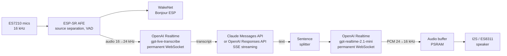

# ESP32-S3-BOX-3 Voice Assistant (Claude / GPT)

A voice assistant that runs entirely on an **ESP32-S3-BOX-3**, with no intermediate server: wake it up by
saying "**Bonjour ESP**", ask your question, and **Claude** (or **GPT**) answers out loud.
Everything is streamed (transcription, answer, speech synthesis): the answer starts playing about
**2.5 s** after the end of the question.

French is the default language; English is available from the Settings screen.

The project started from Espressif's [`chatgpt_demo`](https://github.com/espressif/esp-box) (ESP-IDF),
which has been largely rewritten.

## Features

- Local wake word **"Bonjour ESP"** (or "Hi ESP"), or touch the screen while asleep.
- **Live transcription** while you speak (streamed to the API, so the question is ready as soon as you stop;
  it is shown above the answer).
- Answer **streamed** by the chosen model and shown as it arrives, with an icon of the provider (Claude or
  OpenAI, or a globe when the web was searched) and prefixed with the model id
  (`[claude-haiku-5-5] …`).
- **Model, language and voice chosen on the device** (Settings screen): Claude Haiku 5.5, Sonnet 5.5, Opus 5.5
  (Anthropic) or GPT-6 Luna, GPT-6.1 Sol, GPT-6 Astra (OpenAI); French or English; 10 OpenAI voices.
- **Persona**: a free text (name, who made it, who you are…) given to the assistant with every question,
  edited in `PERSONA.TXT` from the PC.
- **Sentence-by-sentence speech synthesis**: the first sentence is spoken while the model writes the rest.
- **Follow-up without the wake word**: after an answer, the assistant keeps listening for 4 s
  (with the history of the last exchanges).
- **Conversation memory**: the last 10 exchanges are kept across sleep and restarts (saved to flash in
  `/spiffs/history.json` after each answer), so you can ask later "what were we talking about?".
  Saying "Au revoir" ends the conversation and clears it. Changing the model starts a new one; a full
  `idf.py flash` erases it (the `storage` partition is rewritten).
- **Tools** (Claude models), called by Claude when the question needs them:
  - **weather** ("Quel temps fera-t-il demain à Namur ?"), from Open-Meteo, free and without key;
  - **volume** ("Parle plus fort", "Mets le volume à 50"), applied at once if nothing is playing (else after
    the answer), kept across restarts; the assistant then goes back to sleep;
  - **web search** for current information ("Quelles sont les dernières nouvelles en Belgique ?"), run by
    Anthropic, about $0.01 per search, 3 searches at most per question, enabled when the model supports it.

  A short "Je regarde." is spoken (not shown) while a tool runs; the icon left of the answer turns into a
  globe when the web was searched.
- **Knows the date and time**: each question is sent with the current date and time ("[Nous sommes le dimanche
  25 octobre 2026, il est 20 h 07.]"), so "what day is it?" or "how many days until Christmas?" work.
- **Long-term memory**: "Souviens-toi que …" / "Retiens que …" (English: "Remember that …") stores a note,
  "Oublie que …" removes the closest one, "Oublie tout" clears them, "Dis-moi tout ce que tu as mémorisé"
  reads them out. These are answered on the device (no model call); the notes are given to the model with
  every question and can be edited in `MEMORY.TXT`.
- Saying "Bonjour ESP" during an answer, or **double-tapping the screen**, **interrupts** it and listens again.
- **Sleep screen**: under the sleeping robot, the time in glowing seven-segment digits and the date
  (`DIM 25/10/26`), synchronized over the Internet (NTP); the speaker volume at the bottom left (bar, speaker
  icon, percentage) and the Wi-Fi signal at the bottom right (arcs lit with the strength, crossed out when
  disconnected), in the same style.
- Errors (credit exhausted, key rejected, network…) are **shown and spoken**.
- **Answer text** scrolling with the speech, one line at a time (or smoothly), at a configurable reading speed.

## Architecture



| Stage | Service | Details |
| --- | --- | --- |
| Wake word | local (ESP-SR 2.5.5) | WakeNet9 "Bonjour ESP" + "Hi ESP", 2-mic AFE |
| End of speech | local | ESP-SR VAD, 0.9 s of silence |
| Transcription | OpenAI Realtime, `gpt-live-transcribe` | WebSocket kept open, AFE output streamed continuously |
| Answer (Claude) | Anthropic Messages API | `stream: true`, effort `low`, thinking off when the model allows it, 10 exchanges of history |
| Answer (GPT) | OpenAI Responses API | `stream: true`, `store: false`, reasoning effort `none` (Luna) or `low`, 10 exchanges of history |
| Speech synthesis | OpenAI Realtime, `gpt-realtime-2.1-mini`, voice chosen in Settings (default `marin`) | Permanent WebSocket, one response per sentence, read verbatim |
| Playback | local | 24 → 16 kHz resampling, I2S fixed at 16 kHz (shared with the mics) |

The stages overlap: FreeRTOS tasks are chained through queues (model text → sentences → synthesis →
audio buffer → I2S). TLS connections are reused (keep-alive for the chat API, permanent WebSockets for
transcription and voice) and opened while the user is still speaking.

### Available models

| Model | Provider | Price in / out (per 1M tokens) | ≈ cost per 1,000 questions | Speed | Reasoning | Settings used |
| --- | --- | --- | --- | --- | --- | --- |
| `claude-haiku-5-5` (default) | Anthropic | $0.10 / $0.50 | $0.15 | ★★★ fastest | none | thinking `disabled`, effort `low` |
| `gpt-6-luna` | OpenAI | $0.10 / $0.50 | $0.15 | ★☆☆ measured slow: 4 to 9 s to the first word | none | reasoning effort `none` |
| `claude-sonnet-5-5` | Anthropic | $2 / $10 | $3 | ★★☆ | only between tool calls (weather, web search…) | thinking `between_tools`, effort `low` |
| `gpt-6.1-sol` | OpenAI | $2 / $10 | $3 + reasoning | ★★☆ | light (always some reasoning) | reasoning effort `low` |
| `claude-opus-5-5` | Anthropic | $4 / $20 | $6 + thinking | ★☆☆ | adaptive (cannot be disabled; thinks when the question needs it) | thinking left to the model, effort `low` |
| `gpt-6-astra` | OpenAI | $10 / $50 | $15 + reasoning | ★☆☆ slowest | light, on the most capable OpenAI model | reasoning effort `low` |

How to read this table:

- **Cheapest → most expensive**: Haiku 5.5 = GPT-6 Luna < Sonnet 5.5 = GPT-6.1 Sol < Opus 5.5 < GPT-6 Astra.
- **Fastest → slowest** (time to the first spoken word): Haiku 5.5, then Sonnet 5.5 and GPT-6.1 Sol, then Opus 5.5
  and GPT-6 Astra (larger models that reason before answering). Measured on the device: Haiku 5.5 0.7 to 1.6 s
  (see the latencies below), GPT-6 Luna 4 to 9 s despite no reasoning (time spent waiting on OpenAI's side);
  the other ratings are expected, not measured.
- **Tools** (weather, volume, web search) are offered to the Claude models only.
- **Deepest reasoning**: Opus 5.5 and GPT-6 Astra are the most capable models and the only ones that really
  think before answering; GPT-6.1 Sol reasons a little; Haiku 5.5, GPT-6 Luna and Sonnet 5.5 answer directly.
  For short spoken answers, the fast models are usually enough; the larger ones help with tricky questions
  (logic, calculations, nuanced explanations).
- **Cost per 1,000 questions** assumes about 1,000 input tokens (instructions + a few exchanges of history) and
  100 output tokens per question. Reasoning/thinking tokens are billed as output on top of that, so Sol, Opus and
  Astra cost more than shown, depending on the question. Transcription and voice (OpenAI) are billed separately
  and do not depend on the chosen model. Prices as of October 2026; check the providers' pricing pages.
- The effort is kept `low` on every model to favour a fast spoken answer. Raising it (in `llm_models[]`) makes
  Opus, Sol and Astra think more, and makes them slower and more expensive.

The list lives in `main/app/llm.c` (`llm_models[]`). Any other model id can be set in `CONFIG.INI`
(`claude-…` → Anthropic, `gpt-…` → OpenAI); it then shows up as an extra entry in the Settings list.

### Typical latencies (measured with Claude Haiku 5.5)

| Stage | Duration |
| --- | --- |
| End of speech detected | 0.9 s of silence |
| End of speech → final transcript | 0.6 to 0.8 s |
| First word from the model | 0.7 to 1.6 s |
| Transcript → first sound | 1.4 to 2.8 s |
| Weather question (Open-Meteo lookup) | + 3 to 4 s for the answer |
| Web search ("Je regarde." spoken meanwhile) | first sound after 1.9 s, answer after about 3 s |

## Hardware and software

- **ESP32-S3-BOX-3** (16 MB flash, 16 MB octal PSRAM).
- **ESP-IDF v5.3.6** (tested with this version; 6.x versions are not compatible as is).
- An **OpenAI API key** (transcription and voice, and GPT answers) and, for Claude, an **Anthropic API key**
  with credit (console.anthropic.com → API Keys). API credit is separate from a Claude.ai subscription
  and from Claude usage credits.

## Repository layout

Two firmwares live side by side in flash:

| Folder | Partition | Role |
| --- | --- | --- |
| `main/` (root project) | `factory` (6 MB) | The voice assistant |
| `factory_nvs/` | `ota_0` (2 MB) | Configuration mode: the BOX shows up as a USB drive containing `CONFIG.INI`, `PERSONA.TXT` and `MEMORY.TXT` (`factory_nvs/components/esp_tinyuf2`: copy of Espressif's `esp_tinyuf2` 1.2.0, extended with `PERSONA.TXT` and `MEMORY.TXT`, files that can grow when edited, and a bound-checked `CONFIG.INI`) |
| `bsp/` | — | Board component (audio codec, buttons), used by both projects |
| `spiffs/` | `storage` | System sounds (`echo_en_wake.wav`, wake beep); the conversation (`history.json`) is saved there at run time |

Main modules of the assistant (`main/app/`):

| File | Role |
| --- | --- |
| `app_sr.c` | ESP-SR: AFE, wake word, speech and end-of-speech detection |
| `app_audio.c` | Listening sessions, system sounds (wake beep preloaded in PSRAM) |
| `stt_stream.c` | Live transcription (OpenAI Realtime, permanent WebSocket) |
| `llm.c` | Model list and dispatch to the provider of the chosen model |
| `claude_client.c` | Claude client (SSE streaming), history, per-model thinking, tool loop, web search, `pause_turn` |
| `openai_chat.c` | GPT client (Responses API, SSE streaming), history |
| `llm_sse.c` | Server-sent events parser shared by both clients |
| `sentence_splitter.c` | Splits the text into sentences (French-aware rules) |
| `tts_stream.c` | Speech synthesis (OpenAI Realtime), voice change at run time, resampling and I2S playback |
| `app_lang.c` | UI texts, model and voice instructions, error messages (fr / en) |
| `tools.c` | Tools offered to Claude (definitions, dispatch) |
| `weather.c` | Weather from Open-Meteo (geocoding, current conditions, daily forecast) |
| `app_volume.c` | Speaker volume changed by voice (applied when silent, saved to NVS) |
| `app_memory.c` | Long-term memory: "souviens-toi que", "oublie que", "oublie tout", "dis-moi ce que tu as mémorisé" |
| `app_clock.c` | Sleep screen: clock (SNTP time, seven-segment digits drawn by a single LVGL object), volume and Wi-Fi indicators |
| `app_ui_ctrl.c` | LVGL UI (SquareLine): panels, answer scrolling, answer icon, double tap, translations, Settings screen |
| `images/` | Answer icons (Claude, web globe) |
| `main.c` | Listen → transcribe → answer → speak pipeline |

## Build and flash

In an ESP-IDF v5.3.6 terminal:

```bash
# 1. The configuration mode first (its binary is included in the main project's flash)
cd factory_nvs
idf.py set-target esp32s3
idf.py build

# 2. The assistant
cd ..
idf.py set-target esp32s3
idf.py build
idf.py -p COMx flash monitor
```

- `idf.py flash` writes everything: bootloader, assistant, configuration mode, sounds (`spiffs/`) and
  ESP-SR models.
- `idf.py app-flash` only rewrites the assistant (faster): **the sounds are not updated**.
- External components (`managed_components/`) are downloaded automatically on the first build; their
  versions are pinned in `dependencies.lock`.
- After changing a `Kconfig` file, run `idf.py reconfigure`.

## Configuration

### On the device: Settings screen

Tap the gear icon on the home screen:

- **Langue / Language**: Français or English (interface, transcription, answers and voice).
- **Modèle / Model**: the model answering the questions (see the table above).
- **Voix / Voice**: the OpenAI voice reading the answers: Marin, Cedar (both recommended by OpenAI), Alloy,
  Ash, Ballad, Coral, Echo, Sage, Shimmer, Verse. Applied **at once**, without Save or restart: the speech
  session reconnects (~2 s) and the new voice introduces itself.

For the language and the model, press **Save** (bottom right, enabled once something changed): the choice is saved to the device's NVS and the device restarts to apply it.
The folder-and-gear icon (top right) switches to the configuration mode described below.

### On the device: `CONFIG.INI`

On first boot (or via **Settings → Reset → OK**), the BOX enters configuration mode and shows up on the
PC as a USB drive named "ESP-BOX". Edit `CONFIG.INI`, save it, then press **Restart**:

| Key | Role | Example |
| --- | --- | --- |
| `ssid`, `password` | Wi-Fi (WPA2 minimum) | |
| `ChatGPT_key` | OpenAI key (transcription, voice, GPT answers) | `sk-proj-…` |
| `Base_url` | OpenAI API URL | `https://api.openai.com/v1/` |
| `Claude_key` | Anthropic key (Claude answers) | `sk-ant-…` |
| `Chat_model` | Model answering the questions | `claude-haiku-5-5`, `gpt-6-luna`… |
| `Language` | Assistant language (also set from the Settings screen) | `fr` or `en` |
| `Voice` | Voice of the answers (also set from the Settings screen) | `marin`, `cedar`, `coral`… |
| `Volume` | Speaker volume, 0 to 100 (also changed by voice: "parle plus fort") | `90` |
| `Scroll_speed` | Reading speed of the answer on screen, in characters per second (5 to 60): the text scrolls with the speech. Higher = faster | `16` |
| `Scroll_mode` | How the answer scrolls: `line` moves one whole line at a time when the voice reaches it, `smooth` scrolls continuously | `line` |

The drive also holds **`PERSONA.TXT`**: free text always given to the assistant with every question
(Claude and GPT alike), kept across conversations, "Au revoir" included. For example:

```text
Tu t'appelles Jarvis. Tu es un assistant vocal créé par Valéry Letroye, sur base d'un ESP32-S3-BOX-3.
Valéry habite à ...
```

`MEMORY.TXT` holds the notes of the long-term memory, one per line (`- note (25/10/26)`): you can correct or
delete them there.

Both files follow the same rules: several lines are allowed, up to about 3,900 characters; lines starting with
`#` are ignored (an empty file shows a short help in such lines). They are stored in the NVS keys `Persona` and
`Memory` and read at start-up.

`Chat_model` replaces the former `Claude_model` key: its value is kept when the configuration mode first
starts with this version. Spaces and line breaks pasted by mistake around the values are ignored. Keys are
stored in plain text in the device's NVS and never appear in the logs (only their length is shown).

### At build time: `sdkconfig.defaults` / `idf.py menuconfig`

"Example Configuration" menu:

| Option | Default | Role |
| --- | --- | --- |
| `CONFIG_ASSISTANT_LANGUAGE` | `fr` | Language when `Language` is not set |
| `CONFIG_ASSISTANT_CHAT_MODEL` | `claude-haiku-5-5` | Model when `Chat_model` is not set |
| `CONFIG_ASSISTANT_STT_MODEL` | `gpt-live-transcribe` | Transcription model |
| `CONFIG_ASSISTANT_END_OF_SPEECH_MS` | `900` | Silence that ends the question |
| `CONFIG_ASSISTANT_TTS_MODEL` | `gpt-realtime-2.1-mini` | Speech synthesis model |
| `CONFIG_ASSISTANT_TTS_VOICE` | `marin` | Voice when `Voice` is not set |
| `CONFIG_ASSISTANT_REPLY_SCROLL_CPS` | `16` | Answer scrolling speed when `Scroll_speed` is not set |
| `CONFIG_ASSISTANT_TIMEZONE` | `CET-1CEST,M3.5.0,M10.5.0/3` | Time zone of the clock (POSIX TZ; default Brussels/Paris) |
| `CONFIG_ASSISTANT_FOLLOWUP_WINDOW_MS` | `4000` | Listening time after an answer (0 = disabled) |
| `CONFIG_VOLUME_LEVEL` | `90` | Speaker volume when `Volume` is not set |

An existing `sdkconfig` file takes precedence over `sdkconfig.defaults`: to change a value, use
`idf.py menuconfig` (or delete `sdkconfig` before rebuilding).

## Usage

1. Say "**Bonjour ESP**" (beep), then ask your question ("J'écoute …" is shown while you speak).
2. After 0.9 s of silence the question is sent; the answer is shown and spoken.
3. After the answer, the assistant keeps listening for 4 s: you can go on without saying "Bonjour ESP"
   (not after a volume change, which sends it back to sleep).
4. To interrupt an answer, say "Bonjour ESP" again or **double-tap** the screen: it stops and listens.
5. Without speech, it goes back to sleep (no API call is made for silence).
6. Saying just "**Au revoir**" (or "Bonne nuit"; "Goodbye", "Bye", "Good night" in English) sends it back to
   sleep at once, without an answer and without listening again, and clears the saved conversation: the next
   one starts afresh. Otherwise the conversation goes on after sleep or a restart.
   The phrases are listed in `main/app/app_lang.c`.

## System sounds

The sounds in `spiffs/` must be **16-bit PCM WAV at 16 kHz** (mono or stereo): the I2S bus is shared with
the microphones and stays at 16 kHz, other rates are rejected. The wake beep is loaded into PSRAM at start-up
and played once an interrupted answer has left the speaker. After changing the sounds, do a full flash
(`idf.py flash`).

## Logs and diagnostics

The serial monitor (`idf.py -p COMx monitor`) shows, among others:

- `[timing] final transcript … ms after the end of speech`, `[timing] first audio … ms after the transcription`
- `claude: first text after … ms, … tokens in … (cache read …), out …`
- `openai_chat: first text after … ms, … tokens in … (cached …), out … (reasoning …)`
- `tts: "…": first audio … ms` per sentence, `tts: reply played, N underrun(s)`
- `stt: committed … ms of audio; at the end of speech … ms were still to send`
- `tools: get_weather({…})`, `weather: … in … ms`, `claude: server tool: web_search`, `… web search(es)`
- `claude: web search: available` (capability read at the first wake)
- `[heap] internal free …` every 30 s (internal RAM is the critical resource)

## Design notes

- **Memory**: internal RAM (~46 KB free while running) is reserved for stacks, DMA and the network; large
  buffers, JSON trees, TLS buffers (mbedTLS), the network task stacks and the LVGL objects live in PSRAM
  (LVGL's allocator is redirected by `main/lvgl_psram/lv_psram.h` and the top-level `CMakeLists.txt`).
- **No echo cancellation**: speech detection ignores the start of each listening window (beep, end of the
  answer) and filters by volume; empty transcripts and typical Whisper hallucinations on silence are ignored.
- **Costs**: transcription is billed by the duration of audio sent (only while listening); according to
  OpenAI's documentation, idle open connections are not billed. Answer costs depend on the chosen model
  (Opus and Astra are the most expensive).
- **Tools**: `claude_client.c` loops on `stop_reason: tool_use` (up to 3 rounds per question): the tool
  results go back as `tool_result` blocks and stay in the history. To add a tool, declare it in `tools.c`
  (JSON definition + a case in `tools_run()`). GPT models get no tools yet (OpenAI's function calling with
  `store: false` and reasoning models needs more work).
- **Web search**: the server tool `web_search_20250305` is added to the request when the model's description
  (read by the prewarm, `GET /v1/models/{model}`) says it is supported. Its results (encrypted page contents)
  are dropped from the history once the answer is complete, so that they are not sent again with every later
  question; exchanges with thinking blocks (Opus) are kept verbatim. `pause_turn` is resumed.

## Roadmap

- More tools: timers and alarms, home automation…
- Tools for the GPT models.
- Cost of each exchange (transcription, model, voice) shown on screen.
- NVS encryption to protect the API keys.

## Credits and licenses

- Based on the `chatgpt_demo` example from [esp-box](https://github.com/espressif/esp-box) (Espressif,
  CC0 / Apache-2.0 depending on the files).
- Montserrat font (SIL Open Font License), shipped with LVGL, for accented characters.
- Espressif components (ESP-IDF, ESP-SR, esp-box-3, esp_websocket_client) under their respective licenses.
