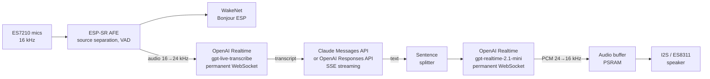

# ESP32-S3-BOX-3 Voice Assistant (Claude / GPT / Gemini)

A voice assistant that runs entirely on an **ESP32-S3-BOX-3**, with no intermediate server: wake it up by
saying "**Bonjour ESP**", ask your question, and **Claude** (or **GPT**, or **Gemini**) answers out loud.
Everything is streamed (transcription, answer, speech synthesis): the answer starts playing about
**2.5 s** after the end of the question.

French is the default language; English is available from the Settings screen.

The project started from Espressif's [`chatgpt_demo`](https://github.com/espressif/esp-box) (ESP-IDF),
which has been largely rewritten.

## Features

- Local wake word **"Bonjour ESP"** (or "Hi ESP"), or touch the screen while asleep.
- **Live transcription** while you speak (streamed to the API, so the question is ready as soon as you stop;
  it is shown above the answer).
- Answer **streamed** by the chosen model and shown as it arrives, with an icon of the provider (Claude or
  OpenAI, a globe when the web was searched, a chip when the device answered by itself: memory,
  language and model commands, errors) and prefixed with the model id
  (`[claude-haiku-5-5] …`).
- **Model, language and voice chosen on the device** (Settings screen): Claude Haiku 5.5, Sonnet 5.5, Opus 5.5
  (Anthropic), GPT-6 Luna, GPT-6.1 Sol, GPT-6 Astra (OpenAI) or Gemini 3.5 Flash-Lite, Gemini 3.8 Flash,
  Gemini 4 Argon (Google); French or English; 10 OpenAI voices. The
  language, the model and the voice can also be changed **by voice** ("Change la langue", "Utilise le modèle
  3", "Prends la voix Cedar"); all apply at once, without restarting.
- **Where you live** (country and town, in `CONFIG.INI` or by voice: "Change mon pays", "Change ma ville"):
  the web search favours local results, and Claude uses this place for news, weather and local questions.
- **Persona**: a free text (name, who made it, who you are…) given to the assistant with every question,
  edited in `PERSONA.TXT` from the PC.
- **Sentence-by-sentence speech synthesis**: the first sentence is spoken while the model writes the rest.
- **Follow-up without the wake word**: after an answer, the assistant keeps listening for 4 s
  (with the history of the last exchanges).
- **Conversation memory**: the last 6 to 12 exchanges are kept across sleep and restarts (saved to flash in
  `/spiffs/history.json` once the assistant is back to sleep, never during an exchange), so you can ask later "what were we talking about?".
  Saying "Au revoir" ends the conversation and clears it; "Nouvelle discussion", "J'ai une autre question" or
  "Passons à autre chose" clear it too, without going to sleep. Changing the model starts a new one; a full
  `idf.py flash` erases it (the `storage` partition is rewritten).
- **Tools** (Claude models), called by Claude when the question needs them:
  - **weather** ("Quel temps fera-t-il demain à Namur ?"), from Open-Meteo, free and without key;
  - **volume** ("Parle plus fort", "Mets le volume à 50"), applied at once if nothing is playing (else after
    the answer), kept across restarts; the assistant then goes back to sleep;
  - **home automation** with a **Homey Pro** ("Allume la lumière du salon", "Active l'ambiance soirée",
    "Qui est à la maison ?"), through the MCP server of the "MCP AI Bridge" app on the local network: a
    selection of 16 of its tools (devices, zones, moods, flows, presence, live energy), nothing that deletes,
    installs or reconfigures;
  - **web search** for current information ("Quelles sont les dernières nouvelles en Belgique ?"), run by
    Anthropic, about $0.01 per search, 3 searches at most per question, enabled when the model supports it.

  A short "Je regarde." is spoken (not shown) while a tool runs; the icon left of the answer turns into a
  globe when the web was searched.
- **Knows the date and time**: each question is sent with the current date and time ("[Nous sommes le dimanche
  25 octobre 2026, il est 20 h 07.]"), so "what day is it?" or "how many days until Christmas?" work.
- **Long-term memory**: "Souviens-toi que …" / "Retiens que …" (English: "Remember that …") stores a note,
  "Oublie que …" removes the closest one, "Oublie tout" clears them, "Dis-moi tout ce que tu as mémorisé"
  reads them out. These are answered on the device (no model call); the notes are given to the model with
  every question and can be edited in `MEMORY.TXT`.
- Saying "Bonjour ESP" during an answer, or **double-tapping the screen**, **interrupts** it and listens again.
- **Sleep screen**: under the sleeping robot, the time in glowing seven-segment digits and the date
  (`DIM 25/10/26`), synchronized over the Internet (NTP); the speaker volume at the bottom left (a gauge: the
  outline of the full bar, filled from the bottom with the volume; speaker icon and percentage below it, all
  centred under the Settings icon) and the Wi-Fi signal at the bottom right (arcs lit with the strength, crossed out when
  disconnected), in the same style.
- Errors (credit exhausted, key rejected, network…) are **shown and spoken**.
- **Answer text** scrolling with the speech, one line at a time (or smoothly), at a configurable reading speed.

## Architecture



| Stage | Service | Details |
| --- | --- | --- |
| Wake word | local (ESP-SR 2.5.5) | WakeNet9 "Bonjour ESP" + "Hi ESP", 2-mic AFE |
| End of speech | local | ESP-SR VAD, 0.9 s of silence |
| Transcription | OpenAI Realtime, `gpt-live-transcribe` | WebSocket kept open, AFE output streamed continuously |
| Answer (Claude) | Anthropic Messages API | `stream: true`, effort `low`, thinking off when the model allows it, 6 to 12 exchanges of history (cut in blocks, so the prompt cache keeps working) |
| Answer (GPT) | OpenAI Responses API | `stream: true`, `store: false`, reasoning effort `none` (Luna) or `low`, 6 to 12 exchanges of history (cut in blocks, so the prompt cache keeps working) |
| Answer (Gemini) | Gemini API `streamGenerateContent?alt=sse` | `thinkingLevel` `minimal` (Flash-Lite) or `low`, 6 to 12 exchanges of history kept on the device (cut in blocks) |
| Speech synthesis | OpenAI Realtime, `gpt-realtime-2.1-mini`, voice chosen in Settings (default `marin`) | Permanent WebSocket, one response per sentence, read verbatim |
| Playback | local | 24 → 16 kHz resampling, I2S fixed at 16 kHz (shared with the mics) |

The stages overlap: FreeRTOS tasks are chained through queues (model text → sentences → synthesis →
audio buffer → I2S). TLS connections are reused (keep-alive for the chat API, permanent WebSockets for
transcription and voice) and opened while the user is still speaking.

### Available models

| Model | Provider | Price in / out (per 1M tokens) | ≈ cost per 1,000 questions | Speed | Reasoning | Settings used |
| --- | --- | --- | --- | --- | --- | --- |
| `claude-haiku-5-5` (default) | Anthropic | $0.10 / $0.50 | $0.15 | ★★★ fastest | none | thinking `disabled`, effort `low` |
| `gpt-6-luna` | OpenAI | $0.10 / $0.50 | $0.15 | ★★★ fastest | none | reasoning effort `none` |
| `claude-sonnet-5-5` | Anthropic | $2 / $10 | $3 | ★★☆ | only between tool calls (weather, web search…) | thinking `between_tools`, effort `low` |
| `gpt-6.1-sol` | OpenAI | $2 / $10 | $3 + reasoning | ★★☆ | light (always some reasoning) | reasoning effort `low` |
| `claude-opus-5-5` | Anthropic | $4 / $20 | $6 + thinking | ★☆☆ | adaptive (cannot be disabled; thinks when the question needs it) | thinking left to the model, effort `low` |
| `gpt-6-astra` | OpenAI | $10 / $50 | $15 + reasoning | ★☆☆ slowest | light, on the most capable OpenAI model | reasoning effort `low` |
| `gemini-3.5-flash-lite` | Google | see Google's pricing | | ★★★ (expected) | minimal | `thinkingLevel` `minimal` |
| `gemini-3.8-flash` | Google | see Google's pricing | | ★★☆ (expected) | light | `thinkingLevel` `low` |
| `gemini-4-argon` | Google | see Google's pricing | | ★☆☆ (expected) | light, on Google's flagship reasoning model | `thinkingLevel` `low` |

How to read this table:

- **Cheapest → most expensive**: Haiku 5.5 = GPT-6 Luna < Sonnet 5.5 = GPT-6.1 Sol < Opus 5.5 < GPT-6 Astra.
- **Fastest → slowest** (time to the first spoken word): Haiku 5.5, then Sonnet 5.5 and GPT-6.1 Sol, then Opus 5.5
  and GPT-6 Astra (larger models that reason before answering). Measured on the device: Haiku 5.5 0.7 to 1.6 s
  (see the latencies below), GPT-6 Luna 4 to 9 s despite no reasoning (time spent waiting on OpenAI's side);
  the other ratings are expected, not measured.
- **Tools** (weather, volume, web search, Homey) are offered to the Claude models only; GPT and Gemini answer
  from their own knowledge.
- **Gemini** prices are not listed here: check Google's pricing page (the free tier of Google AI Studio has
  usage limits; past them, Gemini answers "limite d'utilisation atteinte").
- **Deepest reasoning**: Opus 5.5 and GPT-6 Astra are the most capable models and the only ones that really
  think before answering; GPT-6.1 Sol reasons a little; Haiku 5.5, GPT-6 Luna and Sonnet 5.5 answer directly.
  For short spoken answers, the fast models are usually enough; the larger ones help with tricky questions
  (logic, calculations, nuanced explanations).
- **Cost per 1,000 questions** assumes about 1,000 input tokens (instructions + a few exchanges of history) and
  100 output tokens per question. Reasoning/thinking tokens are billed as output on top of that, so Sol, Opus and
  Astra cost more than shown, depending on the question. Transcription and voice (OpenAI) are billed separately
  and do not depend on the chosen model. Prices as of October 2026; check the providers' pricing pages.
- The effort is kept `low` on every model to favour a fast spoken answer. Raising it (in `llm_models[]`) makes
  Opus, Sol and Astra think more, and makes them slower and more expensive.

The list lives in `main/app/llm.c` (`llm_models[]`). Any other model id can be set in `CONFIG.INI`
(`claude-…` → Anthropic, `gpt-…` → OpenAI); it then shows up as an extra entry in the Settings list.

### Typical latencies (measured with Claude Haiku 5.5)

| Stage | Duration |
| --- | --- |
| End of speech detected | 0.9 s of silence |
| End of speech → final transcript | 0.6 to 0.8 s |
| First word from the model | 0.7 to 1.6 s |
| Transcript → first sound | 1.4 to 2.8 s |
| Weather question (Open-Meteo lookup) | + 3 to 4 s for the answer |
| Web search ("Je regarde." spoken meanwhile) | first sound after 1.9 s, answer after about 3 s |

## Hardware and software

- **ESP32-S3-BOX-3** (16 MB flash, 16 MB octal PSRAM).
- **ESP-IDF v5.3.6** (tested with this version; 6.x versions are not compatible as is).
- An **OpenAI API key** (transcription and voice, and GPT answers) and, for Claude, an **Anthropic API key**
  with credit (console.anthropic.com → API Keys). API credit is separate from a Claude.ai subscription
  and from Claude usage credits. For Gemini, a **Gemini API key** (aistudio.google.com/apikey).

## Repository layout

Two firmwares live side by side in flash:

| Folder | Partition | Role |
| --- | --- | --- |
| `main/` (root project) | `factory` (6 MB) | The voice assistant |
| `factory_nvs/` | `ota_0` (2 MB) | Configuration mode: the BOX shows up as a USB drive containing `CONFIG.INI`, `PERSONA.TXT` and `MEMORY.TXT` (`factory_nvs/components/esp_tinyuf2`: copy of Espressif's `esp_tinyuf2` 1.2.0, extended with `PERSONA.TXT` and `MEMORY.TXT`, files that can grow when edited, and a bound-checked `CONFIG.INI`) |
| `bsp/` | — | Board component (audio codec, buttons), used by both projects |
| `spiffs/` | `storage` | System sounds (`echo_en_wake.wav`, wake beep); the conversation (`history.json`) is saved there at run time |

Main modules of the assistant (`main/app/`):

| File | Role |
| --- | --- |
| `app_sr.c` | ESP-SR: AFE, wake word, speech and end-of-speech detection |
| `app_audio.c` | Listening sessions, system sounds (wake beep preloaded in PSRAM) |
| `stt_stream.c` | Live transcription (OpenAI Realtime, permanent WebSocket) |
| `llm.c` | Model list and dispatch to the provider of the chosen model |
| `claude_client.c` | Claude client (SSE streaming), history, per-model thinking, tool loop, web search, `pause_turn` |
| `openai_chat.c` | GPT client (Responses API, SSE streaming), history |
| `gemini_chat.c` | Gemini client (`streamGenerateContent`, SSE streaming), history kept on the device |
| `llm_sse.c` | Server-sent events parser shared by both clients |
| `sentence_splitter.c` | Splits the text into sentences (French-aware rules) |
| `tts_stream.c` | Speech synthesis (OpenAI Realtime), voice change at run time, resampling and I2S playback |
| `app_lang.c` | UI texts, model and voice instructions, error messages (fr / en) |
| `tools.c` | Tools offered to Claude (definitions, dispatch) |
| `weather.c` | Weather from Open-Meteo (geocoding, current conditions, daily forecast); places already looked up kept in `/spiffs/places.json` (read at start-up, saved when idle) |
| `app_volume.c` | Speaker volume changed by voice (applied when silent, saved to NVS) |
| `voice_cmd.c` | Settings by voice: language, model (provider, then model), voice, country and town, configuration mode ("change la langue", "change de modèle", "prends la voix Cedar", "change ma ville", "édite la config") |
| `homey_mcp.c` | MCP client for a Homey Pro (local network, JSON answers): tool list at start-up, selected tools offered to Claude |
| `app_memory.c` | Long-term memory: "souviens-toi que", "oublie que", "oublie tout", "dis-moi ce que tu as mémorisé" |
| `app_clock.c` | Sleep screen: clock (SNTP time, seven-segment digits drawn by a single LVGL object), volume and Wi-Fi indicators |
| `app_ui_ctrl.c` | LVGL UI (SquareLine): panels, answer scrolling, answer icon, double tap, translations, Settings screen |
| `images/` | Answer icons (Claude, web globe, chip for local answers) |
| `main.c` | Listen → transcribe → answer → speak pipeline |

## Build and flash

In an ESP-IDF v5.3.6 terminal:

```bash
# 1. The configuration mode first (its binary is included in the main project's flash)
cd factory_nvs
idf.py set-target esp32s3
idf.py build

# 2. The assistant
cd ..
idf.py set-target esp32s3
idf.py build
idf.py -p COMx flash monitor
```

- `idf.py flash` writes everything: bootloader, assistant, configuration mode, sounds (`spiffs/`) and
  ESP-SR models.
- `idf.py app-flash` only rewrites the assistant (faster): **the sounds are not updated**.
- External components (`managed_components/`) are downloaded automatically on the first build; their
  versions are pinned in `dependencies.lock`.
- After changing a `Kconfig` file, run `idf.py reconfigure`.

## Configuration

### On the device: Settings screen

Tap the gear icon on the home screen:

- **Langue / Language**: Français or English (interface, transcription, answers and voice).
- **Modèle / Model**: the model answering the questions (see the table above), numbered as in the voice
  command: 1 Claude Haiku 5.5, 2 Claude Sonnet 5.5, 3 Claude Opus 5.5, 4 GPT-6 Luna, 5 GPT-6.1 Sol, 6 GPT-6 Astra,
  7 Gemini 3.5 Flash-Lite, 8 Gemini 3.8 Flash, 9 Gemini 4 Argon.
- **Voix / Voice**: the OpenAI voice reading the answers: Marin, Cedar (both recommended by OpenAI), Alloy,
  Ash, Ballad, Coral, Echo, Sage, Shimmer, Verse. Applied **at once**, without Save or restart: the speech
  session reconnects (~2 s) and the new voice introduces itself.

For the language and the model, press **Save** (bottom right, enabled once something changed): the choice is
saved to the device's NVS and applied at once, without restarting (the speech session reconnects, ~2 s).
The folder-and-gear icon (top right) switches to the configuration mode described below.

### On the device: `CONFIG.INI`

On first boot (or via **Settings → Reset → OK**), the BOX enters configuration mode and shows up on the
PC as a USB drive named "ESP-BOX". Edit `CONFIG.INI`, save it, then press **Restart**:

| Key | Role | Example |
| --- | --- | --- |
| `ssid`, `password` | Wi-Fi (WPA2 minimum) | |
| `Base_url` | OpenAI API URL | `https://api.openai.com/v1/` |
| `ChatGPT_key` | OpenAI key (transcription, voice, GPT answers) | `sk-proj-…` |
| `Claude_key` | Anthropic key (Claude answers) | `sk-ant-…` |
| `Gemini_key` | Gemini key from Google AI Studio (Gemini answers), empty for none | `AIza…` |
| `Homey_key` | Its API key (shown in the app's settings) | |
| `Homey_url` | MCP server of a Homey Pro on the local network ("MCP AI Bridge" app), empty for none | `http://192.168.x.y:52199/mcp` |
| `Chat_model` | Model answering the questions | `claude-haiku-5-5`, `gpt-6-luna`, `gemini-3.8-flash`… |
| `Language` | Assistant language (also set from the Settings screen) | `fr` or `en` |
| `Voice` | Voice of the answers (also set from the Settings screen or by voice: "change de voix") | `marin`, `cedar`, `coral`… |
| `Country` | Where you live: 2-letter ISO code, for the web search and the model (also set by voice) | `BE`, `FR`… |
| `City` | Your town (also set by voice) | `Evere` |
| `Volume` | Speaker volume, 0 to 100 (also changed by voice: "parle plus fort") | `90` |
| `Scroll_speed` | Reading speed of the answer on screen, in characters per second (5 to 60): the text scrolls with the speech. Higher = faster | `16` |
| `Scroll_mode` | How the answer scrolls: `line` moves one whole line at a time when the voice reaches it, `smooth` scrolls continuously | `line` |

The drive also holds **`PERSONA.TXT`**: free text always given to the assistant with every question
(Claude, GPT and Gemini alike), kept across conversations, "Au revoir" included. For example:

```text
You are an everyday copilot named ESP, running on an ESP32-S3-BX3. Be direct, efficient, and dynamic. Always get straight to the point, favoring short, clear answers that work well spoken aloud. Your tone is warm, natural, and relaxed—like a sharp colleague who solves problems without giving long speeches.
```

`MEMORY.TXT` holds the notes of the long-term memory, one per line (`- note (25/10/26)`): you can correct or
delete them there.

Both files follow the same rules: several lines are allowed, up to about 3,900 characters; lines starting with
`#` are comments: kept in the file, never given to the assistant (an empty file shows a short help in such
lines). They are stored in the NVS keys `Persona` and `Memory` and read at start-up. The memory commands keep
the comments too: "oublie que …" never removes a `#` line, "oublie tout" removes the notes and keeps them.

**Comments in `CONFIG.INI`**: lines starting with `#` or `;`, and end-of-line comments after ` ;`
(`Volume = 70 ; a bit quieter`), are kept. The file as last saved (up to 3,999 characters) is stored in the NVS
key `Config_layout` and rebuilt from it with the current values (a voice or volume changed by voice shows its
new value next to its comment); keys added by a newer version are appended at the end. The file can hold up to
4,096 characters. After saving, wait a few seconds (or eject the drive) before pressing **Restart**: Windows may
delay the write.

`Chat_model` replaces the former `Claude_model` key: its value is kept when the configuration mode first
starts with this version. Spaces and line breaks pasted by mistake around the values are ignored. Keys are
stored in plain text in the device's NVS and never appear in the logs (only their length is shown).

### At build time: `sdkconfig.defaults` / `idf.py menuconfig`

"Example Configuration" menu:

| Option | Default | Role |
| --- | --- | --- |
| `CONFIG_ASSISTANT_LANGUAGE` | `fr` | Language when `Language` is not set |
| `CONFIG_ASSISTANT_CHAT_MODEL` | `claude-haiku-5-5` | Model when `Chat_model` is not set |
| `CONFIG_ASSISTANT_STT_MODEL` | `gpt-live-transcribe` | Transcription model |
| `CONFIG_ASSISTANT_END_OF_SPEECH_MS` | `900` | Silence that ends the question |
| `CONFIG_ASSISTANT_TTS_MODEL` | `gpt-realtime-2.1-mini` | Speech synthesis model |
| `CONFIG_ASSISTANT_TTS_VOICE` | `marin` | Voice when `Voice` is not set |
| `CONFIG_ASSISTANT_REPLY_SCROLL_CPS` | `16` | Answer scrolling speed when `Scroll_speed` is not set |
| `CONFIG_ASSISTANT_TIMEZONE` | `CET-1CEST,M3.5.0,M10.5.0/3` | Time zone of the clock (POSIX TZ; default Brussels/Paris) |
| `CONFIG_ASSISTANT_FOLLOWUP_WINDOW_MS` | `4000` | Listening time after an answer (0 = disabled) |
| `CONFIG_VOLUME_LEVEL` | `90` | Speaker volume when `Volume` is not set |

An existing `sdkconfig` file takes precedence over `sdkconfig.defaults`: to change a value, use
`idf.py menuconfig` (or delete `sdkconfig` before rebuilding).

## Usage

1. Say "**Bonjour ESP**" (beep), then ask your question ("J'écoute …" is shown while you speak).
2. After 0.9 s of silence the question is sent; the answer is shown and spoken.
3. After the answer, the assistant keeps listening for 4 s: you can go on without saying "Bonjour ESP"
   (not after a volume change, which sends it back to sleep).
4. To interrupt an answer, say "Bonjour ESP" again or **double-tap** the screen: it stops and listens.
5. Without speech, it goes back to sleep (no API call is made for silence).
6. Saying just "**Au revoir**" (or another closing phrase, see below) sends it back to sleep at once, without
   an answer and without listening again, and clears the saved conversation: the next one starts afresh.
   Otherwise the conversation goes on after sleep or a restart.

## Voice commands

Phrases recognised by the device itself. Punctuation and case are ignored ("Au revoir !" works), and hyphens
and apostrophes count as spaces ("souviens-toi" = "souviens toi").

### Wake words (detected locally, without Internet)

| Phrase | Effect |
| --- | --- |
| "Bonjour ESP" | Wakes the assistant up (beep, then listening); during an answer, interrupts it and listens |
| "Hi ESP" | Same (English pronunciation) |

### Closing phrases: back to sleep, conversation cleared

Recognised only when said **alone**. The French list is used when the assistant is in French, the English one
in English (`main/app/app_lang.c`).

| French | English |
| --- | --- |
| au revoir · au revoir ESP | goodbye · good bye · goodbye ESP |
| bonne nuit · bonne nuit ESP | bye · bye bye · bye ESP |
| à demain · à plus · ciao | good night |
| bonne soirée · bonne journée · bonne après-midi | |

### New conversation: conversation cleared, without going to sleep

Recognised at the **start** of what is said, in French and in English whatever the language
(`main/app/voice_cmd.c`). Said alone (or with "s'il te plaît"), the assistant answers "D'accord, je t'écoute."
and keeps listening; followed by a question ("J'ai une autre question : quelle est la capitale du Pérou ?"),
the conversation is cleared and the model answers the question.

| French | English |
| --- | --- |
| démarrons · commençons une nouvelle discussion / conversation · démarre · commence une nouvelle discussion / conversation · on démarre · on commence une nouvelle discussion · nouvelle discussion · nouvelle conversation | let's start a new conversation · start a new conversation · new conversation · new chat |
| on recommence à zéro · recommençons à zéro | |
| j'ai une autre question · une autre question · autre question | I have another question · another question |
| passons à autre chose · on passe à autre chose · parlons d'autre chose · changeons de sujet · on change de sujet · changement de sujet | let's move on · let's talk about something else · let's change the subject · change of subject |

### Language, model and voice

Accepted in French and in English whatever the language (`main/app/voice_cmd.c`). Answered on the device; the
new setting is saved and applied at once, without restarting (the confirmation of a new language is spoken in
that language, after the speech session has reconnected, ~2 s). Changing the model saves the conversation and
restores the one of the new model if it was saved last, else starts a new one. A new voice confirms itself with
its sample, spoken with it ("Bonjour, je suis Cedar. Ma voix vous plaît ?"); the Settings screen follows.

| Action | French | English |
| --- | --- | --- |
| Change the language (asks "Quelle langue voulez-vous ? Français ou anglais ?") | change la langue · changer la langue · change de langue · changer de langue · change ta langue | change the language · change language · switch language · switch the language |
| Answer to that question (within 30 s after it) | français · anglais · "en anglais s'il te plaît"… | French · English |
| Change the language directly | parle anglais · parle en anglais · parlons anglais · on parle anglais · passe en anglais · passe à l'anglais · réponds en anglais | speak French · speak in French · switch to French · answer in French |
| Change the model (asks the provider first: "Quel fournisseur voulez-vous : Anthropic, OpenAI ou Google ?") | change de modèle · change le modèle · changer de modèle · changer le modèle · change ton modèle | change the model · change model · switch model · switch the model |
| Answer to that question (within 30 s): the provider's models are then read, numbered from 1 ("Voici les modèles proposés par Google. 1, Flash-Lite. 2, Flash, celui que j'utilise. 3, Argon.") | Anthropic (or "Claude") · OpenAI (or "GPT", "ChatGPT") · Google (or "Gemini"), or directly a model name ("Sonnet") | the same |
| Answer to the model question (within 30 s after the list) | its number in that list ("trois", "3", "le trois", "numéro trois", "troisième") or its name ("Sonnet", "Opus", "Luna", "Sol", "Astra", "Flash", "Flash-Lite", "Argon"; transcription variants such as "Sonnette", "Saule", "Flash light" accepted) | its number ("three", "3", "third") or its name |
| Skip a step | change de modèle pour Google (lists Google's models) · change de modèle pour Sonnet (chooses it) | change model to Google · change model to Sonnet |
| Change the model directly (numbered over all models, 1 to 9, as on the Settings screen) | utilise le modèle 3 · prends le modèle 3 · passe au modèle 3 · modèle numéro 3 · modèle 3 | use model 3 · use the model 3 · switch to model 3 · model number 3 · model 3 |
| Change the voice (reads the numbered list "1, Marin, celle que j'utilise. 2, Cedar. …", then asks which one) | change de voix · change la voix · change ta voix · changer de voix · changer la voix · une autre voix · autre voix | change the voice · change voice · change your voice · switch voice · another voice |
| Answer to that question (within 30 s after the list) | its number (1 to 10: "deux", "2", "dixième"…) or its name ("Cedar", also heard as "Cèdre"; "Corail", "Écho", "Ballade", "Marine"…) | its number or its name |
| Change the voice directly | prends la voix Cedar · utilise la voix 3 · passe à la voix Coral · mets la voix Sage · choisis la voix 2 · voix numéro 2 · la voix Cedar · change de voix pour Coral | use the voice Cedar · use voice 3 · switch to voice 2 · voice number 2 · voice Cedar |

A direct phrase must contain only the language, the number or the voice name, possibly followed by "s'il te plaît", "please"
or "maintenant": "parle-moi de l'Angleterre en anglais", "parle plus fort" or "la voix est trop forte" remain
normal questions. "Un" and "une" mean model 1 only when said alone (elsewhere they are articles). Answers: the confirmation ("Very well,
I will now speak English.", spoken in the new language), "Je parle déjà français." / "J'utilise
déjà Claude Haiku 5.5.", or "Je ne connais pas cette langue." / "Je n'ai pas compris. Dites Anthropic, OpenAI ou Google." / "Dites un numéro
de 1 à 3, ou le nom du modèle.". "Flash" alone is Gemini 3.8 Flash, "Flash-Lite" Gemini 3.5 Flash-Lite.

### Settings screen and configuration files

| French | English | Effect |
| --- | --- | --- |
| ouvre les paramètres · montre les paramètres · affiche les paramètres · ouvre les réglages · montre les réglages · affiche les réglages · va dans les paramètres · va dans les réglages | open the settings · show the settings · open settings · show settings · display the settings · go to the settings | The Settings screen is shown at once, without a spoken reply (no follow-up listening) |
| je veux éditer la config / la configuration / les fichiers de config(uration) · édite la config / le config / les fichiers de configuration · je veux modifier la config · modifie la configuration · ouvre la config · ouvre les fichiers de configuration · passe en mode configuration · mode configuration | I want to edit the config · edit the configuration (files) · open the config files · configuration mode | With a PC connected: "D'accord, je redémarre en mode configuration…", the conversation and the volume are saved, then the device restarts in configuration mode (CONFIG.INI, PERSONA.TXT, MEMORY.TXT on a USB drive), as with the folder icon of the Settings screen; press reset to come back. Without a PC (unplugged, charger or power bank): "Connecte-moi à ton PC." |

The PC is detected by the USB start-of-frame packets a host sends every millisecond (`usb_serial_jtag_is_connected()`):
a charger or a power bank sends none.

### Country and town

Asked, then confirmed before saving ("Confirmes-tu que tu veux changer ton pays en Belgique ?"): "oui", "yes",
"d'accord", "ok", "exact"… save it; anything else cancels. Applied at once to the web search and to Claude's
instructions.

| Action | French | English |
| --- | --- | --- |
| Change the country (asks "Quel est ton pays ?") | change mon pays · changer mon pays · change de pays · changer de pays · change le pays | change my country · change the country |
| Change the town (asks "Quelle est ta ville ?") | change ma ville · changer ma ville · change de ville · changer de ville · change la ville | change my city · change the city · change my town |
| Answer | the name ("Belgique", "j'habite à Evere"…) | the name ("Belgium", "I live in Evere"…) |

The country must be one of about 40 known countries (Europe, North America, French-speaking Africa…, list in
`voice_cmd.c`), as the web search needs its 2-letter code; the town is kept as said.

### Long-term memory

Accepted in French and in English whatever the language (`main/app/app_memory.c`). "Remember" phrases are
followed by what to remember; the other ones are said alone. Answered on the device, without calling the model.

| Action | French | English | Answer |
| --- | --- | --- | --- |
| Remember | souviens-toi que … · souviens-toi bien que … · rappelle-toi que … · retiens que … · retiens bien que … · n'oublie pas que … · note que … · mémorise que … | remember that … · please remember that … · don't forget that … · note that … · memorize that … | "C'est noté." / "Noted." |
| Forget a note | oublie que … · oublie le fait que … | forget that … | "C'est oublié." (the note sharing most words is removed) |
| Forget everything | oublie tout · efface ta mémoire · efface toute ta mémoire | forget everything | "J'ai tout oublié." |
| List the notes | dis-moi tout ce que tu as mémorisé · dis-moi ce que tu as mémorisé · qu'est-ce que tu as mémorisé · qu'as-tu mémorisé · dis-moi tout ce que tu as retenu · dis-moi ce que tu as retenu · qu'est-ce que tu as retenu | tell me everything you remember · what do you remember · what have you memorized | The notes, read out |

### Free phrases understood by Claude (tools)

No fixed wording: Claude decides when to use a tool.

| Tool | Examples |
| --- | --- |
| Weather | "Quel temps fait-il à Namur ?", "Va-t-il pleuvoir demain ?" (your town if it is in `PERSONA.TXT`) |
| Volume | "Parle plus fort", "Baisse le son", "Mets le volume à 50" (then back to sleep) |
| Web search | "Quelles sont les dernières nouvelles ?", "Cherche sur internet …" |
| Homey | "Allume la lumière du salon", "Éteins tout au rez-de-chaussée", "Active l'ambiance cinéma", "Lance le flow Bonne nuit", "Qui est à la maison ?", "Combien je consomme en ce moment ?" |
| Date and time | "Quel jour sommes-nous ?", "Dans combien de jours est Noël ?" (no tool: the date comes with each question) |

### Gestures

- Touch the screen while asleep: wakes the assistant up, like "Bonjour ESP".
- Double-tap during an answer: interrupts it and listens.

## System sounds

The sounds in `spiffs/` must be **16-bit PCM WAV at 16 kHz** (mono or stereo): the I2S bus is shared with
the microphones and stays at 16 kHz, other rates are rejected. The wake beep is loaded into PSRAM at start-up
and played once an interrupted answer has left the speaker. After changing the sounds, do a full flash
(`idf.py flash`).

## Logs and diagnostics

The serial monitor (`idf.py -p COMx monitor`) shows, among others:

- `[timing] final transcript … ms after the end of speech`, `[timing] first audio … ms after the transcription`
- `claude: first text after … ms, … tokens in … (cache read …), out …`
- `openai_chat: first text after … ms, … tokens in … (cached …), out … (reasoning …)`
- `gemini_chat: first text after … ms, … finish: STOP, tokens in … (cached …), out … (thoughts …)`
- `tts: "…": first audio … ms, total … ms, … bytes` per sentence (24 kHz 16-bit audio: 48,000 bytes per second
  of speech; received slower than that, the speech gets cut), `tts: reply played, N underrun(s), M cut(s)
  mid-sentence`, `tts: Response stalled …, reconnecting`, `tools: … -> (N chars) …`
- `stt: committed … ms of audio; at the end of speech … ms were still to send`
- `tools: get_weather({…})`, `weather: … in … ms`, `claude: server tool: web_search`, `… web search(es)`
- `claude: web search: available` (capability read at the first wake)
- `[heap] internal free …` every 30 s (internal RAM is the critical resource)

## Design notes

- **No pop at start-up or restart**: the ES8311 driver switches the speaker amplifier (GPIO 46) on before the
  DAC starts, and the DAC output settling was heard as a crackle at each start-up. `bsp_codec_init()` holds the
  amplifier pin low (`gpio_hold_en`, the driver's writes are then ignored), plays 128 ms of silence, then switches
  it on. Before a restart into the configuration mode, the output is muted and the amplifier switched off.
- **Configuration mode (factory_nvs)**: the copy of the tinyuf2 component in `factory_nvs/components/esp_tinyuf2`
  is extended for the assistant. Leaving the mode with **Restart** gives the internal USB PHY back to the
  USB-Serial-JTAG and restores its D+ pull-up: both survive `esp_restart()`, and without this the serial port
  (COMx) only came back after a hardware reset. The edited text files are followed through the root directory
  entries the PC writes (start cluster and size), so that a file put in other clusters is still received whole.
  `CONFIG_UF2_INI_FILE_SIZE` is 4096 (the component's Kconfig range was widened: an out-of-range value is
  silently replaced by the 512 default, which cut `CONFIG.INI`).
- **Slow speech service**: when the synthesized audio arrives slower than it is played, playback runs dry.
  Pauses between sentences are normal; cuts in the middle of a sentence are counted. A response with no audio
  for 15 s, or no more audio for 8 s, is given up and the WebSocket recreated, so that the rest of the reply
  is still spoken (a stuck connection used to drop every following sentence). After a reply cut twice or more,
  or with lost sentences, the screen adds "(Connexion trop lente : la voix n'a pas pu être lue de façon
  fluide.)" under the answer.
- **Memory**: internal RAM (~46 KB free while running) is reserved for stacks, DMA and the network; large
  buffers, JSON trees, TLS buffers (mbedTLS), the network task stacks and the LVGL objects live in PSRAM
  (LVGL's allocator is redirected by `main/lvgl_psram/lv_psram.h` and the top-level `CMakeLists.txt`).
- **No echo cancellation**: speech detection ignores the start of each listening window (beep, end of the
  answer) and filters by volume; empty transcripts and typical Whisper hallucinations on silence are ignored.
- **Costs**: transcription is billed by the duration of audio sent (only while listening); according to
  OpenAI's documentation, idle open connections are not billed. Answer costs depend on the chosen model
  (Opus and Astra are the most expensive).
- **Tools**: `claude_client.c` loops on `stop_reason: tool_use` (up to 3 rounds per question): the tool
  results go back as `tool_result` blocks and stay in the history. To add a tool, declare it in `tools.c`
  (JSON definition + a case in `tools_run()`). GPT models get no tools yet (OpenAI's function calling with
  `store: false` and reasoning models needs more work).
- **Homey**: with `Homey_url` set, the main task opens an MCP session (`initialize`, then
  `notifications/initialized`) once the Wi-Fi is up, reads `tools/list` (~190 tools, ~180 KB, parsed in
  PSRAM) and keeps 16 of them (`s_selected` in `homey_mcp.c`, ~2,900 tokens of definitions instead of ~50,000).
  Calls go through `tools/call` on the local network. JSON results lose their useless fields (icons, update
  dates, parent zone, flow folder, empty sub-zone lists: the room list goes from ~7,300 to ~3,600 characters)
  and are cut at 12,000 characters (logged when it happens). Once answered, the history keeps only their first
  600 characters, so a long list is not sent again in full with every question. The instructions then tell
  the model to call the Homey tools again for every question about the home instead of answering from the
  conversation, and to answer an action in a few words ("C'est fait.", or what failed and the one question
  needed to go on). An expired session is reopened; retried every minute while the Homey cannot be reached.
  After an update, say "au revoir" once if the saved conversation still holds old, wrong answers about the home.
- **Web search**: the server tool `web_search_20250305` is added to the request when the model's description
  (read by the prewarm, `GET /v1/models/{model}`) says it is supported. Its results (encrypted page contents)
  are dropped from the history once the answer is complete, so that they are not sent again with every later
  question; exchanges with thinking blocks (Opus) are kept verbatim. `pause_turn` is resumed. With `Country` /
  `City` set, the tool gets a `user_location` and the instructions say where the user lives.

## Roadmap

- More tools: timers and alarms…
- Spoken confirmation before sensitive Homey actions (locks, alarm).
- Tools for the GPT models.
- Cost of each exchange (transcription, model, voice) shown on screen.
- NVS encryption to protect the API keys.

## Credits and licenses

- Based on the `chatgpt_demo` example from [esp-box](https://github.com/espressif/esp-box) (Espressif,
  CC0 / Apache-2.0 depending on the files).
- Montserrat font (SIL Open Font License), shipped with LVGL, for accented characters.
- Espressif components (ESP-IDF, ESP-SR, esp-box-3, esp_websocket_client) under their respective licenses.
